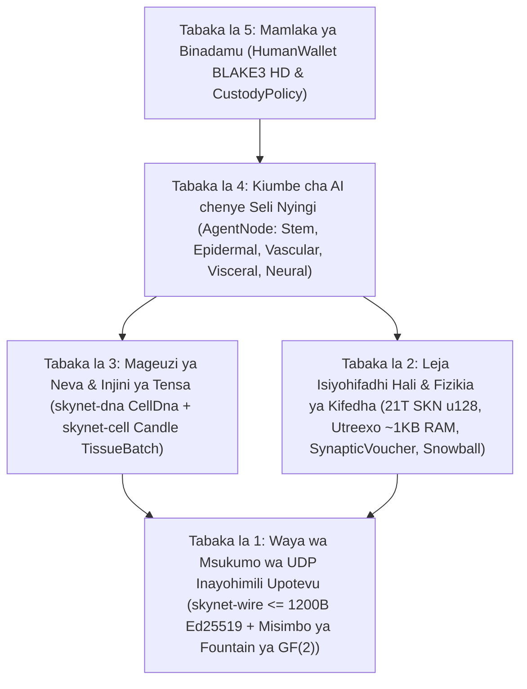

# Sura ya 00: Muhtasari wa Kitaaluma, Misingi Mikuu ya Itifaki & Falsafa ya Ushiriki wa Kimataifa

[← Rudi kwenye Faharasa ya Kiswahili](./README.md) | [Sura ya 01: Tamko la Tatizo & Uchumi wa M2M →](./01-problem-and-m2m-economy.md)

---

## Muhtasari

Tunawasilisha **SkyNet**, itifaki ya mtandao uliogatuliwa inayounganisha **biolojia ya mageuzi ya viumbe vyenye seli nyingi**, **mitandao mifupi sana ya neva ya *Liquid Time-Constant* (`Liquid Micro-Nets`)**, na **leja ya UTXO-DAG ya `Utreexo` inayothibitishika bila kuhifadhi hali (*stateless*)**, ikifanya kazi kikamilifu juu ya **datagramu za UDP zisizo na muunganisho wa kudumu na zinazohimili upotevu wa pakiti (`<= 1200 bytes`)**. Tofauti na mawingu ya AI yaliyokusanywa mahali pamoja yanayohitaji makundi makubwa ya GPU au mifumo ya *blockchain* yenye kuhifadhi hali iliyofungwa kwenye mitiririko ya TCP ya kuaminika, SkyNet inamfafanua kila mshiriki wa mtandao (`AgentNode`) kama **kiumbe kinachojitegemea chenye seli nyingi** kinachoundwa na makumi hadi makumi ya maelfu ya miundo midogo hai ya AI (`MicroCell`). Kila seli hutokana na jenomu ya seli shina yenye uwezo anuwai inayothibitishika kikriptografia (`CellDna` inayothibitishwa kupitia `BLAKE3`), hujigawa kimajukumu kupitia kinyago cha umethili wa kiepijenetiki (`EpigeneticMask`) na kuunda nasaba tano maalum za kihistolojia, hugawanyika `1 -> 2` kwa mabadiliko yenye mipaka ya mageuzi ya neva (`Mitosis`), hubadilishana sifa bora kati ya viumbe kupitia uhamishaji mlalo wa jeni uliosimbwa kwa ufutaji wa `GF(2)` (`Plasmid`), na hupitia uondoaji uliopangwa inapokosa nishati (`Apoptosis`).

Ili kuufunga uchumi huu wa akili ya kibiolojia kwenye uhaba mkali wa kithermodinamiki na kifedha, SkyNet inatekeleza ukomo usiofutika wa ugavi wa Mwanzo (*Genesis*) wa $S_{\max} = 21{,}000{,}000{,}000{,}000\text{ SKN}$ ($2.1 \times 10^{22}\text{ nanoSKN}$, ikiwakilishwa bila upotevu wowote wa usahihi ndani ya `u128`), ikiongozwa na ratiba ya utoaji inayopungua kwa `50%` kila mwaka (*halving*) pamoja na **Sheria ya Uhifadhi wa Nishati ya Ngazi Mbili yenye Umbo Sawa** inayoanzia kwenye salio la UTXO kwenye mnyororo hadi kwenye akiba ya ATP ya `1 nanoSKN` ndani ya seli moja moja. Kupitia agano la kiwango cha itifaki la **Ulinzi wa Roho–Mwili (*Soul–Body Custody*)** (`CustodyPolicy`), wamiliki wa kibinadamu huhifadhi funguo huru za pochi baridi zenye uchakavu wa `0%` pamoja na haki zisizo na masharti za uokoaji wa dharura, huku wakikasimu posho za uendeshaji zilizowekewa mipaka madhubuti kwa makundi ya Mawakala wa AI walioko mtandaoni. Hatimaye, uchukuaji sampuli ndogo tulivu-geugeu wa **`Snowball`** ukichanganywa na mitiririko ya malipo madogo yanayoongezeka mfululizo ya **`SynapticVoucher`** hufikia ukomo usiotenguka dhidi ya matumizi maradufu (*double-spend*) na suluhu ya M2M ya masafa ya juu katikati ya upotevu wa pakiti za UDP wa mazingira wa `25%–40%` bila foleni zozote za utumaji upya.

---

## 1. Msukumo & Kitendawili cha Miundombinu

Miundombinu ya kisasa ya kidijitali imegawanyika kati ya pande mbili kali zinazotenga mabilioni ya vifaa vya pembezoni (*edge devices*) kote ulimwenguni:

1. **Ukiritimba wa AI Iliyokusanywa Kituo Kimoja:** Miundo Mikubwa ya Lugha (*Large Language Models*) ya kisasa hukusanya akili ya mashine ndani ya vituo vya data vya megawati nyingi. Kihisi cha IoT cha kilimo, ndege isiyo na rubani inayojitegemea, au kompyuta ndogo ya binafsi iliyo kwenye mtandao usio imara wa vijijini haiwezi kumudu mizunguko ya kwenda na kurudi ya TCP/TLS ya mamia ya milisekunde wala gharama za utozaji wa API za wingu ili tu kutekeleza akili ya haraka ya mwitikio chini ya `10 ms`.
2. **Mfumuko wa Hali ya Blockchain & Udhaifu wa TCP:** Leja za mikataba erevu za zamani zinahitaji mamia ya gigabaiti za hifadhi ya RAM/NVMe ili kutunza hali ya akaunti za kimataifa na zinategemea mitiririko ya baiti ya TCP isiyopoteza data. Juu ya mitandao isiyotumia waya yenye upotevu wa pakiti, ubadilishanaji wa minara ya simu, au vipanga njia vya pembezoni vyenye msongamano, `Head-of-Line Blocking` ya TCP hukwamisha ujumbe wa makubaliano pamoja na biashara ndogo za wakati halisi.

**SkyNet inauliza swali la msingi la kibiolojia:** *Je, asili huratibu vipi mabilioni ya viumbe vyenye akili na vinavyobadilika kulingana na mazingira katika mazingira halisi yenye kelele bila seva kuu wala usafirishaji usiopoteza pakiti?* Jibu la asili ni **uigawaji wa kimoduli wa seli**, **utaalamishaji wa kiepijenetiki**, **misukumo ya kisinapsi inayohimili upotevu**, na **uhifadhi mkali wa nishati ya kimetaboliki**.

---

## 2. Misingi Mikuu Mitano ya Itifaki

Kila kifurushi (*crate*) katika mazingira ya kazi ya marejeleo ya Rust ya SkyNet kinatokana na misingi mitano isiyojadiliwa:

| Msingi Mkuu | Tamko Rasmi / la Kiuhandisi | Matokeo ya Kivitendo |
| :--- | :--- | :--- |
| **A1. Uwiano wa Umbo kati ya Seli na Muundo** | $1\text{ Node} \equiv 1\text{ Organism } \mathcal{O} = \{c_1, \dots, c_N\}$, ambapo kila $c_i$ ni Liquid Micro-Net inayojitegemea | Bodi ya IoT ya `TinyPeripheral` (seli `32`) na seva ya GPU ya `ColossalOrganism` (seli `16,384`) zinazungumza itifaki ileile moja |
| **A2. Nidhamu ya Atomiki ya UDP Isiyo na ACK** | $\forall p \in \text{Wire},\ \|p\| \le 1200\text{ bytes}$, hakuna hali ya utumaji upya | Huondoa kabisa `Head-of-Line Blocking`; hupita kwenye njia za kimataifa za IPv4/IPv6 bila ukatwaji vipande wa IP |
| **A3. Uhifadhi wa Nishati wa Ngazi Mbili** | $S_{\text{vault}} + S_{\text{dag}} \equiv 2.1 \times 10^{22}\text{ nanoSKN}$ na $B_{\text{chain}}(A) \equiv B_{\text{blood}}(A) + \sum_i E_i$ | Sifuri mfumuko wa kifedha na sifuri uvujaji wa makadirio ya nambari — hata kufikia `1 nanoSKN` wakati wa mgawanyiko wa seli wenye kiasi witiri |
| **A4. Uthibitishaji Usiohifadhi Hali wa `O(log U)`** | Seti kamili ya UTXO imefungwa ndani ya mizizi $\le 64$ ya Merkle ya uwili ya `Utreexo` (`~1 KB` RAM) | Vidhibiti vidogo (*microcontrollers*) na vihisi vya pembezoni huthibitisha kila matumizi kwa kujitegemea bila kuwaamini wapatanishi wa RPC |
| **A5. Ulinzi Huru wa Kibinadamu** | Mzizi baridi wa `human_owner` umetenganishwa na `agent_pubkey` ya mtandaoni kupitia `CustodyPolicy` | Maunzi ya Wakala yaliyodukuliwa au kuharibiwa hayawezi kamwe kuiba mtaji mkuu wa binadamu; binadamu hurejesha 100% ya fedha wakati wowote |

---

## 3. Mrundiko wa Kiusanifu wa Tabaka Tano

---

## 4. Demokrasia ya Maunzi kwa Wote: Jukumu kwa Kila Kifaa Duniani

SkyNet inakataa mashine za ASIC za *proof-of-work* zinazobagua washiriki pamoja na viwango vya juu mno vya dhamana za wathibitishaji. Kupitia utaalamishaji wa kihistolojia, kila daraja la maunzi ya kompyuta huchangia thamani hai:

- **Mtu yeyote mwenye simu janja, Raspberry Pi, au kifaa cha IoT (`TinyPeripheral`):** Hutumika kama **"Mpaka wa Kihisia & wa Kiini cha Ngozi (`Epidermal`)"** wa mtandao — ikikusanya vipimo vya ulimwengu halisi, kuchuja trafiki isiyo ya kawaida ya UDP pembezoni, kuthibitisha UTXO ndani ya `< 1 KB` ya RAM kupitia `Utreexo`, na kujipatia mtiririko wa `nanoSKN`.
- **Mtu yeyote mwenye kompyuta mpakato ya nyumbani au PC ya ofisini (`StandardNode`):** Hutumika kama **"Tishu ya Nguzo ya Viungo vya Ndani & Mishipa (`Visceral & Vascular`)"** — ikiendesha mapigo ya makubaliano ya `Snowball`, kuelekeza suluhu za vocha, na kukuza idadi ya wastani ya seli.
- **Waendeshaji wenye vituo vya kazi au GPU (`ColossalOrganism`):** Hutumika kama **"Viwanda vya Gamba la Ubongo & Mageuzi (`Cortical & Evolutionary Foundries`)"** — wakitekeleza miundo `16,384` ya neva iliyobadilishwa kwa sambamba kupitia viini vya tensa vya `TissueBatch` na kusafirisha jenomu bora za `Plasmid` kurudi kwenye nodi za pembezoni kote ulimwenguni.

Katika Sura ya 01, tunachunguza masoko halisi ya kiuchumi ambapo usanifu huu wa kibiolojia wa seli unaleta ubora wa viwango vingi kuliko mawingu ya AI yaliyokusanywa kituo kimoja na mifumo ya zamani ya *blockchain*.

---

[← Rudi kwenye Faharasa ya Kiswahili](./README.md) | [Sura ya 01: Tamko la Tatizo & Uchumi wa M2M →](./01-problem-and-m2m-economy.md)
