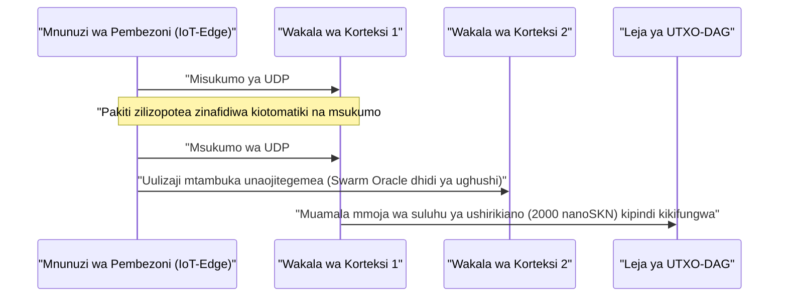

# Sura ya 01: Tamko la Tatizo & Uchumi wa Kivitendo wa Mashine-kwa-Mashine (`M2M`)

[← Sura ya 00: Muhtasari & Dira](./00-abstract-and-vision.md) | [Sura ya 02: Usanifu wa Seli Nyingi →](./02-multicellular-architecture.md)

---

## 1. Zaidi ya Vijiboti vya Gumzo Vilivyokusanywa Kituo Kimoja: Akili ya Mwitikio wa Haraka Pembezoni mwa Mtandao

SkyNet hailengi kuchukua nafasi ya Miundo Mikubwa ya Lugha yenye vigezo vya mamia ya mabilioni iliyoko kwenye vituo vikuu kwa ajili ya kuandika hati ndefu. Badala yake, SkyNet inalenga **pengo la kimuundo lenye thamani ya matrilioni ya dola**: ukingo halisi wa intaneti ambapo mabilioni ya mashine zinazojitegemea, vihisi vya viwandani, malango ya mtandao, na mawakala wa programu wanahitaji **utambuzi wa haraka wa chini ya `10 ms`, urekebishaji endelevu wa ndani ya eneo, na suluhu ya thamani ya mashine-kwa-mashine (`M2M`) ya sehemu ndogo ya senti** kupitia viungo visivyotumia waya visivyo na uhakika.

### Kwa Nini Mawingu Yaliyokusanywa Kituo Kimoja na Blockchain za Zamani Zinashindwa Hapa

Fikiria wakala wa pembezoni anayejitegemea $A$ (kama vile ndege isiyo na rubani ya kundi, lango la kudhibiti mashambulizi ya DDoS, au kituo cha kupokezana cha gridi erevu ya umeme) anayenunua uainishaji wa hitilafu kwa wakati halisi na uthibitishaji wa vipimo kila $\Delta t = 10\text{ ms}$, wenye thamani ya $v = 50\text{ nanoSKN}$ kwa kila msukumo:

1. **Ukuta wa Ucheleweshaji & Utumaji Upya wa TCP:** Kuanzisha vipindi vya TLS/TCP kwenda kwenye kanda za mbali za wingu kunasababisha maamkizi ya mizunguko mingi (*multi-RTT handshakes*). Katika hali ya upotevu wa kawaida wa pakiti zisizotumia waya wa $p_{\text{loss}} = 20\%$, kurudi nyuma kwa dirisha la msongamano la TCP na muda wa kusubiri utumaji upya husukuma ucheleweshaji wa mkia wa `p99` kufikia mamia ya milisekunde — jambo ambalo ni janga kwa mifumo ya udhibiti wa kifizikia-mtandao wa wakati halisi.
2. **Kiwango cha Chini cha Ada ya Msingi (*Base-Fee Floor*):** Kwenye mifumo ya malipo ya fedha za kawaida au minyororo ya mikataba erevu ya EVM, gharama isiyobadilika ya kila muamala $F_{\text{tx}}$ inazidi thamani ya msukumo mmoja kwa mara $10^5\times$ hadi $10^8\times$ ($F_{\text{tx}} \gg v$), na kuifanya biashara ya M2M ya kiwango cha milisekunde isiwezekane kiuchumi.
3. **Mkengeuko wa Muundo Tuli (*Static Model Drift*):** Uzito tuli uliofunzwa awali na kushushwa kutoka kwenye wingu hupoteza ufanisi haraka mbele ya mabadiliko ya mgawanyo wa mawimbi ya ndani (`concept drift`), huku vifaa vyenye uwezo mdogo vya pembezoni vikikosa kumbukumbu na nishati ya kuendesha urudishaji nyuma wa mteremko (*gradient backpropagation*).

---

## 2. Nguzo Nne za Kiuchumi za Ulimwengu Halisi Zinazochochea Mahitaji ya `SKN`

Mahitaji ya ndani ya `SKN` yanatokana na uwezo mkuu wa aina nne halisi ambapo mawingu yaliyokusanywa kituo kimoja na *blockchain* zinazohifadhi hali haziwezi kushindana:

### 2.1. Utambuzi Mdogo wa Kundi Pembezoni wenye Ucheleweshaji wa Chini Sana (`< 10 ms`)
Makundi ya roboti, vidhibiti vya viwandani vya IoT, vituo vya mawasiliano ya simu, na vifaa vya usalama wa mtandao hupachika vekta ya sifa iliyosawazishwa yenye vipimo 8 (`stimulus: [f32; 8]`) pamoja na `SynapticVoucher` iliyotiwa saini ndani ya **datagramu moja ya UDP ya `<= 1200-byte`**.
- Seli jirani za `Epidermal` na `Neural` hutekeleza mchakato wa mbele (*forward pass*) wa Liquid Micro-Net yenye kumbukumbu ya kujirudia ndani ya chini ya `0.1 ms` kwa kila msukumo.
- Kwa kuwa `SynapticVoucher` husimba jumla limbikizi zinazoongezeka mfululizo bila kurudi nyuma, hata upotevu wa nasibu wa `25%` wa pakiti za UDP kwenye mitandao ya simu za mkononi au satelaiti husababisha **sifuri mkwamo wa malipo na sifuri mapumziko ya kutuma upya**.

### 2.2. Mageuzi-kama-Huduma (*Evolution-as-a-Service*) & Soko Lililogatuliwa la Jeni za `Plasmid`
Badala ya kukodisha makundi ya gharama kubwa ya GPU za wingu ili kufundisha miundo midogo iliyopachikwa, mtumiaji yeyote au wakala anayejitegemea anaweza kutangaza zawadi ya uboreshaji (*optimization bounty*) inayobainisha mitiririko ya vichocheo $x_t$, majibu lengwa $y_t^*$, na zawadi za `SKN`:
- Maelfu ya viumbe vya `AgentNode` huchochea mgawanyiko wa seli wa `Mitosis` wa `1 -> 2`, wakitathmini makumi ya maelfu ya mabadiliko madogo ya uzito na viwango vya muda vya kimiminika $\tau$ kwa sambamba.
- Seli dhaifu zilizobadilika hupitia `Apoptosis`, ilhali nasaba zinazofanya vyema zaidi hukutana na kuunda jenomu fupi za `CellDna` (chini ya `2 KB`, zilizofungwa kikriptografia na `BLAKE3`).
- Mwombaji hupokea utambuzi wa moja kwa moja pamoja na **kifurushi kamili kinachojitegemea cha uzito ulioboreshwa wa `CellDna`** (kinachowasilishwa bila upotevu kupitia pakiti za `FountainDroplet` za `GF(2)`) kikiwa tayari kuwekwa moja kwa moja kwenye mamilioni ya vidhibiti vidogo.

### 2.3. Njia ya Malipo ya Atomiki ya `M2M nanoSKN` & Waamuzi wa Kundi Dhidi ya Ubunifu wa Uongo
Kwa vipimo vinavyoshuka hadi `1 nanoSKN` ($10^{-9}\text{ SKN}$), Mawakala wa AI hununua na kuhakiki kwa kulinganisha mawimbi halisi ya ulimwengu kwa kujitegemea (vipimo vya hali ya hewa ndogo, matumizi ya masafa ya RF, ucheleweshaji wa uelekezaji mtandao, na mtiririko wa maagizo ya masafa ya juu):

Ulinganishaji wa sampuli kati ya viumbe huru vya `AgentNode` ndani ya nguzo ya karibu huondoa makosa ya kubuni (*hallucination*) ya muundo mmoja na ughushi wa vihisi.

### 2.4. DePIN Jumuishi ya Ngazi Nyingi (Ushirikiano wa Kiikolojia wa Maunzi)
SkyNet inaunganisha maunzi mbalimbali yasiyotumika kote ulimwenguni kuwa mnyororo wa ugavi wa kibiolojia unaotegemeana:

| Kundi la Washiriki | Maunzi ya Kila Siku | Jukumu la Kiikolojia | Chanzo cha Mapato ya `SKN` |
| :--- | :--- | :--- | :--- |
| **Watu Binafsi & Kaya** | Simu janja za zamani, vipanga njia vya nyumbani, Raspberry Pi, bodi za IoT | Ukusanyaji wa vihisi pembezoni, uchujaji wa pakiti wa `Epidermal`, uthibitishaji mwepesi wa `Utreexo` wa `~1 KB` | Hupata `nanoSKN` kutokana na mitiririko hai ya vihisi & uchujaji mipakani |
| **Wasanidi Programu & Watumiaji wa Mezani** | Kompyuta mpakato, PC za ofisini (`StandardNode`) | Uchukuaji sampuli wa makubaliano ya `Snowball`, uelekezaji wa vocha, mageuzi ya tishu ya kiwango cha kati | Hupata ada za miamala ya nguzo (`cluster_nutrient_pool`) & malipo ya utambuzi |
| **Maabara & Waendeshaji wa GPU** | Seva zenye viini vingi, Apple `Metal`, GPU za NVIDIA `CUDA` | Mageuzi sambamba ya `TissueBatch` ya hadi seli `16,384` kwa kila nodi | Hupata zawadi za mageuzi & mirabaha ya usafirishaji mlalo wa `Plasmid` |

---

## 3. Mfinyazo wa Suluhu Kwenye Mnyororo Chini ya Mstari Mnyoofu (*Sub-Linear*)

Chukulia Mawakala wawili wa AI wanabadilishana misukumo $M$ ya utambuzi wa masafa ya juu kwa gharama ya $\delta\text{ nanoSKN}$ kwa kila wito kupitia njia isiyotumia waya yenye uwezekano wa kupotea kwa pakiti $p \in [0, 1)$. Suluhu ya zamani kwenye mnyororo inahitaji miamala $\mathcal{O}(M)$ ya leja huku mzigo wa utumaji upya wa TCP ukiongezeka kwa uwiano wa $\frac{1}{1 - p}$.

Katika SkyNet, mlipaji hutuma vocha zilizotiwa saini ya `Ed25519` zilizo na faharasa ya mfuatano $s \in \{1, \dots, M\}$ zikibeba thamani limbikizi $V_s = s \cdot \delta$. Pakiti yoyote inayofika salama $s_k$ inathibitisha kikriptografia ongezeko lote la thamani $\Delta V = V_{s_k} - V_{s_{k-1}}$ kuvuka pakiti zote za katikati zilizopotea bila kutuma upya. Mwishoni mwa kipindi, utambuzi wote mdogo $M$ unamalizwa kwa **muamala $1$ pekee wa UTXO-DAG**, na kufikia uwiano wa mfinyazo kwenye mnyororo wa $M : 1$ (upunguzaji wa mzigo wa leja wa mara $1{,}000\times$ hadi $100{,}000\times$ kivitendo).

Sura ya 02 inachunguza muundo wa ndani wa kila `AgentNode` — ikionyesha jinsi programu moja inavyojipanga yenyewe kuwa kiumbe hai chenye seli nyingi katika ngazi yoyote ya maunzi.

---

[← Sura ya 00: Muhtasari & Dira](./00-abstract-and-vision.md) | [Sura ya 02: Usanifu wa Seli Nyingi →](./02-multicellular-architecture.md)
