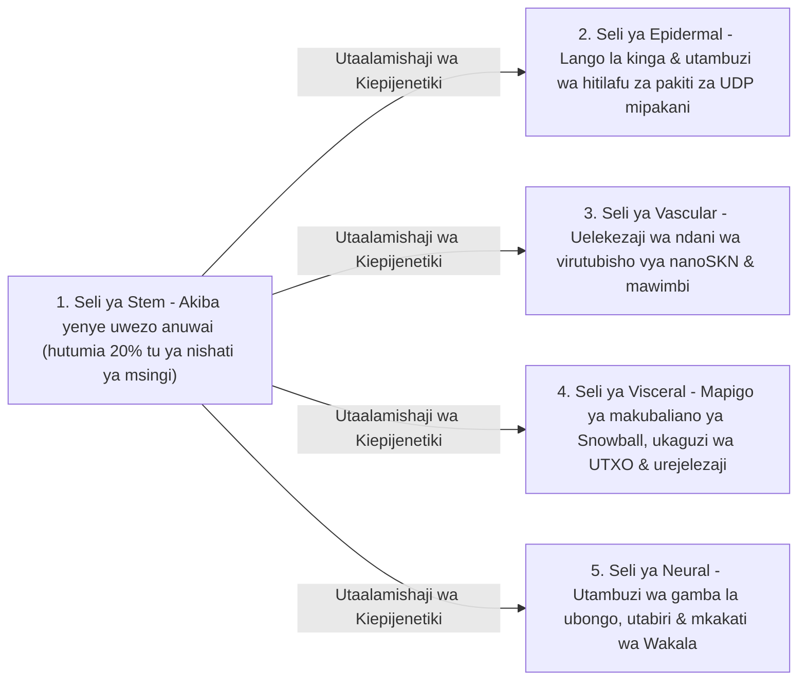

# Sura ya 02: Usanifu wa Kiumbe chenye Seli Nyingi & Upanuzi Nyumbufu wa Maunzi (`AgentNode`)

[← Sura ya 01: Tamko la Tatizo & Uchumi wa M2M](./01-problem-and-m2m-economy.md) | [Sura ya 03: `CellDna` & Seli za Neva za Kimiminika →](./03-dna-and-liquid-neural-cells.md)

---

## 1. Uwiano wa Kibiolojia: `1 Node = 1 Kiumbe chenye Seli Nyingi`

Katika mitandao ya kawaida ya rika-kwa-rika (*peer-to-peer*), kila nodi huendesha mashine ya hali moja ngumu na isiyobadilika bila kujali kama inafanya kazi kwenye kidhibiti kidogo kilichopachikwa au seva ya GPU yenye viini 64. Katika SkyNet (`crates/skynet-agent`), kila mshiriki wa mtandao huundwa kama **`AgentNode`** — kiumbe hai chenye seli nyingi kinachojumuisha idadi inayobadilika ya seli ndogo za AI $\mathcal{C}(t) = \{c_1, c_2, \dots, c_{N(t)}\}$, hazina ya ndani ya kimetaboliki (`AgentMetabolicBank`), mthibitishaji wa mizizi ya `Utreexo` usiohifadhi hali (`StatelessUtreexoRoots`), na injini ya `SnowballEngine` inayohimili upotevu wa pakiti.

Ukubwa wa idadi ya seli $N(t) = |\mathcal{C}(t)|$ hauwekwi kamwe kama nambari isiyobadilika; **hupanuka kupitia `Mitosis` na kusinyaa kupitia `Apoptosis` kiasili kulingana na uwezo wa maunzi mwenyeji na mtiririko wa virutubisho vya `nanoSKN` vinavyopatikana**.

---

## 2. Ngazi Tatu Nyumbufu za Maunzi (`HardwareTier`)

Wakati wa kuwashwa, `HardwareProfile::for_tier` hupanga uwezo wa kifaa mwenyeji katika mojawapo ya wasifu tatu za kiikolojia zenye viwango kamili vya kimetaboliki vya `nanoSKN` (`crates/skynet-cell/src/lib.rs`):

| Kigezo cha Kibiolojia (`HardwareProfile`) | `TinyPeripheral` (IoT / MCU ya Pembezoni) | `StandardNode` (Kompyuta Mpakato / PC) | `ColossalOrganism` (Seva / GPU) |
| :--- | :--- | :--- | :--- |
| **Idadi ya Juu ya Seli (`max_cells`)** | seli `32` | seli `512` | seli `16,384` |
| **Matumizi ya Msingi ya Seli Hai / Pigo (`basal_burn_per_tick`)** | `50 nanoSKN` | `25 nanoSKN` | `10 nanoSKN` |
| **Matumizi ya `Stem` Iliyotulia / Pigo (akiba ya 80%)** | `10 nanoSKN` | `5 nanoSKN` | `2 nanoSKN` |
| **Kiwango cha Mgawanyiko (`mitosis_threshold`)** | `2,000 nanoSKN` | `1,500 nanoSKN` | `1,000 nanoSKN` |
| **Ada ya Damu ya Mgawanyiko (`mitosis_blood_fee`)** | `100 nanoSKN` | `60 nanoSKN` | `40 nanoSKN` |
| **Kiwango cha Chini cha Kuondolewa (`apoptosis_floor`)** | `100 nanoSKN` | `80 nanoSKN` | `50 nanoSKN` |
| **Injini ya Ukokotoaji (`candle_core::Device`)** | `Cpu` | `Cpu` / `Metal` / `Cuda` | `Cuda` / `Metal` / `Cpu` SIMD |

> [!NOTE]
> **Uchumi wa Kiwango cha Kibiolojia (Sheria ya Kleiber):** Kama vile viumbe vikubwa vya kibiolojia vinavyoonyesha gharama ndogo ya kimetaboliki kwa kila gramu ya tishu, nodi za `ColossalOrganism` hutumia nishati ndogo ya msingi kwa kila seli (`10 nanoSKN` dhidi ya `50 nanoSKN`) kwa sababu maelfu ya seli hugawana gharama ya utekelezaji ndani ya kiini kimoja cha tensa cha GPU kilichokusanywa pamoja, ilhali nodi za `TinyPeripheral` hubaki nyepesi na stahimilivu pembezoni mwa mtandao.

---

## 3. Nasaba Tano Maalum za Kihistolojia (`CellRole`)

Wakati `AgentNode` inapoanzishwa (`AgentNode::from_signing_key`), huotesha mbegu ya kiinitete yenye seli 6 (`2 Stem`, `1 Epidermal`, `1 Vascular`, `1 Visceral`, `1 Neural`) zinazotokana na jenomu bainifu ya `base_stem`. Katika muda wote wa uhai wa kiumbe, nasaba tano za kihistolojia hutekeleza majukumu matano muhimu ya kifiziolojia:

1. **`Stem` (Akiba yenye Uwezo Anuwai — `operon_index = None`):** Seli za ukarabati zilizotulia zinazotumia $\max(\lfloor E_{\text{burn}} / 5 \rfloor, 1)$ pekee kwa kila pigo (*tick*). Wakati wowote kiungo chochote maalum kinapopungukiwa na seli, seli ya `Stem` hujibadilisha kiepijenetiki (`differentiate`) ili kukijaza upya bila kupakua msimbo kutoka nje.
2. **`Epidermal` (Ngozi & Lango la Kinga — `operon_index = Some(0)`):** Hulinda soketi ghafi ya UDP (`epidermal_inspect_packet`). Kabla ya pakiti yoyote inayoingia kufikia leja au injini ya makubaliano, seli ya `Epidermal` hutathmini vipimo vilivyosawazishwa vya pakiti (`raw_len / 1200`, `hop_ttl / 16`, mkengeuko wa `epoch`) kwenye `candle` ili kutupa misukumo iliyoharibika au ya mafuriko ya mashambulizi.
3. **`Vascular` (Mdhibiti wa Mzunguko — `operon_index = Some(1)`):** Hudhibiti ukwasi wa ndani wa `blood_pool` ndani ya `AgentMetabolicBank`, ikielekeza zawadi za `nanoSKN` kwenda kwa seli zenye usahihi wa juu.
4. **`Visceral` (Utunzaji wa Viungo — `operon_index = Some(2)`):** Huendesha mdundo wa upigaji kura wa `Snowball`, uthibitishaji wa mashahidi wa `Utreexo` usiohifadhi hali, na urejelezaji wa kimetaboliki.
5. **`Neural` (Ubongo wa Korteksi — `operon_index = Some(3)`):** Hutekeleza utambuzi wa kiakili; wastani wa pamoja wa seli zote hai za `Neural` ($\bar{y}_{\text{cortical}} = \frac{1}{|\mathcal{C}_{\text{neural}}|} \sum_{i \in \mathcal{C}_{\text{neural}}} y_i$) huunda matokeo ya maamuzi ya pamoja ya kiumbe.

---

## 4. Mzunguko wa Maisha wa Pigo la Kibiolojia wa Awamu Sita (`run_biological_tick`)

Katika kila mpigo (`pulse_seq`), `AgentNode` hutekeleza mzunguko bainifu wa kifiziolojia wa awamu sita unaounganisha ushindani wa Kidarwini na uhifadhi kamili wa `nanoSKN` ndani ya `u128`:

1. **Awamu ya 1 — Kimetaboliki cha Msingi:** Kila seli $c_i$ huchoma nishati ya matengenezo $b_i = \text{metabolize\_tick}()$. Jambo la msingi ni kwamba $b_i$ haiteketezwi kamwe kwenye mnyororo; 100% ya ATP ya ndani ya seli iliyochomwa hurejeshwa tena ndani ya `bank.blood_pool`. Seli zenye njaa ($E_i = 0$) hupoteza `0.25` ya `health`.
2. **Awamu ya 2 — Utambuzi wa Tensa wa `candle` kwa Mpigo Mmoja:** Seli zote $N$ zilizo hai hutekelezwa kwa wakati mmoja kupitia `TissueBatch::forward_slice`, zikizalisha matokeo $y_i \in \mathbb{R}^4$ na kusasisha vekta za kumbukumbu fupi ya kimiminika $h_{i,t} \in \mathbb{R}^{16}$.
3. **Awamu ya 3 — Uteuzi wa Virutubisho wa Kidarwini Ndani ya Kiungo:**
   Kwa kupewa ishara lengwa $t \in \mathbb{R}^4$, ubora wa utabiri wa seli $i$ hupimwa kupitia Wastani wa Kosa Halisi (*Mean Absolute Error*) wenye mipaka:

   $$q_i = \operatorname{clamp}\!\left(1 - \frac{1}{4}\sum_{k=1}^{4} |y_{i,k} - t_k|,\ 0.0,\ 1.0\right)$$

   Acha $\bar{q}_r$ iwakilishe ubora wa wastani kwa seli zote zinazoshiriki jukumu la kiungo $r = \text{role}(c_i)$. Seli maalum hupata virutubisho vya `nanoSKN` kutoka kwenye `blood_pool` ikiwa na ikiwa tu kiungo chake kina seli $\le 2$ au inashinda kiwango cha ushindani wa ndani ya kiungo $q_i \ge 0.98 \cdot \bar{q}_r$:

   $$R_i = \min\!\left(\lfloor 320 \cdot q_i \rfloor + E_{\text{basal}},\ \left\lfloor \frac{B_{\text{blood}}}{8} \right\rfloor\right)$$

   Seli zilizobadilika zinazofanya vibaya ($q_i < 0.98 \cdot \bar{q}_r$) hazipati virutubisho vyovyote na hupata adhabu ya `-0.35` kwenye `health`.
4. **Awamu ya 4 — Utaalamishaji wa Seli Shina wa Usawazishaji (*Homeostatic*):** Kiumbe hubaini kiungo chake maalum kilicho na upungufu mkubwa zaidi wa seli (`find_most_needed_role`). Wakati wowote `stem_count > 1`, seli moja ya `Stem` hujibadilisha na kuingia kwenye kiungo hicho huku ikihifadhi angalau seli `1` ya uzazi ya `Stem` wakati wote.
5. **Awamu ya 5 — Mitosis ya `1 -> 2`:** Seli zenye afya na lishe ya kutosha (`health >= 0.65` na $E_i \ge E_{\text{mitosis}}$) hugawanyika na kutoa nakala hifadhi (Seli Binti A) na mchunguzi aliyegeuka (Seli Binti B) hadi kufikia ukomo wa `profile.max_cells`.
6. **Awamu ya 6 — Apoptosis Inayolinda Viungo:** Seli zenye njaa kali ($E_i < E_{\text{apoptosis}}$) au zilizoharibika vibaya (`health <= 0.15`) huyeyuka na kurudisha 100% ya `nanoSKN` zao zilizosalia kwenye `blood_pool` — chini ya kinga kali ya uhai: **angalau seli `1` hai kwa kila `CellRole` iliyopo huhifadhiwa bila masharti** ili kiungo chochote muhimu kisitoweke kamwe.

Mwishoni mwa kila pigo, `verify_internal_skn_conservation()` huthibitisha mlinganyo kamili wa `u128`:

$$B_{\text{chain}}(\text{Agent}) \equiv B_{\text{blood}}(\text{Agent}) + \sum_{c_i \in \mathcal{C}} E_i$$

Sura ya 03 inafungua kiini cha seli ili kubainisha muundo kamili wa baiti na hisabati wa `CellDna`, ubadilishaji wa operoni wa kiepijenetiki, na utekelezaji wa Neva za Kimiminika wa 3D wa `TissueBatch`.

---

[← Sura ya 01: Tamko la Tatizo & Uchumi wa M2M](./01-problem-and-m2m-economy.md) | [Sura ya 03: `CellDna` & Seli za Neva za Kimiminika →](./03-dna-and-liquid-neural-cells.md)
