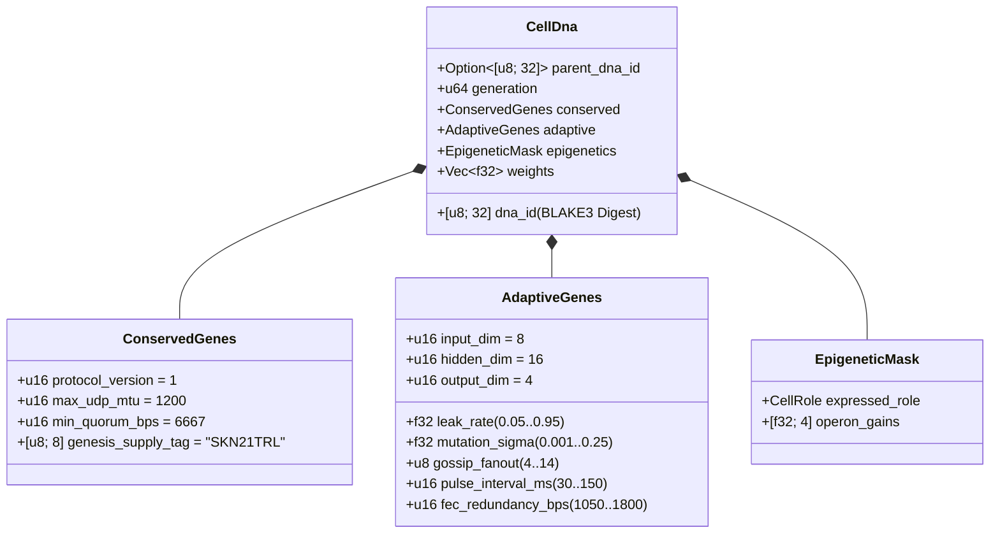

# Sura ya 03: Usimbaji wa Kijenetiki (`CellDna`), Epijenetiki & Mageuzi ya Neva Ndogo za Kimiminika kwenye `candle`

[← Sura ya 02: Usanifu wa Seli Nyingi](./02-multicellular-architecture.md) | [Rudi kwenye Faharasa ya Kiswahili →](./README.md)

---

## 1. Usanifu wa Jenomu ya Seli (`CellDna`)

Mageuzi ya kibiolojia husawazisha nguvu mbili zinazopingana: **uhifadhi mkali** wa misingi isiyobadilika ya kibayokemikali (ambapo mabadiliko ya jeni ni hatari kwa uhai) na **utofautishaji endelevu** wa sifa za neva na tabia. Kifurushi cha `skynet-dna` hurasimisha uwili huu ndani ya `CellDna`:

### 1.1. `ConservedGenes` Zisizobadilika
Hakuna mabadiliko ya jeni (*mutation*) wala ubadilishanaji mlalo (*horizontal crossover*) unaoweza kubadilisha `ConservedGenes`. Jenomu yoyote inayokiuka mojawapo ya masharti manne ya usalama wa makubaliano hukataliwa mara moja kwa kosa la `DnaError::ConservedGeneViolation`:
- `protocol_version == 1`
- `max_udp_mtu == 1200` (ukomo wa juu wa UDP usio na ukatwaji vipande)
- $6667 \le \text{min\_quorum\_bps} \le 10000$ (ikilazimisha wingi mkuu wa $\ge \frac{2}{3}$ katika `Snowball`)
- `genesis_supply_tag == *b"SKN21TRL"` (ikifunga kwa nguvu ukomo wa ugavi wa trilioni 21 za `SKN`)

### 1.2. `AdaptiveGenes` & Mpangilio wa Uzito wa Operoni wenye Shina la Pamoja
Badala ya kuhifadhi mitandao minne tofauti ya neva kwa ajili ya aina nne za seli maalum, `CellDna` husimba **Shina Moja la Kihisia la Pamoja (*Shared Sensory Trunk*)** linalolisha **Vichwa Vinne Maalum vya Makadirio ya Operoni**. Kwa vipimo $(D_{\text{in}}, H, D_{\text{out}})$, idadi kamili ya vigezo vya `f32` ni:

$$|\theta| = \underbrace{(D_{\text{in}} \cdot H + H)}_{\text{Shared Sensory Trunk }(W_1, b_1)} + \underbrace{4 \cdot (H \cdot D_{\text{out}} + D_{\text{out}})}_{\text{4 Specialized Operon Heads }(W_{2,r}, b_{2,r})}$$

Chini ya vipimo chaguo-msingi $(D_{\text{in}} = 8,\ H = 16,\ D_{\text{out}} = 4)$:
- Shina la pamoja: vigezo $8 \times 16 + 16 = 144$.
- Vichwa vinne vya operoni (`Epidermal`, `Vascular`, `Visceral`, `Neural`): vigezo $4 \times (16 \times 4 + 4) = 272$.
- Jumla ya uzito wa jenomu: $|\theta| = 416$ za nambari za nukta-elezi za `f32` ($1{,}664\text{ bytes}$ za uzito ghafi). Jenomu za seli shina za kizazi-0 (`CellDna::genesis_stem`) huanzishwa kwa njia bainifu kupitia `ChaCha8Rng` juu ya $\mathcal{U}(-\sigma_0, +\sigma_0)$ kwa kipimo cha mpaka cha Xavier:

$$\sigma_0 = \sqrt{\frac{2}{D_{\text{in}} + H}}$$

### 1.3. Alama ya Kikriptografia Bainifu ya `BLAKE3` (`SKYNET_DNA_V1`)
Kila kigezo kikuu cha nukta-elezi na uzito husimbwa kwa mfuatano kupitia mifumo rasmi ya biti ya IEEE-754 ya *little-endian* (`to_bits().to_le_bytes()`) kuingia kwenye heshi iliyotenganishwa kikikoa ya `BLAKE3("SKYNET_DNA_V1", ...)`. Uharibifu wowote wa biti moja, uingizaji wa `NaN`/`Inf`, au uchezaji usioidhinishwa wa uzito husababisha kukataliwa mara moja ndani ya `verify_integrity()`.

---

## 2. Ubadilishaji wa Umethili wa Kiepijenetiki (`EpigeneticMask`)

Katika biolojia ya viumbe vyenye seli nyingi, seli ya neva na seli ya ngozi hubeba mfuatano unaofanana kabisa wa DNA lakini huonyesha sifa za nje zilizo tofauti kabisa kupitia umethili wa jeni. Katika SkyNet, seli ya `Stem` inapojibadilisha na kuingia kwenye jukumu lengwa $r \in \{0, 1, 2, 3\}$ (`CellDna::differentiate`), **100% ya vekta ya msingi ya `weights` hubaki bila kuguswa** ilhali `EpigeneticMask` hubadilisha kikuza sauti (*gain*) cha uonyeshaji:

- **Hali Iliyotulia ya `Stem`:** `operon_gains = [0.25, 0.25, 0.25, 0.25]`, ikipitisha makadirio kupitia kichwa cha operoni `0` kwa kikuza kilichopunguzwa cha $g = 0.25$.
- **Jukumu Maalum $r$:** Kichwa cha operoni $r$ huwaka kwa nguvu kamili ($g_r = 1.0$) huku vichwa visivyoonyeshwa vikikandamizwa hadi $0.05$:

$$g_k = \begin{cases} 1.0 & \text{if } k = r \\ 0.05 & \text{if } k \neq r \end{cases}$$

Matokeo yake, uwakilishi wa kihisia uliojifunzwa katika shina la pamoja $(W_1, b_1)$ pamoja na urekebishaji uliofichika katika vichwa vilivyotulia hudumu vizazi hadi vizazi na hubaki tayari kutumika wakati wa mabadiliko ya jukumu la seli (*transdifferentiation*).

---

## 3. Mienendo ya *Liquid Time-Constant* & Utekelezaji wa 3D wa `TissueBatch`

### 3.1. Mienendo ya Kimiminika Yenye Kumbukumbu ya Seli Moja
Mitandao ya MLP ya mwelekeo mmoja isiyohifadhi hali haiwezi kunasa uhusiano wa kimuda katika mitiririko isiyolandanishwa ya pakiti za UDP. Kila `MicroCell` hutunza vekta ya kumbukumbu ya muda mfupi inayojirudia $h_t \in \mathbb{R}^H$ inayoongozwa na uchanganyaji wa hali ya **Liquid Time-Constant (LTC)** wenye kiwango cha uvujaji kinachoweza kubadilika kimgeuzi $\tau \in [0.05, 0.95]$:

$$h_t = (1 - \tau)\, h_{t-1} + \tau\, \tanh(x_t W_1 + b_1)$$

$$y_t = g_{\text{role}} \cdot \tanh(h_t W_{2,r} + b_{2,r})$$

- Wakati $\tau \to 0.05$, seli huhifadhi kumbukumbu ya muda mrefu (inafaa sana kwa ufuatiliaji wa mwenendo wa `Visceral` na `Neural`).
- Wakati $\tau \to 0.95$, seli huitikia papo hapo misukumo ya mipakani yenye masafa ya juu (inafaa sana kwa utambuzi wa hitilafu wa `Epidermal`).
- Kwa sababu $\tau$ iko ndani ya `AdaptiveGenes`, **upeo wa kumbukumbu ya muda wa kila seli hubadilika na kukua kiasili sambamba na uzito wake wa kisinapsi**.

### 3.2. Injini ya Tensa ya 3D ya `TissueBatch` yenye Kasi ya Juu (`Cpu` / `Metal` / `Cuda`)
Kikwazo kikubwa cha kihistoria katika mageuzi ya neva ni utofauti wa uzito: kila seli $i \in \{1, \dots, N\}$ hubeba majedwali tofauti yaliyobadilika $W_1^{(i)} \neq W_1^{(j)}$ na viwango tofauti vya uvujaji $\tau^{(i)} \neq \tau^{(j)}$. Kuendesha viini vidogo $N$ kimoja baada ya kingine kungesababisha GPU za kisasa zikose kazi ya kutosha.

`TissueBatch::forward_slice` ndani ya `skynet-cell` hutatua hili kwa kufunga seli zote $N$ zilizo tofauti ndani ya tensa mfuatano za daraja la 3 (*rank-3*) kwenye `candle_core::Device`:

$$\mathbf{X} \in \mathbb{R}^{N \times 1 \times D_{\text{in}}}, \quad \mathbf{W}_1 \in \mathbb{R}^{N \times D_{\text{in}} \times H}, \quad \mathbf{B}_1 \in \mathbb{R}^{N \times 1 \times H}$$

$$\mathbf{H}_t = (\mathbf{1} - \boldsymbol{\tau}) \odot \mathbf{H}_{t-1} + \boldsymbol{\tau} \odot \tanh\!\big(\operatorname{BMM}(\mathbf{X}, \mathbf{W}_1) + \mathbf{B}_1\big)$$

$$\mathbf{Y}_t = \mathbf{G} \odot \tanh\!\big(\operatorname{BMM}(\mathbf{H}_t, \mathbf{W}_2) + \mathbf{B}_2\big)$$

ambapo $\operatorname{BMM}$ inawakilisha Uzidishaji wa Majedwali kwa Mpigo Mmoja (*Batched Matrix Multiplication*) katika kiini kimoja na $\odot$ inawakilisha uzidishaji wa kipengele-kwa-kipengele wa utangazaji pamoja na $\boldsymbol{\tau}, \mathbf{G} \in \mathbb{R}^{N \times 1 \times 1}$. Majaribio ya vitengo yaliyokaguliwa yanathibitisha kuwa `TissueBatch` inalingana na utekelezaji wa seli moja moja ndani ya uvumilivu wa nukta-elezi wa $< 10^{-5}$ huku ikipanuka hadi miundo `16,384` inayobadilika kwa wakati mmoja kwa kila `ColossalOrganism`.

---

## 4. Mitosis Isiyolingana, Uhifadhi Kamili wa `nanoSKN` Witiri & Ubadilishanaji wa Plasmid

### 4.1. `Mitosis` Isiyolingana ya `1 -> 2` & Uthibitisho wa Uhifadhi Kamili wa Kiatomiki
Wakati seli mzazi $P$ inapotimiza $E_P \ge \max(E_{\text{mitosis}}, F_{\text{blood}} + 2)$ na `health >= 0.65`, `divide_mitosis` huzalisha seli binti mbili za kizazi-$(g+1)$:
- **Seli Binti A (Nakala Hifadhi):** Huhifadhi 100% ya uzito uliothibitishwa wa mzazi na vigezo nyumbufu bila mabadiliko yoyote.
- **Seli Binti B (Mchunguzi Aliyegeuka):** Hurithi mwendelezo wa `hidden_state` ya mzazi huku ikipitia mabadiliko yenye mipaka ya mageuzi ya neva:
  - Kila uzito $w \in \theta$ hubadilika kwa uwezekano wa $0.35$ kupitia mchepuko wa Gauss wa Irwin-Hall wa sampuli 6 usiotegemea maktaba za nje ($\Delta w \sim \mathcal{N}(0, \sigma^2)$), ukibanwa madhubuti ndani ya $[-4.0, +4.0]$ ili kuzuia mlipuko wa mteremko au uzito.
  - $\tau$, $\sigma$, `gossip_fanout` ($\pm 1$), `pulse_interval_ms` ($\pm 10\text{ ms}$), na `fec_redundancy_bps` ($\pm 50\text{ bps}$) hubadilika pamoja ndani ya mipaka maalum.

**Uthibitisho wa Uhifadhi wa `nanoSKN` Witiri Usio na Uvujaji:** Acha $E_{\text{dist}} = E_P - F_{\text{blood}}$ iwe ATP inayoweza kugawanywa baada ya ada. Masalio ya seli binti hugawanywa kupitia hesabu ya hisa na baki ya nambari kamili ndani ya `u128`:

$$E_A = \left\lfloor \frac{E_{\text{dist}}}{2} \right\rfloor + (E_{\text{dist}} \bmod 2), \qquad E_B = \left\lfloor \frac{E_{\text{dist}}}{2} \right\rfloor$$

Kwa kila nambari kamili isiyo hasi $E_{\text{dist}} \in \mathbb{Z}_{\ge 0}$ (ikijumuisha masalio witiri kama vile `3,333 nanoSKN`), uhifadhi kamili unasimama sawasawa kila wakati:

$$E_A + E_B + F_{\text{blood}} = \left(2\left\lfloor \frac{E_{\text{dist}}}{2} \right\rfloor + (E_{\text{dist}} \bmod 2)\right) + F_{\text{blood}} = E_{\text{dist}} + F_{\text{blood}} \equiv E_P$$

Hakuna hata `nanoSKN` moja inayopotea kwa makadirio ya nambari au kuumbwa hewani katika mabilioni ya migawanyiko ya seli.

### 4.2. Uhamishaji Mlalo wa Jeni Kati ya Mawakala (Ubadilishanaji wa `Plasmid`)
Kwa kuiga ubadilishanaji wa plasmidi za bakteria, `AgentNode` husafirisha `CellDna` ya seli yake yenye ufanisi wa juu zaidi kuingia kwenye pakiti za UDP za `FountainDroplet` zilizosimbwa kwa ufutaji (`encode_elite_plasmid_droplets`). Baada ya kuunganisha tena `donor_dna` kupitia viungo vya UDP vyenye upotevu, Wakala mpokeaji huboresha seli yake yenye ufanisi wa chini zaidi kupitia `horizontal_crossover`:
- Sifa nyumbufu za mtandao na viwango vya muda huchanganyika kama $0.7 \cdot \text{Recipient} + 0.3 \cdot \text{Donor}$.
- $30\%$ ya uzito wa kisinapsi huchanganyika kwa usawa kama $0.5 \cdot w_{\text{rec}} + 0.5 \cdot w_{\text{don}} \in [-4.0, +4.0]$.

Kupitia uhamishaji mlalo wa plasmidi, kihisi cha IoT cha `TinyPeripheral` chenye rasilimali chache hufyonza akili bora ya neva iliyokuzwa kwenye nodi za mbali za GPU za `ColossalOrganism` huku kikilinda kikriptografia usalama wa `ConservedGenes`.

---

> **Inayofuata katika Awamu ya 2 (Sehemu ya II):** Sura za `04–06` zinarasimisha hisabati ya Hazina ya Upunguzaji Nusu (*Halving Vault*) ya `21,000,000,000,000 SKN`, agano la Ulinzi Huru wa Binadamu la `Soul–Body`, pamoja na upanuzi wa leja ya `Utreexo` Isiyohifadhi Hali ya `~1 KB` + `SynapticVoucher`.

[← Sura ya 02: Usanifu wa Seli Nyingi](./02-multicellular-architecture.md) | [Rudi kwenye Faharasa ya Kiswahili →](./README.md)
