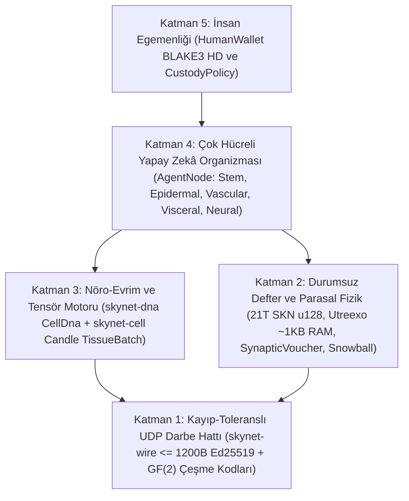

# Bölüm 00: Akademik Özet, Protokol Aksiyomları ve Küresel Katılım Felsefesi

[← Türkçe İndekse Dön](./README.md) | [Bölüm 01: Problem Tanımı ve `M2M` Ekonomisi →](./01-problem-and-m2m-economy.md)

---

## Özet

Bu çalışmada, **çok hücreli evrimsel biyolojiyi**, **ultra kompakt Sıvı Zaman Sabitli sinir ağlarını (`Liquid Micro-Nets`)** ve **durumsuz olarak doğrulanabilen `Utreexo` tabanlı bir UTXO-DAG dağıtık defterini** birleştiren ve tamamıyla **bağlantısız, paket kaybına dayanıklı UDP datagramları (`<= 1200 bytes`)** üzerinde çalışan merkeziyetsiz ağ protokolü **SkyNet**'i sunuyoruz. Hiper ölçekli GPU kümeleri gerektiren merkezi yapay zekâ bulutlarının veya güvenilir TCP akışlarına bağımlı durum bilgili (stateful) blokzincirlerin aksine SkyNet, her ağ katılımcısını (`AgentNode`) onlarca ila on binlerce canlı mikro-yapay zekâ modelinden (`MicroCell`) oluşan **özerk çok hücreli bir organizma** olarak tanımlar. Her hücre, kriptografik olarak doğrulanabilen çok potansiyelli (pluripotent) bir kök genomdan (`BLAKE3` ile doğrulanan `CellDna`) doğar, epigenetik bir metilasyon maskesi (`EpigeneticMask`) aracılığıyla beş uzmanlaşmış histolojik hücre soyuna farklılaşır, sınırlandırılmış nöro-evrimsel mutasyonlarla `1 -> 2` şeklinde bölünür (`Mitosis`), `GF(2)` silme kodlu yatay gen transferi (`Plasmid`) yoluyla organizmalar arasında seçkin özelliklerini paylaşır ve besinsiz kaldığında programlanmış hücre ölümüne uğrar (`Apoptosis`).

Bu biyolojik zekâ ekonomisini mutlak termodinamik ve parasal kıtlığa sabitlemek amacıyla SkyNet, yıllık `50%` yarılanma (halving) emisyon takvimi ve zincir üstü UTXO bakiyelerinden hücre içi tekil `1 nanoSKN` ATP rezervlerine kadar uzanan **İki Katmanlı İzomorfik Enerji Korunumu Yasası** tarafından yönetilen $S_{\max} = 21{,}000{,}000{,}000{,}000\text{ SKN}$ ($2.1 \times 10^{22}\text{ nanoSKN}$, `u128` içinde kayıpsız temsil edilir) tutarında değiştirilemez bir Başlangıç (Genesis) arz tavanı uygular. Protokol düzeyindeki **Ruh–Beden Saklama (`Soul–Body Custody`)** sözleşmesi (`CustodyPolicy`) sayesinde insan sahipler, koşulsuz acil durum kurtarma haklarına sahip `%0` aşınmalı (`0%`-decay) egemen soğuk cüzdan anahtarlarını ellerinde tutarken, çevrimiçi yapay zekâ ajan filolarına kesin sınırlarla çizilmiş operasyonel harcama limitleri devrederler. Son olarak, monotonik **`SynapticVoucher`** mikro-ödeme akışlarıyla birleştirilen yarı kararlı (metastable) **`Snowball`** alt-örneklemesi, sıfır yeniden iletim kuyruğuyla `%25–%40` (`25%–40%`) ortam UDP paket kaybı altında geri döndürülemez çifte harcama kesinliği ve yüksek frekanslı M2M mutabakatı sağlar.

---

## 1. Motivasyon ve Altyapı Paradoksu

Çağdaş dijital altyapı, dünya genelinde milyarlarca uç cihazı sistem dışına iten iki aşırı uç arasında parçalanmış durumdadır:

1. **Merkezi Yapay Zekâ Tekelleşmesi:** Öncü Büyük Dil Modelleri, makine zekâsını çok megavatlık veri merkezlerinin içine hapseder. Tarımsal bir IoT sensörü, otonom bir insansız hava aracı veya istikrarsız kırsal bağlantı üzerindeki mütevazı bir kişisel bilgisayar, salt `10 ms` altındaki refleksif zekâyı çalıştırmak için yüzlerce milisaniyelik TCP/TLS gidiş-dönüş gecikmelerini veya bulut API faturalandırma yüklerini karşılayamaz.
2. **Blokzincir Durum Şişkinliği ve TCP Kırılganlığı:** Geleneksel akıllı sözleşme defterleri, küresel hesap durumunu korumak için yüzlerce gigabayt RAM/NVMe depolama alanı talep eder ve güvenilir TCP bayt akışlarını varsayar. Kayıplı kablosuz bağlantılar, hücresel baz istasyonu geçişleri veya yoğun uç yönlendiriciler üzerinde TCP **Kuyruk Başı Tıkanması (`Head-of-Line Blocking`)**, hem mutabakat mesajlaşmasını hem de gerçek zamanlı mikro-ticareti felç eder.

**SkyNet temel bir biyolojik soru sorar:** *Doğa, merkezi bir sunucu veya kayıpsız bir iletim kanalı olmaksızın gürültülü fiziksel ortamlarda milyarlarca uyarlanabilir zeki organizmayı nasıl koordine eder?* Doğanın yanıtı; **hücresel modülerlik**, **epigenetik uzmanlaşma**, **kayıp-toleranslı sinaptik darbeler** ve **katı metabolik enerji korunumudur**.

---

## 2. Beş Temel Protokol Aksiyomu

SkyNet Rust referans çalışma alanındaki her bir kütüphane paketi (crate), müzakere edilemez beş temel aksiyomdan türetilmiştir:

| Aksiyom | Biçimsel / Mühendislik İfadesi | Pratik Sonucu |
| :--- | :--- | :--- |
| **A1. Hücre–Model İzomorfizmi** | $1\text{ Node} \equiv 1\text{ Organism } \mathcal{O} = \{c_1, \dots, c_N\}$; burada her $c_i$ bağımsız bir Sıvı Mikro-Ağdır (`Liquid Micro-Net`) | Bir `TinyPeripheral` IoT kartı (`32` hücre) ile bir `ColossalOrganism` GPU sunucusu (`16,384` hücre) birebir aynı protokolü konuşur |
| **A2. Atomik Sıfır-ACK UDP Disiplini** | $\forall p \in \text{Wire},\ \|p\| \le 1200\text{ bytes}$, sıfır yeniden iletim durumu | `Head-of-Line Blocking` sorununu tamamen ortadan kaldırır; küresel IPv4/IPv6 yollarını IP parçalanması (fragmentation) olmadan aşar |
| **A3. İki Katmanlı Enerji Korunumu** | $S_{\text{vault}} + S_{\text{dag}} \equiv 2.1 \times 10^{22}\text{ nanoSKN}$ ve $B_{\text{chain}}(A) \equiv B_{\text{blood}}(A) + \sum_i E_i$ | Sıfır parasal enflasyon ve sıfır yuvarlama sızıntısı — tek sayılı bakiye bölünmelerinde dahi `1 nanoSKN` hassasiyetinde tam korunum |
| **A4. `O(log U)` Durumsuz Doğrulama** | Tüm UTXO kümesinin $\le 64$ adet `Utreexo` ikili Merkle köküne (`~1 KB` RAM) taahhüt edilmesi | Mikrodenetleyiciler ve uç sensörler, RPC aracılarına güvenmeksizin her harcamayı bağımsız olarak doğrular |
| **A5. Egemen İnsan Saklama Güvencesi** | Soğuk `human_owner` kökünün `CustodyPolicy` aracılığıyla çevrimiçi `agent_pubkey` anahtarından ayrılması | Ele geçirilen veya imha edilen Ajan donanımı insan anaparasını asla çalamaz; insanlar fonlarının %100'ünü diledikleri an geri alabilir |

---

## 3. Beş Katmanlı Mimari Yığın

---

## 4. Evrensel Donanım Demokrasisi: Dünyadaki Her Cihaz İçin Bir Rol

SkyNet, dışlayıcı iş-kanıtı (PoW) ASIC cihazlarını ve fahiş doğrulayıcı teminat alt sınırlarını reddeder. Histolojik uzmanlaşma sayesinde her bilgi işlem donanımı sınıfı ağa organik değer katar:

- **Akıllı telefonu, Raspberry Pi kartı veya IoT cihazı olan herkes (`TinyPeripheral`):** Ağın **"Duyusal ve Epidermal Sınırı"** olarak görev yapar — gerçek dünya telemetrisini yakalar, uçta anormal UDP trafiğini filtreler, `Utreexo` aracılığıyla `< 1 KB` RAM içinde UTXO doğrulaması yapar ve kesintisiz `nanoSKN` akışı kazanır.
- **Ev dizüstü bilgisayarı veya ofis PC'si olan herkes (`StandardNode`):** **"Visseral ve Vasküler Küme Dokusu"** olarak görev yapar — `Snowball` mutabakat nabızlarını yürütür, ödeme makbuzu (voucher) mutabakatını yönlendirir ve orta ölçekli hücre popülasyonlarını evrimleştirir.
- **İş istasyonu veya GPU sahibi operatörler (`ColossalOrganism`):** **"Kortikal ve Evrimsel Dökümhaneler"** olarak görev yapar — `TissueBatch` tensör çekirdekleri aracılığıyla `16,384` mutasyona uğramış sinirsel modeli paralel olarak çalıştırır ve seçkin `Plasmid` genomlarını dünya çapındaki uç düğümlere ihraç eder.

Bölüm 01'de, bu biyo-hücresel mimarinin merkezi yapay zekâ bulutlarına ve geleneksel blokzincirlere kıyasla büyüklük mertebeleriyle ölçülen üstünlük sağladığı somut gerçek dünya ekonomik pazarlarını inceliyoruz.

---

[← Türkçe İndekse Dön](./README.md) | [Bölüm 01: Problem Tanımı ve `M2M` Ekonomisi →](./01-problem-and-m2m-economy.md)
