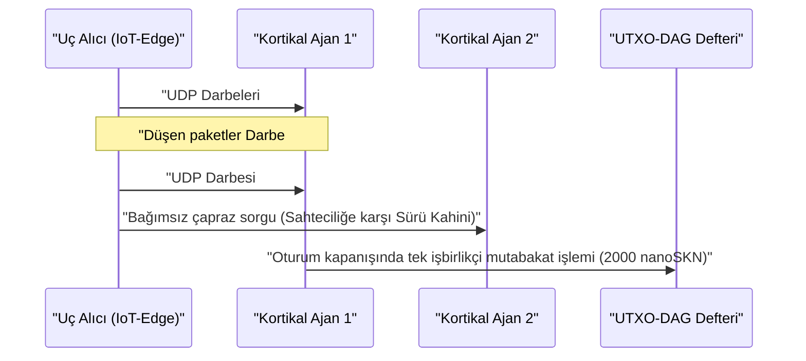

# Bölüm 01: Problem Tanımı ve Pratik Makineden Makineye (`M2M`) Ekonomi

[← Bölüm 00: Özet ve Vizyon](./00-abstract-and-vision.md) | [Bölüm 02: Çok Hücreli Mimari →](./02-multicellular-architecture.md)

---

## 1. Merkezi Sohbet Robotlarının Ötesi: Fiziksel Uçta Refleksif Zekâ

SkyNet, uzun metin yazarlığı için kullanılan yüz milyarlarca parametreli merkezi Büyük Dil Modellerinin yerini almayı amaçlamaz. Bunun yerine SkyNet, **çok trilyon dolarlık yapısal bir kör noktayı** hedefler: milyarlarca otonom makinenin, endüstriyel sensörün, ağ geçidinin ve yazılım ajanının güvenilmez kablosuz bağlantılar üzerinden **`10 ms` altı refleksif çıkarıma, kesintisiz yerel adaptasyona ve kuruş-altı makineden makineye (`M2M`) değer mutabakatına** ihtiyaç duyduğu internetin fiziksel ucu.

### Merkezi Bulutlar ve Geleneksel Blokzincirler Burada Neden Başarısız Olur?

Her $\Delta t = 10\text{ ms}$ aralıklarla, darbe başına $v = 50\text{ nanoSKN}$ değerinde gerçek zamanlı anomali sınıflandırması ve telemetri doğrulaması satın alan otonom bir uç ajanı $A$'yı (örneğin bir sürü dronu, DDoS önleme ağ geçidi veya akıllı şebeke rölesi) ele alalım:

1. **Gecikme ve TCP Yeniden İletim Duvarı:** Uzak bulut bölgelerine TLS/TCP oturumları kurmak çok turlu (multi-RTT) el sıkışmalar gerektirir. $p_{\text{loss}} = 20\%$ düzeyindeki ortam kablosuz paket kaybı altında, TCP tıkanıklık penceresi geri çekilmesi ve yeniden iletim zaman aşımları `p99` kuyruk gecikmesini yüzlerce milisaniyeye fırlatır — bu da gerçek zamanlı siber-fiziksel kontrol döngüleri için yıkıcıdır.
2. **Taban Ücret Zemini:** İtibari para ödeme raylarında veya EVM akıllı sözleşme zincirlerinde işlem başına sabit ek yük $F_{\text{tx}}$, tek bir darbenin değerini $10^5\times$ ila $10^8\times$ oranında aşar ($F_{\text{tx}} \gg v$); bu durum milisaniye hassasiyetindeki M2M ticaretini ekonomik açıdan imkânsız kılar.
3. **Statik Model Kayması:** Buluttan dağıtılan önceden eğitilmiş statik ağırlıklar, değişen yerel sinyal dağılımları (`concept drift`) karşısında hızla bozulurken, kısıtlı uç cihazlar gradyan geri yayılımını (backpropagation) çalıştıracak bellek ve güç bütçesinden yoksundur.

---

## 2. `SKN` Talebini Yönlendiren Dört Gerçek Dünya Ekonomik Sütunu

`SKN` için içsel talep, merkezi bulutların ve durum bilgili blokzincirlerin rekabet edemediği dört somut yetenekten doğar:

### 2.1. Ultra Düşük Gecikmeli Sürü Uç Mikro-Çıkarımı (`< 10 ms`)
Robotik filoları, endüstriyel IoT denetleyicileri, telekom röleleri ve ağ güvenliği donanımları, 8 boyutlu normalize edilmiş bir öznitelik vektörünü (`stimulus: [f32; 8]`) imzalı bir `SynapticVoucher` ile birlikte **tek bir `<= 1200-byte` UDP datagramı** içine gömer.
- Komşu `Epidermal` ve `Neural` hücreleri, darbe başına `0.1 ms` altında tekrarlayan (recurrent) Sıvı Mikro-Ağ ileri besleme adımlarını yürütür.
- `SynapticVoucher` monotonik olarak artan kümülatif toplamları kodladığından, hücresel veya uydu bağlantıları üzerindeki `%25` (`25%`) rastgele UDP paket kaybı bile **sıfır faturalandırma duraksamasına ve sıfır yeniden iletim beklemesine** yol açar.

### 2.2. Hizmet Olarak Evrim ve Merkeziyetsiz `Plasmid` Gen Pazarı
Kompakt gömülü modelleri eğitmek için pahalı bulut GPU kümeleri kiralamak yerine, herhangi bir kullanıcı veya otonom ajan uyaran akışlarını $x_t$, hedef yanıtları $y_t^*$ ve `SKN` ödüllerini belirten bir optimizasyon ödülü (bounty) yayınlayabilir:
- Binlerce `AgentNode` organizması `1 -> 2` hücresel `Mitosis` başlatarak on binlerce ağırlık pertürbasyonunu ve sıvı zaman sabitini $\tau$ paralel biçimde değerlendirir.
- Zayıf mutantlar `Apoptosis` sürecine girerken, en yüksek performanslı soylar kompakt `CellDna` genomlarına (`2 KB` altında, `BLAKE3` ile kriptografik olarak mühürlenmiş) yakınsar.
- Talep sahibi hem canlı çıkarımı hem de milyonlarca mikrodenetleyiciye doğrudan yazılmaya hazır **bağımsız evrimleşmiş `CellDna` ağırlık artefaktını** (`GF(2)` `FountainDroplet` paketleriyle kayıpsız teslim edilir) teslim alır.

### 2.3. Atomik `M2M nanoSKN` Ödeme Hattı ve Halüsinasyon Önleyici Sürü Kahinleri
`1 nanoSKN` ($10^{-9}\text{ SKN}$) birimine kadar bölünebilen değerlerle yapay zekâ ajanları, gerçek dünya fiziksel sinyallerini (mikro-hava durumu telemetrisi, RF spektrum doluluğu, yönlendirme gecikmesi, yüksek frekanslı emir akışı) otonom olarak satın alır ve çapraz doğrular:

Yerel bir küme içindeki bağımsız `AgentNode` organizmalarının çapraz örneklenmesi, tekil model halüsinasyonunu ve sensör sahteciliğini (spoofing) ortadan kaldırır.

### 2.4. Kapsayıcı Çok Katmanlı DePIN (Donanım Simbiyozu)
SkyNet, dünya çapındaki atıl ve heterojen donanımları simbiyotik bir biyolojik tedarik zincirinde birleştirir:

| Katılımcı Segmenti | Günlük Donanım | Ekolojik Rol | `SKN` Gelir Akışı |
| :--- | :--- | :--- | :--- |
| **Bireyler ve Haneler** | Eski akıllı telefonlar, ev yönlendiricileri, Raspberry Pi'ler, IoT kartları | Uç duyusal veri yakalama, `Epidermal` paket filtreleme, `~1 KB` `Utreexo` hafif doğrulama | Canlı sensör akışlarından ve sınır filtrelemeden `nanoSKN` kazanımı |
| **Geliştiriciler ve Masaüstü Kullanıcıları** | Dizüstü bilgisayarlar, ofis PC'leri (`StandardNode`) | `Snowball` mutabakat örneklemesi, makbuz yönlendirme, orta ölçekli doku evrimi | Küme işlem ücretleri (`cluster_nutrient_pool`) ve çıkarım ödemesi kazanımı |
| **Laboratuvarlar ve GPU Operatörleri** | Çok çekirdekli sunucular, Apple `Metal`, NVIDIA `CUDA` GPU'ları | Düğüm başına `16,384` hücreye kadar `TissueBatch` paralel evrimi | Evrim ödülleri ve yatay `Plasmid` ihracat telif gelirleri kazanımı |

---

## 3. Zincir Üstü Doğrusal-Altı (Sub-Linear) Mutabakat Sıkıştırması

İki yapay zekâ ajanının, paket düşme olasılığı $p \in [0, 1)$ olan bir kablosuz kanal üzerinden çağrı başına $\delta\text{ nanoSKN}$ bedelle $M$ adet yüksek frekanslı çıkarım darbesi alışverişinde bulunduğunu varsayalım. Geleneksel zincir üstü mutabakat $\mathcal{O}(M)$ adet defter işlemi gerektirirken, TCP yeniden iletim ek yükü $\frac{1}{1 - p}$ oranında büyür.

SkyNet'te ise ödeyici taraf, $s \in \{1, \dots, M\}$ dizisiyle indekslenen ve $V_s = s \cdot \delta$ kümülatif değerini taşıyan `Ed25519` imzalı makbuzlar yayınlar. Hedefe ulaşan herhangi bir $s_k$ paketi, aradaki tüm kayıp paketler boyunca oluşan $\Delta V = V_{s_k} - V_{s_{k-1}}$ artımlı farkının tamamını yeniden iletime gerek kalmaksızın kriptografik olarak kanıtlar. Oturum sonunda $M$ adet mikro-çıkarımın tamamı **yalnızca $1$ adet UTXO-DAG işleminde** mutabakata bağlanarak $M : 1$ zincir üstü sıkıştırma oranına ulaşır (pratikte defter yükünde $1{,}000\times$ ila $100{,}000\times$ azalma sağlar).

Bölüm 02, her bir `AgentNode` düğümünün iç anatomisini inceleyerek tek bir yazılım ikilisinin (binary) herhangi bir donanım katmanında nasıl kendi kendini örgütleyerek canlı çok hücreli bir organizmaya dönüştüğünü göstermektedir.

---

[← Bölüm 00: Özet ve Vizyon](./00-abstract-and-vision.md) | [Bölüm 02: Çok Hücreli Mimari →](./02-multicellular-architecture.md)
