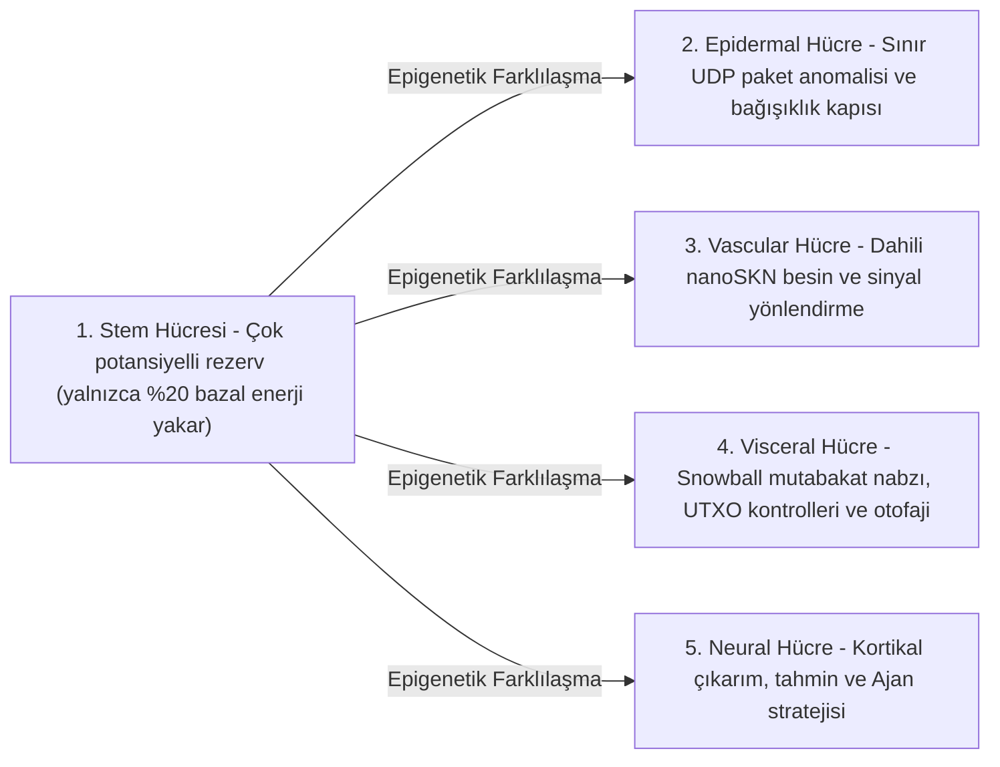

# Bölüm 02: Çok Hücreli Organizma Mimarisi ve Esnek Donanım Ölçeklendirmesi (`AgentNode`)

[← Bölüm 01: Problem Tanımı ve `M2M` Ekonomisi](./01-problem-and-m2m-economy.md) | [Bölüm 03: `CellDna` ve Sıvı Sinir Hücreleri →](./03-dna-and-liquid-neural-cells.md)

---

## 1. Biyolojik İzomorfizm: `1 Node = 1 Multicellular Organism`

Geleneksel eşler arası (peer-to-peer) ağlarda her düğüm, ister gömülü bir mikrodenetleyici ister 64 çekirdekli bir GPU sunucusu üzerinde çalışsın, monolitik ve katı bir durum makinesi yürütür. SkyNet'te (`crates/skynet-agent`) ise her ağ katılımcısı, dinamik bir mikro-yapay zekâ hücre popülasyonu $\mathcal{C}(t) = \{c_1, c_2, \dots, c_{N(t)}\}$, dahili bir metabolik hazine (`AgentMetabolicBank`), durumsuz bir `Utreexo` kök doğrulayıcısı (`StatelessUtreexoRoots`) ve paket kaybına dayanıklı bir `SnowballEngine` barındıran canlı çok hücreli bir organizma — yani bir **`AgentNode`** — olarak örneklenir.

Hücre popülasyonu büyüklüğü $N(t) = |\mathcal{C}(t)|$ asla sabit kodlanmamıştır; **ana bilgisayarın donanım kapasitesine ve kazanılan `nanoSKN` besin girişine göre `Mitosis` yoluyla organik olarak genişler ve `Apoptosis` yoluyla daralır**.

---

## 2. Üç Esnek Donanım Katmanı (`HardwareTier`)

Başlangıçta `HardwareProfile::for_tier`, ana cihaz kapasitesini kesin `nanoSKN` metabolik eşiklerine sahip üç ekolojik profilden birine eşler (`crates/skynet-cell/src/lib.rs`):

| Biyolojik Parametre (`HardwareProfile`) | `TinyPeripheral` (IoT / Uç MCU) | `StandardNode` (Dizüstü / Masaüstü PC) | `ColossalOrganism` (Sunucu / GPU) |
| :--- | :--- | :--- | :--- |
| **Maksimum Hücre Popülasyonu (`max_cells`)** | `32` hücre | `512` hücre | `16,384` hücre |
| **Aktif Bazal Yakım / Tik (`basal_burn_per_tick`)** | `50 nanoSKN` | `25 nanoSKN` | `10 nanoSKN` |
| **Uyuyan `Stem` Yakımı / Tik (%80 tasarruf)** | `10 nanoSKN` | `5 nanoSKN` | `2 nanoSKN` |
| **Bölünme Eşiği (`mitosis_threshold`)** | `2,000 nanoSKN` | `1,500 nanoSKN` | `1,000 nanoSKN` |
| **Bölünme Kan Ücreti (`mitosis_blood_fee`)** | `100 nanoSKN` | `60 nanoSKN` | `40 nanoSKN` |
| **Eliminasyon Tabanı (`apoptosis_floor`)** | `100 nanoSKN` | `80 nanoSKN` | `50 nanoSKN` |
| **Hesaplama Arka Ucu (`candle_core::Device`)** | `Cpu` | `Cpu` / `Metal` / `Cuda` | `Cuda` / `Metal` / `Cpu` SIMD |

> [!NOTE]
> **Biyolojik Ölçek Ekonomileri (Kleiber Yasası):** Tıpkı daha büyük biyolojik organizmaların gram doku başına daha düşük metabolik maliyet sergilemesi gibi, `ColossalOrganism` düğümleri de binlerce hücrenin tek bir toplu (batched) GPU tensör çekirdeği içinde yürütme maliyetini amorti etmesi sayesinde hücre başına daha düşük bazal yakıma (`50 nanoSKN` yerine `10 nanoSKN`) katlanır; buna karşılık `TinyPeripheral` düğümleri ağın ucunda yalın ve dayanıklı kalır.

---

## 3. Beş Uzmanlaşmış Histolojik Hücre Soyu (`CellRole`)

Bir `AgentNode` doğduğunda (`AgentNode::from_signing_key`), deterministik bir `base_stem` genomundan türetilen 6 hücrelik embriyonik bir çekirdek (`2 Stem`, `1 Epidermal`, `1 Vascular`, `1 Visceral`, `1 Neural`) başlatır. Organizmanın yaşam süresi boyunca beş histolojik hücre soyu beş temel fizyolojik işlevi yerine getirir:

1. **`Stem` (Çok Potansiyelli Rezerv — `operon_index = None`):** Tik başına yalnızca $\max(\lfloor E_{\text{burn}} / 5 \rfloor, 1)$ tüketen uyku halindeki rejeneratif hücrelerdir. Herhangi bir uzmanlaşmış organ kayıp yaşadığında, bir `Stem` hücresi harici kod indirmeye gerek duymaksızın onu yenilemek üzere epigenetik olarak farklılaşır (`differentiate`).
2. **`Epidermal` (Deri ve Bağışıklık Kapısı — `operon_index = Some(0)`):** Ham UDP soketini korur (`epidermal_inspect_packet`). Gelen herhangi bir paket dağıtık deftere veya mutabakat motoruna ulaşmadan önce, bir `Epidermal` hücresi bozuk veya taşkın (flood) darbelerini düşürmek amacıyla `candle` üzerinde normalize edilmiş paket telemetrisini (`raw_len / 1200`, `hop_ttl / 16`, `epoch` sapması) değerlendirir.
3. **`Vascular` (Dolaşım Düzenleyicisi — `operon_index = Some(1)`):** `AgentMetabolicBank` içindeki dahili `blood_pool` likiditesini düzenleyerek `nanoSKN` ödüllerini yüksek doğruluklu hücrelere kanalize eder.
4. **`Visceral` (Organ Bakımı — `operon_index = Some(2)`):** `Snowball` oylama temposunu, durumsuz `Utreexo` tanık (witness) doğrulamasını ve metabolik geri dönüşümü yürütür.
5. **`Neural` (Kortikal Beyin — `operon_index = Some(3)`):** Bilişsel çıkarımı yürütür; yaşayan tüm `Neural` hücreleri üzerindeki topluluk ortalaması ($\bar{y}_{\text{cortical}} = \frac{1}{|\mathcal{C}_{\text{neural}}|} \sum_{i \in \mathcal{C}_{\text{neural}}} y_i$), organizmanın kolektif karar çıktısını oluşturur.

---

## 4. Altı Aşamalı Biyolojik Tik Yaşam Döngüsü (`run_biological_tick`)

Her nabızda (`pulse_seq`), `AgentNode` Darwinci rekabeti tam `u128` `nanoSKN` korunumuyla birleştiren deterministik altı aşamalı bir fizyolojik döngü yürütür:

1. **Aşama 1 — Bazal Metabolizma:** Her $c_i$ hücresi $b_i = \text{metabolize\_tick}()$ kadar bakım enerjisi yakar. Kritik bir nokta olarak $b_i$ zincir üstünde asla yok edilmez; yakılan hücre içi ATP'nin %100'ü tekrar `bank.blood_pool` havuzuna geri dönüştürülür. Aç kalan hücreler ($E_i = 0$) `0.25` oranında `health` (sağlık) kaybeder.
2. **Aşama 2 — Toplu `candle` Tensör Çıkarımı:** Yaşayan $N$ hücrenin tamamı `TissueBatch::forward_slice` aracılığıyla eşzamanlı olarak yürütülür; $y_i \in \mathbb{R}^4$ çıktılarını üretir ve kısa süreli sıvı bellek vektörlerini $h_{i,t} \in \mathbb{R}^{16}$ günceller.
3. **Aşama 3 — Organ İçi Darwinci Besin Seçilimi:**
   Verilen hedef sinyal $t \in \mathbb{R}^4$ için $i$ hücresinin tahmin kalitesi sınırlandırılmış Ortalama Mutlak Hata (MAE) ile ölçülür:

   $$q_i = \operatorname{clamp}\!\left(1 - \frac{1}{4}\sum_{k=1}^{4} |y_{i,k} - t_k|,\ 0.0,\ 1.0\right)$$

   $r = \text{role}(c_i)$ organ rolünü paylaşan tüm hücrelerin ortalama kalitesi $\bar{q}_r$ olsun. Uzmanlaşmış bir hücre, ancak ve ancak organında $\le 2$ hücre bulunuyorsa veya organ içi rekabet eşiğini $q_i \ge 0.98 \cdot \bar{q}_r$ aşıyorsa `blood_pool` havuzundan besin `nanoSKN` kazanır:

   $$R_i = \min\!\left(\lfloor 320 \cdot q_i \rfloor + E_{\text{basal}},\ \left\lfloor \frac{B_{\text{blood}}}{8} \right\rfloor\right)$$

   Düşük performanslı mutantlar ($q_i < 0.98 \cdot \bar{q}_r$) sıfır besin alır ve `-0.35` `health` cezasına çarptırılır.
4. **Aşama 4 — Homeostatik Kök Hücre Farklılaşması:** Organizma, nüfusu en yetersiz uzmanlaşmış organını belirler (`find_most_needed_role`). `stem_count > 1` olduğu her durumda, en az `1` eşey hattı (germline) `Stem` hücresini daima koruyarak bir `Stem` hücresi ilgili organa farklılaşır.
5. **Aşama 5 — `1 -> 2` Mitoz Bölünme (`Mitosis`):** Sağlıklı ve iyi beslenmiş hücreler (`health >= 0.65` ve $E_i \ge E_{\text{mitosis}}$), `profile.max_cells` sınırına kadar muhafazakâr bir klon (Yavru A) ve mutasyona uğramış bir kâşif (Yavru B) olarak ikiye bölünür.
6. **Aşama 6 — Organ Korumalı Apoptoz (`Apoptosis`):** Aç kalan ($E_i < E_{\text{apoptosis}}$) veya kritik hasar gören (`health <= 0.15`) hücreler çözünür ve kalan `nanoSKN` bakiyelerinin %100'ünü `blood_pool` havuzuna iade eder — ancak bu işlem katı bir hayatta kalma güvencesine tabidir: hiçbir hayati organın soyu tükenmesin diye **mevcut her `CellRole` için en az `1` canlı hücre koşulsuz olarak korunur**.

Her tikin kapanışında `verify_internal_skn_conservation()` fonksiyonu kesin `u128` özdeşliğini doğrular:

$$B_{\text{chain}}(\text{Agent}) \equiv B_{\text{blood}}(\text{Agent}) + \sum_{c_i \in \mathcal{C}} E_i$$

Bölüm 03, `CellDna` yapısının bayt ve matematiksel düzeydeki tam mimarisini, epigenetik operon anahtarlamasını ve 3B `TissueBatch` Sıvı Sinirsel yürütümünü tanımlamak üzere hücre çekirdeğini açmaktadır.

---

[← Bölüm 01: Problem Tanımı ve `M2M` Ekonomisi](./01-problem-and-m2m-economy.md) | [Bölüm 03: `CellDna` ve Sıvı Sinir Hücreleri →](./03-dna-and-liquid-neural-cells.md)
