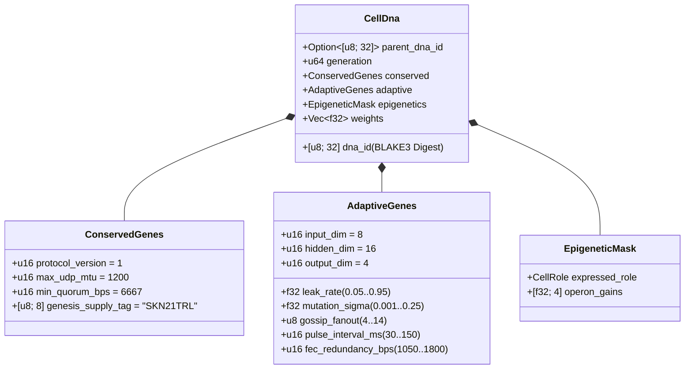

# Bölüm 03: Genetik Kodlama (`CellDna`), Epigenetik ve `candle` Üzerinde Sıvı Mikro-Nöral Evrim

[← Bölüm 02: Çok Hücreli Mimari](./02-multicellular-architecture.md) | [Türkçe İndekse Dön →](./README.md)

---

## 1. Hücresel Genom Mimarisi (`CellDna`)

Biyolojik evrim iki karşıt gücü dengeler: temel biyokimyasal değişmezlerin **mutlak korunumu** (buradaki mutasyonlar ölümcüldür) ile sinirsel ve davranışsal özelliklerin **sürekli çeşitliliği**. `skynet-dna` paketi bu ikiliği `CellDna` yapısı içinde biçimselleştirir:

### 1.1. Değiştirilemez `ConservedGenes` (Korunmuş Genler)
Hiçbir mutasyon veya yatay çaprazlama `ConservedGenes` alanını değiştiremez. Dört mutabakat güvenliği önermesinden herhangi birini ihlal eden her genom, `DnaError::ConservedGeneViolation` hatasıyla derhal reddedilir:
- `protocol_version == 1`
- `max_udp_mtu == 1200` (parçalanmasız UDP tavanı)
- $6667 \le \text{min\_quorum\_bps} \le 10000$ (`Snowball` mutabakatında $\ge \frac{2}{3}$ nitelikli çoğunluğu zorunlu kılar)
- `genesis_supply_tag == *b"SKN21TRL"` (21 trilyon `SKN` arz tavanını donanımsal kesinlikle sabitler)

### 1.2. `AdaptiveGenes` ve Paylaşımlı Gövde Operon Ağırlık Düzeni
Dört uzmanlaşmış hücre tipi için birbirinden kopuk dört ayrı sinir ağı depolamak yerine `CellDna`, **dört Uzmanlaşmış Operon Projeksiyon Başlığını (`Specialized Operon Projection Heads`)** besleyen **tek bir Paylaşımlı Duyusal Gövde (`Shared Sensory Trunk`)** kodlar. $(D_{\text{in}}, H, D_{\text{out}})$ boyutları için tam `f32` parametre sayısı şöyledir:

$$|\theta| = \underbrace{(D_{\text{in}} \cdot H + H)}_{\text{Shared Sensory Trunk }(W_1, b_1)} + \underbrace{4 \cdot (H \cdot D_{\text{out}} + D_{\text{out}})}_{\text{4 Specialized Operon Heads }(W_{2,r}, b_{2,r})}$$

Varsayılan $(D_{\text{in}} = 8,\ H = 16,\ D_{\text{out}} = 4)$ boyutları altında:
- Paylaşımlı gövde: $8 \times 16 + 16 = 144$ parametre.
- Dört operon başlığı (`Epidermal`, `Vascular`, `Visceral`, `Neural`): $4 \times (16 \times 4 + 4) = 272$ parametre.
- Toplam genom ağırlıkları: $|\theta| = 416$ adet `f32` kayan noktalı sayı ($1{,}664\text{ bytes}$ ham ağırlık). 0. nesil kök genomları (`CellDna::genesis_stem`), Xavier ölçekli sınırla $\mathcal{U}(-\sigma_0, +\sigma_0)$ düzgün dağılımı üzerinden `ChaCha8Rng` aracılığıyla deterministik olarak başlatılır:

$$\sigma_0 = \sqrt{\frac{2}{D_{\text{in}} + H}}$$

### 1.3. Deterministik `BLAKE3` Kriptografik Özeti (`SKYNET_DNA_V1`)
Her kayan noktalı hiperparametre ve ağırlık, kanonik küçük sonlu (little-endian) IEEE-754 bit dizilimleri (`to_bits().to_le_bytes()`) üzerinden alan-ayrımlı (domain-separated) bir `BLAKE3("SKYNET_DNA_V1", ...)` özetine serileştirilir. Tek bitlik bir bozulma, `NaN`/`Inf` enjeksiyonu veya yetkisiz ağırlık müdahalesi `verify_integrity()` içinde anında reddedilmeyi tetikler.

---

## 2. Epigenetik Metilasyon Anahtarlaması (`EpigeneticMask`)

Çok hücreli biyolojide bir nöron ile epidermal deri hücresi birebir aynı DNA dizilimini taşır, ancak gen metilasyonu yoluyla kökten farklı fenotipler ifade eder. SkyNet'te bir `Stem` hücresi hedef rol $r \in \{0, 1, 2, 3\}$ yönünde farklılaştığında (`CellDna::differentiate`), **altta yatan `weights` vektörünün %100'ü dokunulmadan kalırken** `EpigeneticMask` ifade kazancını (gain) kaydırır:

- **Uyuyan `Stem` Durumu:** `operon_gains = [0.25, 0.25, 0.25, 0.25]` olup `0` numaralı operon başlığı üzerinden zayıflatılmış $g = 0.25$ kazancıyla projeksiyon yapar.
- **Farklılaşmış Rol $r$:** Operon başlığı $r$ tam kazançla ($g_r = 1.0$) etkinleşirken, ifade edilmeyen başlıklar $0.05$ düzeyine baskılanır:

$$g_k = \begin{cases} 1.0 & \text{if } k = r \\ 0.05 & \text{if } k \neq r \end{cases}$$

Sonuç olarak, paylaşımlı gövdede $(W_1, b_1)$ öğrenilen duyusal temsiller ve uyuyan başlıklardaki örtük adaptasyonlar nesiller boyunca korunur ve doku dönüşümü (transdifferentiation) sırasında yeniden kullanıma hazır kalır.

---

## 3. Sıvı Zaman Sabitli Dinamikler ve 3B `TissueBatch` Yürütümü

### 3.1. Tek Hücreli Tekrarlayan Sıvı Dinamikleri
Durumsuz ileri beslemeli MLP ağları, asenkron UDP paket akışları arasındaki zamansal korelasyonları yakalayamaz. Her `MicroCell`, evrimleşebilir sızıntı oranı $\tau \in [0.05, 0.95]$ ile ayrık **Sıvı Zaman Sabitli (Liquid Time-Constant — LTC)** durum interpolasyonu tarafından yönetilen tekrarlayan bir kısa süreli bellek vektörü $h_t \in \mathbb{R}^H$ barındırır:

$$h_t = (1 - \tau)\, h_{t-1} + \tau\, \tanh(x_t W_1 + b_1)$$

$$y_t = g_{\text{role}} \cdot \tanh(h_t W_{2,r} + b_{2,r})$$

- $\tau \to 0.05$ yaklaştıkça hücre uzun ufuklu bellek eylemsizliğini korur (`Visceral` ve `Neural` eğilim takibi için idealdir).
- $\tau \to 0.95$ yaklaştıkça hücre yüksek frekanslı sınır darbelerine anında tepki verir (`Epidermal` anomali puanlaması için idealdir).
- $\tau$ parametresi `AdaptiveGenes` içinde yer aldığından, **her hücrenin zamansal bellek ufku kendi sinaptik ağırlıklarıyla birlikte doğal olarak ortaklaşa evrimleşir**.

### 3.2. Yüksek Verimli 3B `TissueBatch` Tensör Motoru (`Cpu` / `Metal` / `Cuda`)
Nöro-evrimdeki klasik darboğazlardan biri ağırlık heterojenliğidir: her $i \in \{1, \dots, N\}$ hücresi birbirinden farklı mutasyona uğramış $W_1^{(i)} \neq W_1^{(j)}$ matrisleri ve farklı $\tau^{(i)} \neq \tau^{(j)}$ sızıntı oranları taşır. Ardışık $N$ adet mikro-çekirdek (micro-kernel) başlatmak modern GPU'ları verimsizliğe mahkûm eder.

`skynet-cell` içindeki `TissueBatch::forward_slice`, $N$ adet heterojen hücrenin tamamını `candle_core::Device` üzerinde bitişik 3. derece (rank-3) tensörler halinde paketleyerek bu sorunu çözer:

$$\mathbf{X} \in \mathbb{R}^{N \times 1 \times D_{\text{in}}}, \quad \mathbf{W}_1 \in \mathbb{R}^{N \times D_{\text{in}} \times H}, \quad \mathbf{B}_1 \in \mathbb{R}^{N \times 1 \times H}$$

$$\mathbf{H}_t = (\mathbf{1} - \boldsymbol{\tau}) \odot \mathbf{H}_{t-1} + \boldsymbol{\tau} \odot \tanh\!\big(\operatorname{BMM}(\mathbf{X}, \mathbf{W}_1) + \mathbf{B}_1\big)$$

$$\mathbf{Y}_t = \mathbf{G} \odot \tanh\!\big(\operatorname{BMM}(\mathbf{H}_t, \mathbf{W}_2) + \mathbf{B}_2\big)$$

burada $\operatorname{BMM}$ tek çekirdekli Toplu Matris Çarpımını (Batched Matrix Multiplication), $\odot$ ise $\boldsymbol{\tau}, \mathbf{G} \in \mathbb{R}^{N \times 1 \times 1}$ ile yayınlamalı (broadcast) eleman bazlı çarpımı ifade eder. Denetlenmiş birim testleri, `TissueBatch` çıktısının tekil hücre yürütümüyle $< 10^{-5}$ kayan nokta toleransı dahilinde örtüştüğünü ve `ColossalOrganism` başına `16,384` eşzamanlı evrimleşmiş modele kadar ölçeklendiğini doğrulamaktadır.

---

## 4. Asimetrik Mitoz, Tam Tekil-`nanoSKN` Korunumu ve Plazmid Çaprazlaması

### 4.1. Asimetrik `1 -> 2` `Mitosis` ve Tam Atomik Korunum Kanıtı
Ebeveyn hücre $P$, $E_P \ge \max(E_{\text{mitosis}}, F_{\text{blood}} + 2)$ ve `health >= 0.65` koşullarını sağladığında `divide_mitosis`, $(g+1)$ neslinden iki yavru hücre üretir:
- **Yavru A (Muhafazakâr Klon):** Kanıtlanmış ebeveyn ağırlıklarının ve uyarlanabilir parametrelerinin %100'ünü hiçbir pertürbasyon olmaksızın korur.
- **Yavru B (Mutasyona Uğramış Kâşif):** Sınırlandırılmış nöro-evrimsel mutasyona uğrarken ebeveynin `hidden_state` sürekliliğini miras alır:
  - Her $w \in \theta$ ağırlığı, gradyan/ağırlık patlamasını önlemek üzere kesin olarak $[-4.0, +4.0]$ aralığına kenetlenmiş, sıfır bağımlılıklı 6 örnekli Irwin-Hall Gauss pertürbasyonu ($\Delta w \sim \mathcal{N}(0, \sigma^2)$) aracılığıyla $0.35$ olasılıkla mutasyona uğrar.
  - $\tau$, $\sigma$, `gossip_fanout` ($\pm 1$), `pulse_interval_ms` ($\pm 10\text{ ms}$) ve `fec_redundancy_bps` ($\pm 50\text{ bps}$) parametreleri sınırlandırılmış aralıklar içinde ortaklaşa mutasyona uğrar.

**Sıfır Sızıntılı Tekil-`nanoSKN` Korunumu Kanıtı:** Ücret sonrası dağıtılabilir ATP miktarı $E_{\text{dist}} = E_P - F_{\text{blood}}$ olsun. Yavru bakiyeleri `u128` üzerinde tamsayı bölüm-kalan aritmetiği ile paylaştırılır:

$$E_A = \left\lfloor \frac{E_{\text{dist}}}{2} \right\rfloor + (E_{\text{dist}} \bmod 2), \qquad E_B = \left\lfloor \frac{E_{\text{dist}}}{2} \right\rfloor$$

Negatif olmayan her $E_{\text{dist}} \in \mathbb{Z}_{\ge 0}$ tamsayısı için (`3,333 nanoSKN` gibi tek sayılı bakiyeler dahil) tam korunum özdeş olarak sağlanır:

$$E_A + E_B + F_{\text{blood}} = \left(2\left\lfloor \frac{E_{\text{dist}}}{2} \right\rfloor + (E_{\text{dist}} \bmod 2)\right) + F_{\text{blood}} = E_{\text{dist}} + F_{\text{blood}} \equiv E_P$$

Milyarlarca bölünme boyunca tek bir `nanoSKN` dahi yuvarlama nedeniyle kaybolmaz veya yoktan üretilmez.

### 4.2. Ajanlar Arası Yatay Gen Transferi (`Plasmid` Çaprazlaması)
Bakteriyel plazmid alışverişini yansıtan bir mekanizmayla `AgentNode`, en yüksek uyumluluk (fitness) değerine sahip hücresinin `CellDna` genomunu silme kodlu UDP `FountainDroplet` paketlerine (`encode_elite_plasmid_droplets`) aktarır. Kayıplı UDP bağlantıları üzerinden `donor_dna` yeniden birleştirildiğinde, alıcı Ajan en düşük uyumluluklu hücresini `horizontal_crossover` ile yükseltir:
- Uyarlanabilir ağ ve zaman sabiti özellikleri $0.7 \cdot \text{Recipient} + 0.3 \cdot \text{Donor}$ oranında harmanlanır.
- Sinaptik ağırlıkların $30\%$'u $0.5 \cdot w_{\text{rec}} + 0.5 \cdot w_{\text{don}} \in [-4.0, +4.0]$ biçiminde düzgün olarak harmanlanır.

Yatay plazmid transferi sayesinde kaynak kısıtlı bir `TinyPeripheral` IoT sensörü, `ConservedGenes` güvenliğini kriptografik olarak korurken uzak GPU `ColossalOrganism` düğümlerinde evrimleşmiş seçkin sinirsel zekâyı bünyesine katar.

---

> **Faz 2'de Sırada (Kısım II):** Bölüm `04–06`; `21,000,000,000,000 SKN` Yarılanma Kasası (Halving Vault) matematiğini, `Soul–Body` İnsan Egemen Saklama sözleşmesini ve `~1 KB` Durumsuz `Utreexo` + `SynapticVoucher` dağıtık defter ölçeklendirmesini biçimselleştirmektedir.

[← Bölüm 02: Çok Hücreli Mimari](./02-multicellular-architecture.md) | [Türkçe İndekse Dön →](./README.md)
