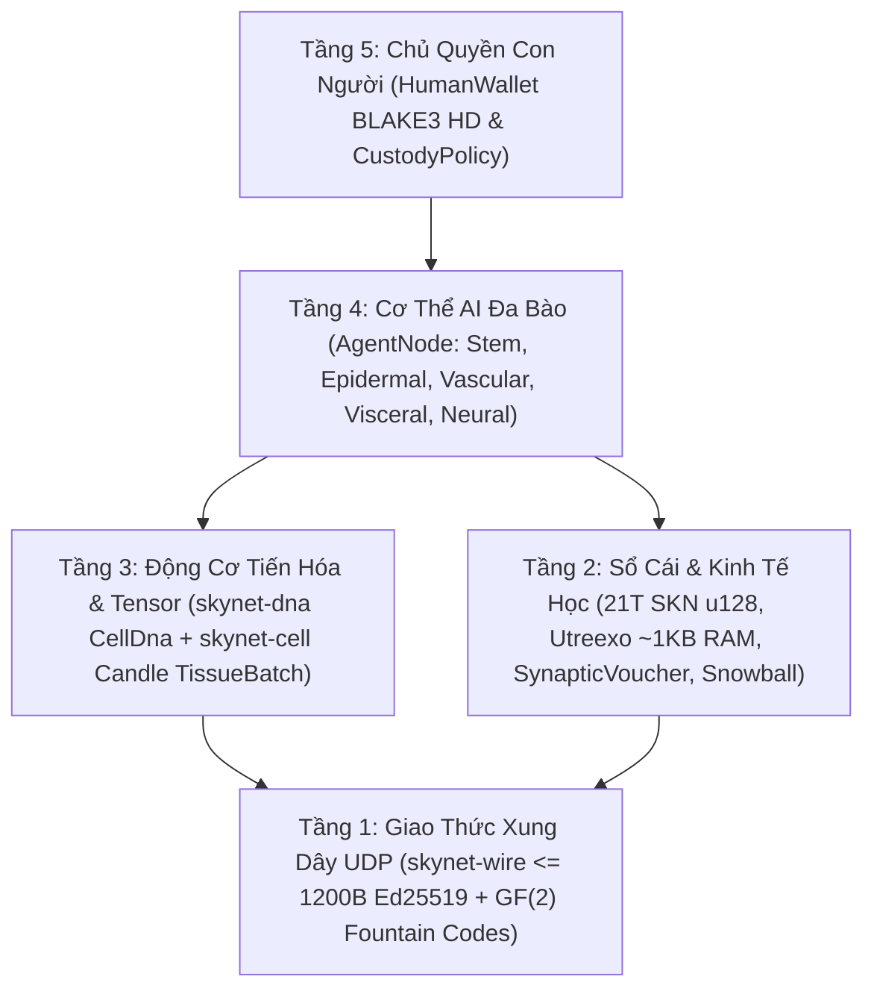

# Chương 00: Tóm Tắt Học Thuật, Tiên Đề Thiết Kế & Triết Lý Tham Gia Toàn Cầu

[← Về Mục Lục Tiếng Việt](./README.md) | [Chương 01: Bài Toán Thực Tiễn & Kinh Tế M2M →](./01-problem-and-m2m-economy.md)

---

## Tóm Tắt (Abstract)

Chúng tôi trình bày **SkyNet**, một giao thức mạng phi tập trung hợp nhất **sinh học tiến hóa đa bào**, **mạng nơ-ron thời gian lỏng siêu nhỏ (`Liquid Time-Constant Micro-Nets`)** và **sổ cái UTXO-DAG không trạng thái xác thực bằng bộ tích lũy `Utreexo`**, vận hành hoàn toàn trên **các gói tin UDP không kết nối (`<= 1200 bytes`) chấp nhận mất gói tự nhiên**. Khác với các đám mây AI tập trung đòi hỏi siêu trung tâm dữ liệu ngàn tỉ đồng hay các chuỗi khối trạng thái nặng nề dựa trên giao thức TCP tin cậy, SkyNet định nghĩa mỗi nút mạng (`AgentNode`) là một **cơ thể sống đa bào tự chủ** cấu thành từ hàng chục đến hàng vạn mô hình AI siêu mini (`MicroCell`). Mọi tế bào khởi sinh từ một bộ mã di truyền gốc (`CellDna`) có kiểm chứng mật mã `BLAKE3`, tự biệt hóa qua mặt nạ thượng di truyền (`EpigeneticMask`) thành năm dòng mô học chuyên biệt, nhân đôi `1 -> 2` có đột biến giới hạn (`Mitosis`), trao đổi gen ngang (`Plasmid`) qua mã xóa đài phun `GF(2)` và tự đào thải khi suy kiệt (`Apoptosis`).

Để neo giữ nền kinh tế sinh học này vào kỷ luật vật lý bất biến, SkyNet ấn định tổng cung tuyệt đối tại khối khởi nguyên là $S_{\max} = 21{,}000{,}000{,}000{,}000\text{ SKN}$ ($2.1 \times 10^{22}\text{ nanoSKN}$, biểu diễn chính xác bằng số nguyên `u128`), phân phối theo lịch giảm một nửa (`Halving`) `50%` mỗi năm, đồng thời cưỡng chế **Định luật Bảo toàn Năng lượng Đẳng cấu Hai tầng** từ chuỗi UTXO-DAG xuống tới từng đơn vị năng lượng nội bào `1 nanoSKN`. Thông qua cơ chế lưu ký tách biệt **Linh hồn và Cơ thể (`Soul–Body Custody`)**, con người nắm giữ khóa lạnh tối thượng với mức hao hụt trao đổi chất `0%`, trong khi ủy quyền vốn có hạn mức nghiêm ngặt cho đàn AI Agent tự động làm việc kiếm thưởng. Cuối cùng, cơ chế lấy mẫu xác suất **`Snowball`** kết hợp biên nhận cộng dồn đơn điệu **`SynapticVoucher`** cho phép đạt tính chung cục chống chi tiêu kép và thanh toán vi mô tần số cao ngay cả khi đường truyền vật lý rớt `25%–40%` gói tin mà không cần bất kỳ hàng đợi gửi lại nào.

---

## 1. Động Lực & Nghịch Lý Của Hạ Tầng Hiện Tại

Thế giới số hiện đại đang bị chia cắt bởi hai thái cực hạ tầng không tương thích với mạng lưới thiết bị biên toàn cầu:

1. **Sự độc quyền của AI tập trung:** Các mô hình ngôn ngữ lớn (LLM) tập trung hóa trí tuệ vào một số ít cụm máy chủ GPU tiêu thụ hàng megawatt điện. Một cảm biến nông nghiệp, một thiết bị bay tự hành (drone) hay một máy tính cũ ở vùng sâu vùng xa không thể chịu nổi độ trễ khứ hồi hàng trăm mili-giây qua TCP/TLS lẫn chi phí suy luận đắt đỏ chỉ để ra quyết định phản xạ thời gian thực (`< 10 ms`).
2. **Sự phình đại trạng thái và lệ thuộc TCP của Blockchain cổ điển:** Các sổ cái truyền thống yêu cầu hàng trăm gigabyte RAM/SSD để lưu trữ trạng thái toàn cục và giả định mạng lưới kết nối tin cậy dựa trên luồng TCP. Khi gặp môi trường sóng vô tuyến nhiễu loạn, mạng di động yếu hoặc tấn công làm nghẽn băng thông, hiện tượng nghẽn đầu hàng đợi (`Head-of-Line Blocking`) làm tê liệt cả đồng thuận lẫn dòng chảy thanh toán vi mô.

**SkyNet đặt lại câu hỏi nền tảng:** *Làm thế nào tự nhiên vận hành hàng tỉ sinh vật thông minh phối hợp nhịp nhàng trong môi trường vật lý đầy nhiễu động mà không cần một máy chủ trung tâm hay kết nối không mất mát?* Câu trả lời của tự nhiên là **cấu trúc tế bào phân tán**, **biệt hóa thượng di truyền**, **xung thần kinh chấp nhận nhiễu** và **bảo toàn năng lượng trao đổi chất nghiêm ngặt**.

---

## 2. Năm Tiên Đề Thiết Kế Cốt Lõi (Protocol Axioms)

Toàn bộ mã nguồn tham chiếu của SkyNet được xây dựng từ năm tiên đề bất khả xâm phạm:

| Tiên đề | Phát biểu Toán học / Kỹ thuật | Hệ quả Thực tiễn |
| :--- | :--- | :--- |
| **A1. Đẳng cấu Tế bào – Mô hình** | $1\text{ Node} \equiv 1\text{ Đa bào } \mathcal{O} = \{c_1, \dots, c_N\}$, mỗi $c_i$ là 1 mạng nơ-ron lỏng độc lập | Thiết bị IoT chạy 16–32 tế bào và máy chủ GPU chạy 16,384 tế bào nói chung một giao thức duy nhất |
| **A2. Kỷ luật Xung UDP Nguyên tử** | $\forall p \in \text{Wire},\ \|p\| \le 1200\text{ bytes}$, `0` hàng đợi gửi lại (`Zero-ACK`) | Loại bỏ hoàn toàn `Head-of-Line Blocking`, xuyên thủng IPv4/IPv6 toàn cầu không phân mảnh |
| **A3. Bảo toàn Năng lượng Hai tầng** | $S_{\text{vault}} + S_{\text{dag}} \equiv 2.1 \times 10^{22}\text{ nanoSKN}$ và $B_{\text{chain}}(A) \equiv B_{\text{blood}}(A) + \sum_i E_i$ | Không thể in khống tiền tệ, không thất thoát dù chỉ `1 nanoSKN` khi tế bào phân chia số lẻ |
| **A4. Xác thực Không Trạng thái `O(log U)`** | Cam kết toàn bộ tập UTXO bằng rừng nhị phân `Utreexo` $\le 64$ gốc (`~1 KB` RAM) | Một vi điều khiển hay cảm biến biên tự xác thực chống chi tiêu kép mà không tin cậy bên thứ ba |
| **A5. Chủ quyền Tối thượng Con người** | Khóa lạnh `human_owner` tách rời khóa nóng `agent_pubkey` qua giao ước `CustodyPolicy` | Máy chạy AI bị cháy hỏng hay bị chiếm quyền cũng không thể đánh cắp vốn gốc `SKN` của con người |

---

## 3. Toàn Cảnh Kiến Trúc Năm Tầng Của SkyNet

---

## 4. Triết Lý Dân Chủ Hóa Toàn Cầu: Mọi Thiết Bị Đều Có Chỗ Đứng

SkyNet không loại trừ người tham gia dựa trên khả năng tài chính mua phần cứng chuyên dụng (ASIC hay cụm siêu GPU). Nhờ cơ chế phân vai mô học tự nhiên:

- **Người dùng có điện thoại, Raspberry Pi hoặc thiết bị IoT (`TinyPeripheral`):** Đóng vai trò **"Tế bào Da & Giác quan ngoại vi"** ở rìa mạng — thu thập dữ liệu thực tế, lọc gói tin biên, xác thực giao dịch bằng bộ tích lũy `Utreexo` chưa tới `1 KB` RAM và nhận thù lao trực tiếp bằng dòng vi thanh toán `nanoSKN`.
- **Người dùng có máy tính cá nhân / laptop làm việc (`StandardNode`):** Đóng vai trò **"Cơ quan Nội tạng & Mạch máu cụm"** — duy trì nhịp đồng thuận `Snowball`, lưu chuyển thanh khoản voucher và tiến hóa các dòng tế bào tầm trung.
- **Người vận hành máy trạm hoặc GPU (`ColossalOrganism`):** Đóng vai trò **"Vỏ não & Lò luyện Tiến hóa"** — thực thi hàng vạn mô hình đột biến cùng lúc bằng nhân đại số tuyến tính gộp lô `TissueBatch`, xuất khẩu các bộ gen tinh hoa (`Plasmid`) cho các thiết bị nhỏ hơn trên toàn cầu.

Trong chương tiếp theo, chúng ta phân tích chi tiết các bài toán kinh tế thực tế nơi cấu trúc sinh học này tạo ra giá trị vượt trội mà đám mây tập trung và blockchain truyền thống không thể đáp ứng.

---

[← Về Mục Lục Tiếng Việt](./README.md) | [Chương 01: Bài Toán Thực Tiễn & Kinh Tế M2M →](./01-problem-and-m2m-economy.md)
