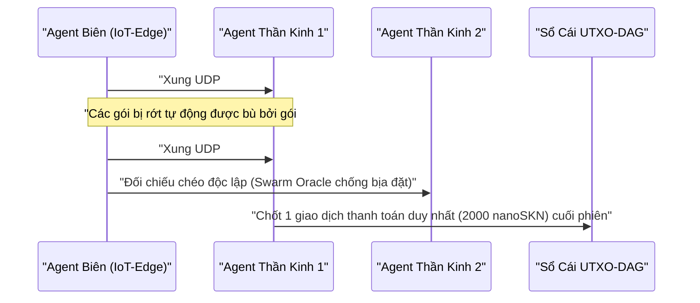

# Chương 01: Bài Toán Thực Tiễn & Nền Kinh Tế Vi Mô Máy–Máy (`M2M`)

[← Chương 00: Tóm Tắt & Tầm Nhìn](./00-abstract-and-vision.md) | [Chương 02: Kiến Trúc Cơ Thể Sống Đa Bào →](./02-multicellular-architecture.md)

---

## 1. Ranh Giới Giữa Trí Tuệ Tập Trung và Phản Xạ Sinh Học Ở Biên

SkyNet không được sinh ra để cạnh tranh trực diện với các mô hình ngôn ngữ lớn hàng trăm tỉ tham số trong tác vụ soạn thảo văn bản dài trên máy chủ đám mây. Thay vào đó, SkyNet giải quyết **khoảng trống hạ tầng trị giá hàng nghìn tỉ đô-la ở thế giới thực**: nơi hàng chục tỉ thiết bị tự hành, cảm biến công nghiệp, cổng mạng biên và tác nhân phần mềm cần **phản xạ thông minh siêu trễ thấp, tự thích nghi liên tục và trao đổi giá trị vi mô tức thời** trên những đường truyền không ổn định.

### Vì sao Đám mây Tập trung và Blockchain Cổ điển Bất lực?

Hãy xét một tác nhân biên $A$ (ví dụ: thiết bị bay tự hành, bộ lọc chống tấn công mạng hoặc cảm biến giao thông thông minh) cần mua tín hiệu xác thực và suy luận phân loại bất thường mỗi $\Delta t = 10\text{ ms}$ với giá trị kinh tế mỗi lần gọi là $v = 50\text{ nanoSKN}$ (tương đương một phần triệu xu):

1. **Rào cản độ trễ vật lý & TCP:** Thiết lập phiên TLS/TCP tới trung tâm dữ liệu ở xa tốn nhiều chu kỳ bắt tay (`3-way handshake`). Chỉ cần tỷ lệ mất gói vô tuyến đạt $p_{\text{loss}} = 20\%$, cơ chế truyền lại và giảm cửa sổ tắc nghẽn của TCP đẩy độ trễ đuôi (`p99 latency`) vọt lên hàng trăm mili-giây — quá muộn cho điều khiển thời gian thực.
2. **Rào cản phí giao dịch tối thiểu:** Trên thẻ tín dụng truyền thống hoặc các mạng hợp đồng thông minh EVM, phí cố định cho một giao dịch $F_{\text{tx}}$ lớn gấp $10^5$ đến $10^8$ lần giá trị của một xung dữ liệu đơn lẻ ($F_{\text{tx}} \gg v$), khiến thương mại máy–máy theo từng mili-giây hoàn toàn bất khả thi về mặt toán học.
3. **Rào cản tính cứng nhắc của mô hình tĩnh:** Một mô hình AI tĩnh được huấn luyện sẵn trên đám mây nhanh chóng bị suy giảm độ chính xác (`concept drift`) khi môi trường nhiễu cục bộ thay đổi, trong khi thiết bị biên không đủ VRAM để chạy lan truyền ngược (`backpropagation`) quy mô lớn.

---

## 2. Bốn Trụ Cột Giá Trị Kinh Tế Của Đồng `SKN`

Nhu cầu nắm giữ và chi trả đồng `SKN` xuất phát trực tiếp từ bốn tiện ích thực tiễn không thể thay thế:

### 2.1. Suy Luận Bầy Đàn Siêu Trễ Thấp Ở Biên (`Swarm Edge Micro-Inference < 10 ms`)
Các hệ thống robot bầy đàn, IoT nhà máy, trạm thu phát viễn thông và bộ lọc chống DDoS gửi trực tiếp véc-tơ đặc trưng kích thích (`stimulus: [f32; 8]`) đính kèm biên nhận `SynapticVoucher` trong **một gói UDP duy nhất `<= 1200 bytes`**.
- Các tế bào `Epidermal` (Da/Miễn dịch) và `Neural` (Thần kinh) tại các nút lân cận xử lý qua mạng nơ-ron trạng thái lỏng trong thời gian dưới `0.1 ms` trên mỗi xung.
- Nhờ tính chất cộng dồn đơn điệu của `SynapticVoucher`, dù đường truyền di động hay vệ tinh mất `25%` gói tin giữa chừng, luồng dịch vụ và thanh toán vẫn diễn ra liên tục không gián đoạn.

### 2.2. Tiến Hóa Mô Hình Theo Đặt Hàng & Chợ Gen AI (`Evolution-as-a-Service & Plasmid Market`)
Thay vì thuê cụm GPU tập trung đắt đỏ để tinh chỉnh mô hình nhúng, bất kỳ cá nhân hay doanh nghiệp nào cũng có thể phát đi bài toán tối ưu hóa (gồm luồng tín hiệu đầu vào $x_t$, tín hiệu mục tiêu $y_t^*$ và quỹ thưởng `SKN`):
- Hàng ngàn `AgentNode` trên toàn cầu cho quần thể tế bào tự động phân bào `1 -> 2` (`Mitosis`), thử nghiệm hàng vạn phép đột biến trọng số và hằng số thời gian lỏng $\tau$ song song.
- Các cá thể yếu tự bị loại bỏ (`Apoptosis`); cá thể xuất sắc nhất hội tụ thành bộ mã gen `CellDna` siêu gọn (chỉ vài kilobyte, kiểm chứng toàn vẹn bằng băm `BLAKE3`).
- Bên đặt hàng nhận được đồng thời luồng suy luận trực tiếp lẫn **tệp trọng số `CellDna` tinh hoa** (truyền qua các giọt mã đài phun `FountainDroplet`) để nhúng thẳng vào vi điều khiển của mình.

### 2.3. Đường Ray Thanh Toán Vi Mô Máy–Máy & Oracle Sự Thật Bầy Đàn (`M2M nanoSKN Rail & Swarm Oracle`)
Với đơn vị nguyên tử tối thiểu `1 nanoSKN` ($10^{-9}\text{ SKN}$), các AI Agent tự động mua bán dữ liệu thực tế (thời tiết vi khí hậu, độ trễ mạng, phổ tần vô tuyến, giá thanh khoản tài chính) theo từng xung:

Việc đối chiếu chéo đầu ra từ nhiều `AgentNode` độc lập trong cùng cụm tiền tố giúp triệt tiêu hiện tượng ảo giác AI (`hallucination`) và giả mạo cảm biến (`sensor spoofing`).

### 2.4. Hạ Tầng Vật Lý Phi Tập Trung Bao Trùm Đa Tầng (`Inclusive Multi-Tier DePIN`)
Mạng lưới chuyển hóa mọi chu kỳ CPU/GPU nhàn rỗi trên hành tinh thành một chuỗi cung ứng sinh học cộng sinh:

| Nhóm Người Tham Gia | Thiết Bị Sẵn Có | Vai Trò Trong Hệ Sinh Thái | Nguồn Thu `SKN` |
| :--- | :--- | :--- | :--- |
| **Cá nhân & Hộ gia đình** | Điện thoại cũ, bộ định tuyến, Raspberry Pi, cảm biến IoT | Thu thập tín hiệu thực tại biên, gác cổng miễn dịch `Epidermal`, xác thực nhẹ `Utreexo` | Nhận `nanoSKN` từ cung cấp dữ liệu cảm biến & phí gác cổng biên |
| **Kỹ sư & Văn phòng** | Máy tính xách tay, PC để bàn (`StandardNode`) | Chạy đồng thuận `Snowball`, định tuyến thanh khoản cụm, tiến hóa mô hình vừa | Nhận phí giao dịch cụm (`cluster_nutrient_pool`) & thưởng suy luận |
| **Phòng Lab & Trung tâm GPU** | Máy chủ đa nhân, Apple Silicon (`Metal`), GPU `CUDA` | Gộp lô `TissueBatch` luyện hàng vạn tế bào đột biến mỗi giây | Nhận thưởng tiến hóa mô hình & bản quyền xuất khẩu gen `Plasmid` |

---

## 3. Hiệu Quả Nén Tải Chuỗi Cận Tuyến Tính

Giả sử một cặp AI Agent thực hiện $M$ lượt gọi suy luận vi mô trong một phiên làm việc, mỗi lượt trị giá $\delta\text{ nanoSKN}$ trên kênh mạng có xác suất rớt gói $p \in [0, 1)$. Trên chuỗi khối thông thường, số giao dịch trên chuỗi là $\mathcal{O}(M)$ và chi phí truyền lại tăng theo $\frac{1}{1 - p}$.

Trong SkyNet, bên mua phát luồng biên nhận ký `Ed25519` có số thứ tự $s \in \{1, \dots, M\}$ và tổng tích lũy đơn điệu $V_s = s \cdot \delta$. Bất kỳ gói tin $s_k$ nào tới đích đều xác nhận hợp lệ toàn bộ giá trị cộng dồn từ đầu phiên $\Delta V = V_{s_k} - V_{s_{k-1}}$ mà không cần hỏi lại các gói bị rớt giữa $s_{k-1}$ và $s_k$. Cuối phiên, toàn bộ $M$ tương tác AI được tất toán bằng **đúng $1$ giao dịch UTXO-DAG duy nhất**, đạt tỷ số nén tải sổ cái $M : 1$ (thực tế giảm tải chuỗi từ $1{,}000\times$ đến $100{,}000\times$).

Chương tiếp theo đi sâu vào giải phẫu bên trong mỗi `AgentNode`: cách một nút mạng đơn lẻ tự tổ chức thành một cơ thể sống đa bào hoàn chỉnh.

---

[← Chương 00: Tóm Tắt & Tầm Nhìn](./00-abstract-and-vision.md) | [Chương 02: Kiến Trúc Cơ Thể Sống Đa Bào →](./02-multicellular-architecture.md)
