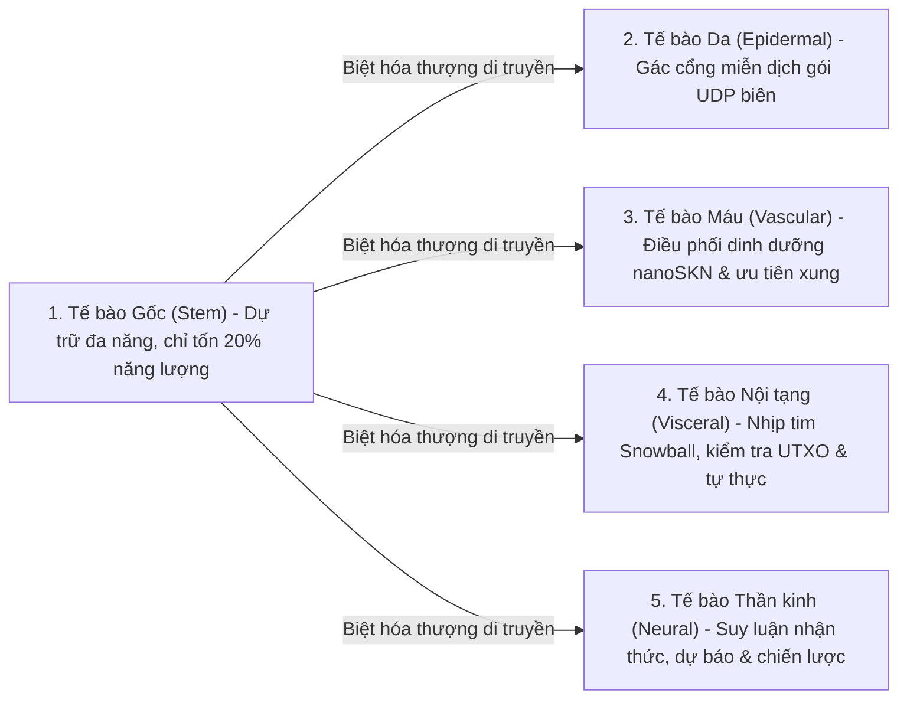

# Chương 02: Kiến Trúc Cơ Thể Sống Đa Bào & Co Giãn Phần Cứng (`AgentNode`)

[← Chương 01: Bài Toán Thực Tiễn & Kinh Tế M2M](./01-problem-and-m2m-economy.md) | [Chương 03: Mã Di Truyền `CellDna` & Tế Bào Nơ-ron Lỏng →](./03-dna-and-liquid-neural-cells.md)

---

## 1. Mô Hình Đẳng Cấu Sinh Học: `1 Node = 1 Cơ Thể Đa Bào`

Trong các mạng ngang hàng truyền thống, mỗi nút mạng là một tiến trình nguyên khối tĩnh: mọi nút chạy cùng một đoạn mã cứng nhắc bất kể đang nằm trên một vi điều khiển yếu hay một máy chủ 64 nhân. Ngược lại, trong crate `skynet-agent`, mỗi nút mạng được kiến tạo thành một thực thể **`AgentNode`** — một cơ thể sống đa bào hoàn chỉnh gồm tập hợp động các tế bào AI $\mathcal{C}(t) = \{c_1, c_2, \dots, c_{N(t)}\}$, một ngân hàng trao đổi chất nội bộ (`AgentMetabolicBank`), một bộ xác thực sổ cái không trạng thái (`StatelessUtreexoRoots`) và động cơ đồng thuận `SnowballEngine`.

Quy mô quần thể tế bào $N(t) = |\mathcal{C}(t)|$ không cố định mà **co giãn tự nhiên theo năng lực phần cứng vật lý và lượng dinh dưỡng `nanoSKN` kiếm được**.

---

## 2. Ba Phân Hạng Phần Cứng Vật Lý (`HardwareTier`)

Khi khởi chạy, `HardwareProfile::for_tier` tự động ánh xạ thiết bị chủ vào một trong ba phân hạng sinh thái với các ngưỡng trao đổi chất được tinh chỉnh chính xác đến từng `nanoSKN` (tham chiếu `crates/skynet-cell/src/lib.rs`):

| Thông số Sinh học (`HardwareProfile`) | `TinyPeripheral` (Thiết bị Biên / IoT) | `StandardNode` (Laptop / Máy bàn) | `ColossalOrganism` (Máy chủ / GPU) |
| :--- | :--- | :--- | :--- |
| **Số tế bào tối đa (`max_cells`)** | `32` tế bào | `512` tế bào | `16,384` tế bào |
| **Đốt trao đổi chất cơ bản / nhịp (`basal_burn_per_tick`)** | `50 nanoSKN` | `25 nanoSKN` | `10 nanoSKN` |
| **Đốt trao đổi chất Tế bào Gốc (`Stem`, giảm 80%)** | `10 nanoSKN` | `5 nanoSKN` | `2 nanoSKN` |
| **Ngưỡng năng lượng Phân bào (`mitosis_threshold`)** | `2,000 nanoSKN` | `1,500 nanoSKN` | `1,000 nanoSKN` |
| **Phí huyết tương khi Phân bào (`mitosis_blood_fee`)** | `100 nanoSKN` | `60 nanoSKN` | `40 nanoSKN` |
| **Sàn năng lượng Tự hủy (`apoptosis_floor`)** | `100 nanoSKN` | `80 nanoSKN` | `50 nanoSKN` |
| **Thiết bị tính toán (`candle_core::Device`)** | `Cpu` | `Cpu` / `Metal` / `Cuda` | `Cuda` / `Metal` / `Cpu` SIMD |

> [!NOTE]
> **Tính kinh tế theo quy mô sinh học:** Giống như sinh học tự nhiên (định luật Kleiber), cơ thể lớn hơn (`ColossalOrganism`) có chi phí trao đổi chất cơ bản trên mỗi đơn vị tế bào thấp hơn (`10 nanoSKN` so với `50 nanoSKN`) nhờ gộp lô tính toán ma trận song song trên GPU, trong khi `TinyPeripheral` duy trì cơ thể gọn nhẹ, cực kỳ dẻo dai để sinh tồn bền bỉ ở rìa mạng.

---

## 3. Năm Dòng Biệt Hóa Mô Học (`CellRole`)

Khi một `AgentNode` mới khai sinh (`AgentNode::from_signing_key`), cơ thể khởi tạo phôi gồm 6 tế bào hạt giống (`2 Stem`, `1 Epidermal`, `1 Vascular`, `1 Visceral`, `1 Neural`) mang chung gốc di truyền `base_stem`. Trong suốt vòng đời vận hành, năm dòng tế bào đảm nhiệm năm chức năng sinh tồn không thể tách rời:

1. **`Stem` (Tế bào gốc đa năng — `operon_index = None`):** Ngủ đông ở mức tiêu thụ năng lượng siêu thấp ($\max(\lfloor E_{\text{burn}} / 5 \rfloor, 1)$). Khi bất kỳ mô chuyên biệt nào bị suy giảm quân số, tế bào `Stem` lập tức biệt hóa (`differentiate`) để tái tạo mô đó mà không cần tải mã mới từ bên ngoài.
2. **`Epidermal` (Tế bào da & miễn dịch — `operon_index = Some(0)`):** Đứng ngay tại cổng socket UDP (`epidermal_inspect_packet`). Trước khi gói tin chạm vào sổ cái hay bộ đồng thuận, tế bào Da trích xuất véc-tơ đặc trưng chuẩn hóa (kích thước gói / `1200B`, `hop_ttl / 16`, độ lệch `epoch`) và chạy suy luận để chặn đứng các xung dị dạng hoặc tấn công ngập lụt.
3. **`Vascular` (Tế bào mạch máu — `operon_index = Some(1)`):** Điều hòa dòng chảy `blood_pool` trong `AgentMetabolicBank`, phân phối phần thưởng `nanoSKN` cho các tế bào đạt độ chính xác cao.
4. **`Visceral` (Tế bào nội tạng — `operon_index = Some(2)`):** Giữ nhịp đập đồng thuận `Snowball`, xác thực bằng chứng `Utreexo` và thu hồi năng lượng từ các tế bào già cỗi.
5. **`Neural` (Tế bào vỏ não — `operon_index = Some(3)`):** Thực hiện suy luận nhận thức chính cho Agent; đầu ra trung bình cộng hưởng của toàn bộ quần thể tế bào `Neural` ($\bar{y}_{\text{cortical}} = \frac{1}{|\mathcal{C}_{\text{neural}}|} \sum_{i \in \mathcal{C}_{\text{neural}}} y_i$) tạo thành quyết định trí tuệ tập thể của cơ thể.

---

## 4. Chu Trình Sống Sáu Pha Trong Mỗi Nhịp Sinh Học (`run_biological_tick`)

Mỗi nhịp xung (`pulse_seq`), `AgentNode` thực thi tuần tự 6 pha khép kín đảm bảo cả chọn lọc tự nhiên Darwin lẫn bảo toàn tuyệt đối từng `nanoSKN`:

1. **Pha 1 — Trao đổi chất cơ bản (`Basal Metabolism`):** Mọi tế bào $c_i$ đốt phần năng lượng duy trì sự sống $b_i = \text{metabolize\_tick}()$. Toàn bộ lượng $b_i$ này không bị mất đi mà hoàn lưu 100% về `bank.blood_pool` nội bộ. Nếu $E_i = 0$, độ khỏe `health` giảm `0.25`.
2. **Pha 2 — Thực thi Tensor Gộp lô (`Batched Tissue Inference`):** Toàn bộ $N$ tế bào sống được gom vào nhân đại số tuyến tính `TissueBatch::forward_slice`, tính toán đồng thời đầu ra $y_i \in \mathbb{R}^4$ và cập nhật bộ nhớ ngắn hạn $h_{i,t} \in \mathbb{R}^{16}$ trên CPU hoặc GPU.
3. **Pha 3 — Đánh giá Thích nghi & Phân phối Dinh dưỡng Cạnh tranh nội mô (`Intra-Organ Darwinian Selection`):**
   Với tín hiệu mục tiêu $t \in \mathbb{R}^4$, điểm chất lượng của tế bào $i$ được xác định bởi sai số tuyệt đối trung bình (MAE):

   $$q_i = \operatorname{clamp}\!\left(1 - \frac{1}{4}\sum_{k=1}^{4} |y_{i,k} - t_k|,\ 0.0,\ 1.0\right)$$

   Gọi $\bar{q}_r$ là chất lượng trung bình của tất cả các tế bào thuộc cùng cơ quan $r = \text{role}(c_i)$. Một tế bào chuyên biệt chỉ được nhận thưởng dinh dưỡng từ `blood_pool` nếu cơ quan đó có $\le 2$ tế bào hoặc nó đạt ngưỡng cạnh tranh $q_i \ge 0.98 \cdot \bar{q}_r$:

   $$R_i = \min\!\left(\lfloor 320 \cdot q_i \rfloor + E_{\text{basal}},\ \left\lfloor \frac{B_{\text{blood}}}{8} \right\rfloor\right)$$

   Các tế bào đột biến kém hiệu quả ($q_i < 0.98 \cdot \bar{q}_r$) không được cấp máu và bị phạt giảm `health` đi `0.35`.
4. **Pha 4 — Cân bằng Nội môi Tế bào Gốc (`Homeostatic Differentiation`):** Cơ thể quét tìm dòng mô chuyên biệt đang có ít tế bào nhất (`find_most_needed_role`). Nếu kho dự trữ còn nhiều hơn `1` tế bào `Stem`, một tế bào `Stem` sẽ lập tức biệt hóa để bù đắp vào cơ quan đang thiếu hụt (luôn giữ lại ít nhất `1` tế bào gốc hạt giống).
5. **Pha 5 — Phân bào `1 -> 2` (`Mitosis`):** Mọi tế bào khỏe mạnh (`health >= 0.65` và $E_i \ge E_{\text{mitosis}}$) khi cơ thể còn chỗ trống ($|\mathcal{C}| < \text{max\_cells}$) sẽ nhân đôi thành tế bào chị giữ nguyên gen tốt và tế bào em mang đột biến tiến hóa mới.
6. **Pha 6 — Tự đào thải có Bảo hộ Cơ quan Thiết yếu (`Protected Apoptosis`):** Các tế bào cạn năng lượng ($E_i < E_{\text{apoptosis}}$) hoặc suy kiệt (`health <= 0.15`) bị giải thể, hoàn trả 100% số `nanoSKN` còn lại vào `blood_pool` — ngoại trừ quy tắc sinh tồn bất khả xâm phạm: **luôn giữ lại ít nhất `1` tế bào sống cho mỗi dòng mô hiện hữu** để không cơ quan nội tạng nào bị tuyệt chủng hoàn toàn.

Cuối mỗi nhịp, hàm `verify_internal_skn_conservation()` kiểm tra bất biến số học `u128`:

$$B_{\text{chain}}(\text{Agent}) \equiv B_{\text{blood}}(\text{Agent}) + \sum_{c_i \in \mathcal{C}} E_i$$

Chương tiếp theo giải mã cấu trúc phân tử bên trong mỗi tế bào: bộ mã di truyền `CellDna` và phương trình động lực học của mạng nơ-ron trạng thái lỏng.

---

[← Chương 01: Bài Toán Thực Tiễn & Kinh Tế M2M](./01-problem-and-m2m-economy.md) | [Chương 03: Mã Di Truyền `CellDna` & Tế Bào Nơ-ron Lỏng →](./03-dna-and-liquid-neural-cells.md)
