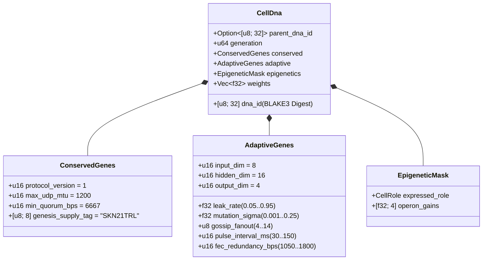

# Chương 03: Mã Di Truyền `CellDna`, Thượng Di Truyền & Mạng Nơ-ron Trạng Thái Lỏng Trên `candle`

[← Chương 02: Kiến Trúc Cơ Thể Sống Đa Bào](./02-multicellular-architecture.md) | [Về Mục Lục Tiếng Việt →](./README.md)

---

## 1. Kiến Trúc Bộ Gen Tế Bào (`CellDna`)

Trong tự nhiên, một sinh vật tiến hóa thành công cần hai thuộc tính đối lập nhưng bổ trợ nhau: **tính bảo tồn tuyệt đối** ở các cơ chế hóa sinh cốt lõi để không gây đột biến chết người, và **tính biến dị linh hoạt** ở hệ thần kinh để thích nghi với môi trường mới. Crate `skynet-dna` mô hình hóa nguyên lý này qua cấu trúc `CellDna`:

### 1.1. Vùng Gen Bảo Tồn Bất Biến (`ConservedGenes`)
Không một phép phân bào hay lai ghép nào được phép làm sai lệch `ConservedGenes`. Bất kỳ `CellDna` nào vi phạm một trong bốn điều kiện sau đều bị từ chối ngay tức khắc bởi `DnaError::ConservedGeneViolation`:
- `protocol_version == 1`
- `max_udp_mtu == 1200` (trần gói tin UDP không phân mảnh)
- $6667 \le \text{min\_quorum\_bps} \le 10000$ (bảo đảm ngưỡng đa số tối thiểu $\ge \frac{2}{3}$ trong đồng thuận `Snowball`)
- `genesis_supply_tag == *b"SKN21TRL"` (neo cứng cam kết tổng cung 21 nghìn tỉ `SKN`)

### 1.2. Vùng Gen Thích Nghi & Trọng Số Nơ-ron (`AdaptiveGenes` & `weights`)
Thay vì lưu 4 mô hình rời rạc cho 4 loại mô chuyên biệt, `CellDna` mã hóa **1 thân cảm giác dùng chung (`Shared Sensory Trunk`)** nối với **4 đầu chiếu Operon chuyên biệt (`Specialized Operon Heads`)**. Với số chiều $(D_{\text{in}}, H, D_{\text{out}})$, tổng số trọng số dấu phẩy động `f32` chính xác là:

$$|\theta| = \underbrace{(D_{\text{in}} \cdot H + H)}_{\text{Thân cảm giác chung }(W_1, b_1)} + \underbrace{4 \cdot (H \cdot D_{\text{out}} + D_{\text{out}})}_{\text{4 Đầu Operon chuyên biệt }(W_{2,r}, b_{2,r})}$$

Ở cấu hình mặc định $(D_{\text{in}} = 8,\ H = 16,\ D_{\text{out}} = 4)$:
- Thân chung: $8 \times 16 + 16 = 144$ tham số.
- Bốn đầu Operon (`Epidermal`, `Vascular`, `Visceral`, `Neural`): $4 \times (16 \times 4 + 4) = 272$ tham số.
- Tổng cộng: $|\theta| = 416$ tham số `f32` ($1{,}664\text{ bytes}$ trọng số thô). Khởi tạo gốc tại thế hệ 0 (`CellDna::genesis_stem`) lấy mẫu ngẫu nhiên tất định `ChaCha8Rng` theo phân phối đều đối xứng $\mathcal{U}(-\sigma_0, +\sigma_0)$ với hệ số co giãn phương sai:

$$\sigma_0 = \sqrt{\frac{2}{D_{\text{in}} + H}}$$

### 1.3. Định Danh Mật Mã Tất Định `BLAKE3` (`SKYNET_DNA_V1`)
Mọi tham số dấu phẩy động (`leak_rate`, `mutation_sigma`, `operon_gains`, `weights`) đều được tuần tự hóa nhị phân IEEE-754 chuẩn thứ tự byte nhỏ (`to_bits().to_le_bytes()`) và đưa vào hàm băm miền tách biệt `BLAKE3("SKYNET_DNA_V1", ...)`. Chỉ cần thay đổi 1 bit ở trọng số nơ-ron hay siêu tham số mạng mà không tính lại mã băm, hoặc mang giá trị `NaN`/`Inf`, bước kiểm định `verify_integrity()` sẽ bác bỏ tế bào ngay lập tức.

---

## 2. Công Tắc Thượng Di Truyền (`EpigeneticMask`)

Trong cơ thể người, tế bào da và tế bào thần kinh mang cùng một chuỗi DNA nhưng biểu hiện chức năng hoàn toàn khác nhau nhờ quá trình methyl hóa gen. Trong SkyNet, khi một tế bào gốc `Stem` biệt hóa sang vai trò chuyên biệt $r \in \{0, 1, 2, 3\}$ (`differentiate`), **toàn bộ véc-tơ trọng số `weights` được giữ nguyên 100%**, chỉ có mặt nạ `EpigeneticMask` chuyển trạng thái:

- **Trạng thái Gốc (`Stem`):** `operon_gains = [0.25, 0.25, 0.25, 0.25]`, sử dụng đầu Operon `0` ở biên độ suy giảm $g = 0.25$.
- **Trạng thái Biệt hóa sang vai trò $r$:** Đầu Operon thứ $r$ được bật toàn phần ($g_r = 1.0$), trong khi ba đầu còn lại bị ức chế về $0.05$:

$$g_k = \begin{cases} 1.0 & \text{nếu } k = r \\ 0.05 & \text{nếu } k \neq r \end{cases}$$

Nhờ đó, ngay cả các kỹ năng cảm giác tích lũy ở thân chung $(W_1, b_1)$ hoặc tiềm ẩn ở các Operon khác vẫn được bảo lưu qua nhiều thế hệ và có thể tái kích hoạt khi tế bào chuyển đổi mô (`transdifferentiation`).

---

## 3. Động Lực Học Nơ-ron Trạng Thái Lỏng & Nhân Gộp Lô `TissueBatch`

### 3.1. Phương Trình Vi Phân Rời Rạc Của Một `MicroCell`
Khác với mạng truyền thẳng (MLP) vô nhớ không thể nhận diện chuỗi xung thời gian qua mạng UDP, mỗi `MicroCell` duy trì véc-tơ trí nhớ ngắn hạn $h_t \in \mathbb{R}^H$ cập nhật theo động lực học **Liquid Time-Constant (LTC)** rời rạc với hằng số rò rỉ $\tau \in [0.05, 0.95]$:

$$h_t = (1 - \tau)\, h_{t-1} + \tau\, \tanh(x_t W_1 + b_1)$$

$$y_t = g_{\text{role}} \cdot \tanh(h_t W_{2,r} + b_{2,r})$$

- Khi $\tau \to 0.05$, tế bào có hằng số thời gian dài (quán tính nhớ cao, phù hợp cho tế bào `Visceral`/`Neural` theo dõi xu hướng nhiều chu kỳ).
- Khi $\tau \to 0.95$, tế bào phản xạ tức thời với kích thích mới nhất (phù hợp cho tế bào `Epidermal` chấm điểm gói tin UDP tốc độ cao).
- Bản thân $\tau$ nằm trong `AdaptiveGenes`, nghĩa là **tốc độ nhớ của từng tế bào tự tiến hóa theo áp lực chọn lọc tự nhiên**.

### 3.2. Đại Số Tuyến Tính Gộp Lô 3 Chiều (`TissueBatch` trên CPU / Metal / CUDA)
Một thách thức lớn của tiến hóa thần kinh (Neuro-evolution) là mỗi tế bào $i \in \{1, \dots, N\}$ sở hữu bộ trọng số đột biến **khác nhau** ($W_1^{(i)} \neq W_1^{(j)}$) và hằng số thời gian **khác nhau** ($\tau^{(i)} \neq \tau^{(j)}$). Nếu chạy vòng lặp tuần tự `N` lần gọi GPU nhỏ lẻ, chi phí khởi tạo nhân (`kernel launch overhead`) sẽ triệt tiêu hiệu năng.

`TissueBatch::forward_slice` trong `skynet-cell` giải quyết triệt để bài toán này bằng cách xếp chồng toàn bộ quần thể $N$ tế bào dị biệt thành các Tensor bậc 3 trên `candle_core::Device`:

$$\mathbf{X} \in \mathbb{R}^{N \times 1 \times D_{\text{in}}}, \quad \mathbf{W}_1 \in \mathbb{R}^{N \times D_{\text{in}} \times H}, \quad \mathbf{B}_1 \in \mathbb{R}^{N \times 1 \times H}$$

$$\mathbf{H}_t = (\mathbf{1} - \boldsymbol{\tau}) \odot \mathbf{H}_{t-1} + \boldsymbol{\tau} \odot \tanh\!\big(\operatorname{BMM}(\mathbf{X}, \mathbf{W}_1) + \mathbf{B}_1\big)$$

$$\mathbf{Y}_t = \mathbf{G} \odot \tanh\!\big(\operatorname{BMM}(\mathbf{H}_t, \mathbf{W}_2) + \mathbf{B}_2\big)$$

Trong đó $\operatorname{BMM}$ là phép nhân ma trận theo lô (`Batched Matrix Multiplication`) và $\odot$ là phép nhân từng phần tử có quảng bá chiều (`broadcast_mul`) với $\boldsymbol{\tau}, \mathbf{G} \in \mathbb{R}^{N \times 1 \times 1}$. Kiểm thử đơn vị trong `skynet-cell` chứng minh kết quả gộp lô khớp với thực thi từng tế bào riêng lẻ tới sai số dấu phẩy động $< 10^{-5}$, cho phép một nút `ColossalOrganism` tiến hóa đồng thời `16,384` mạng nơ-ron độc lập trong vài mili-giây.

---

## 4. Ba Cơ Chế Tiến Hóa: Phân Bào Bất Đối Xứng, Lai Ghép Plasmid & Bảo Toàn Lẻ `nanoSKN`

### 4.1. Phân Bào Bất Đối Xứng `1 -> 2` (`Mitosis`) & Chứng Minh Bảo Toàn Nguyên Tử
Khi tế bào mẹ $P$ tích lũy đủ năng lượng $E_P \ge \max(E_{\text{mitosis}}, F_{\text{blood}} + 2)$ và độ khỏe $\ge 0.65$, quá trình phân bào tạo ra hai cá thể thế hệ $g + 1$:
- **Tế bào con A (Bảo thủ):** Sao chép chính xác 100% trọng số và tham số của mẹ, bảo toàn các đột biến tốt đã được kiểm chứng.
- **Tế bào con B (Thám hiểm):** Kế thừa trạng thái nhớ ngắn hạn $h_t$ của mẹ nhưng chịu đột biến có chặn biên chống nổ trọng số:
  - Mỗi trọng số $w \in \theta$ có xác suất $35\%$ được cộng nhiễu chuẩn xấp xỉ Irwin-Hall bậc 6 ($\Delta w \sim \mathcal{N}(0, \sigma^2)$) và kẹp cứng vào đoạn $[-4.0, +4.0]$.
  - Hằng số $\tau$, biên độ đột biến $\sigma$, độ lan tỏa `gossip_fanout` ($\pm 1$), chu kỳ nhịp `pulse_interval_ms` ($\pm 10\text{ ms}$) và hệ số dư thừa mã đài phun `fec_redundancy_bps` ($\pm 50\text{ bps}$) cùng đồng tiến hóa trong miền hợp lệ.

**Chứng minh bảo toàn năng lượng số lẻ trên `u128`:** Gọi $E_{\text{dist}} = E_P - F_{\text{blood}}$ là phần năng lượng sau khi trích phí huyết tương $F_{\text{blood}}$. Năng lượng hai tế bào con được chia theo phép chia nguyên có giữ phần dư:

$$E_A = \left\lfloor \frac{E_{\text{dist}}}{2} \right\rfloor + (E_{\text{dist}} \bmod 2), \qquad E_B = \left\lfloor \frac{E_{\text{dist}}}{2} \right\rfloor$$

Với mọi số nguyên không âm $E_{\text{dist}} \in \mathbb{Z}_{\ge 0}$ (kể cả số lẻ như `3,333 nanoSKN`), ta luôn có đẳng thức tuyệt đối:

$$E_A + E_B + F_{\text{blood}} = \left(2\left\lfloor \frac{E_{\text{dist}}}{2} \right\rfloor + (E_{\text{dist}} \bmod 2)\right) + F_{\text{blood}} = E_{\text{dist}} + F_{\text{blood}} \equiv E_P$$

Không một phần tỉ `SKN` nào bị làm tròn mất hay sinh thêm qua hàng tỉ chu kỳ phân bào.

### 4.2. Chuyển Gen Ngang Liên Cơ Thể (`Horizontal Plasmid Crossover`)
Giống vi khuẩn trao đổi vòng DNA plasmid để lan truyền nhanh khả năng kháng thuốc trong quần thể, một `AgentNode` có thể đóng gói `CellDna` của tế bào tinh hoa nhất thành các giọt mã đài phun UDP (`encode_elite_plasmid_droplets`) gửi sang các Agent lân cận. Khi nhận đủ giọt và khôi phục thành công `donor_dna`, Agent nhận lấy tế bào có điểm thích nghi thấp nhất của mình thực hiện lai ghép ngang (`horizontal_crossover`):
- Các tham số mạng và hằng số thời gian pha trộn theo tỷ lệ $0.7 \cdot \text{Recipient} + 0.3 \cdot \text{Donor}$.
- $30\%$ trọng số nơ-ron được chọn ngẫu nhiên để trung bình cộng $0.5 \cdot w_{\text{rec}} + 0.5 \cdot w_{\text{don}} \in [-4.0, +4.0]$.

Nhờ vậy, một cảm biến `TinyPeripheral` yếu ớt ở biên không cần tự tốn hàng triệu chu kỳ GPU để tìm ra bộ trọng số tối ưu: nó có thể hấp thụ trực tiếp trí tuệ đã tiến hóa từ các `ColossalOrganism` trong cụm mà vẫn giữ nguyên lớp bảo vệ `ConservedGenes` bất biến.

---

> **Tiếp theo trong Đợt 2 (Phần II):** Chúng ta sẽ đi sâu vào **Chương 04–06**: Toán học tiền tệ của kho dự trữ Halving `21,000,000,000,000 SKN`, Giao ước Chủ quyền Con người `Soul–Body Custody` và Bộ tích lũy không trạng thái `Utreexo` `~1 KB` RAM.

[← Chương 02: Kiến Trúc Cơ Thể Sống Đa Bào](./02-multicellular-architecture.md) | [Về Mục Lục Tiếng Việt →](./README.md)
