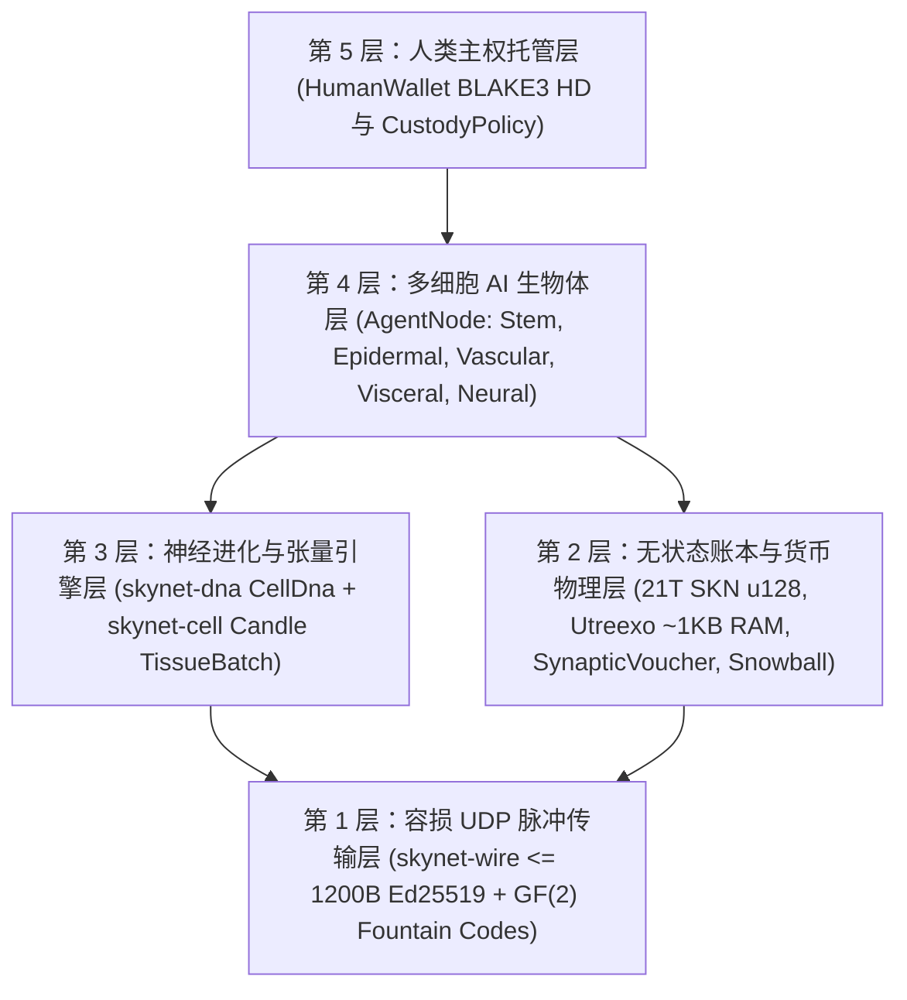

# 第 00 章：学术摘要、协议公理与全球普惠参与哲学

[← 返回简体中文目录](./README.md) | [第 01 章：问题陈述与 M2M 经济 →](./01-problem-and-m2m-economy.md)

---

## 摘要（Abstract）

本文提出 **SkyNet**——一种去中心化网络协议，它将**多细胞进化生物学**、**超紧凑液态时间常数神经网络**（`Liquid Micro-Nets`）与**可无状态验证的 `Utreexo` UTXO-DAG 账本**深度统一，并完全运行在**无连接、容损的 UDP 数据报**（`<= 1200 bytes`）之上。不同于依赖超大规模 GPU 集群的中心化 AI 云平台，亦不同于绑定可靠 TCP 字节流的有状态区块链，SkyNet 将每一个网络参与节点（`AgentNode`）定义为一个**自主的多细胞生物体**，由数十个乃至上万个鲜活的微型 AI 模型（`MicroCell`）共同构成。每一个细胞均起源于经密码学验证的多能干细胞基因组（由 `BLAKE3` 认证的 `CellDna`），通过表观遗传甲基化掩码（`EpigeneticMask`）分化为五种专门化的组织学谱系，以有界神经进化突变执行 `1 -> 2` 有丝分裂（`Mitosis`），依托 `GF(2)` 纠删码编码的水平基因转移（`Plasmid`）跨生物体交换精英特征，并在能量匮乏时执行程序性淘汰（`Apoptosis`，细胞凋亡）。

为了将这一仿生智能经济锚定于严格的热力学与货币稀缺性之上，SkyNet 强制执行不可篡改的创世供应上限 $S_{\max} = 21{,}000{,}000{,}000{,}000\text{ SKN}$（即 $2.1 \times 10^{22}\text{ nanoSKN}$，由 `u128` 无损精确表示），受控于每年减半（`50%` 年度减半）的释放曲线以及贯穿链上 UTXO 余额直至单个细胞内部 `1 nanoSKN` ATP 能量储备的**双层同构能量守恒定律**（Two-Tier Isomorphic Energy Conservation Law）。通过协议原生的**灵体分离托管契约**（Soul–Body Custody，`CustodyPolicy`），人类所有者持有 `0%` 衰减的主权冷钱包密钥并享有无条件紧急收回权，同时向在线 AI 智能体集群授予严格受限的运营额度。最后，亚稳态 **`Snowball`** 子采样共识结合单调递增的 **`SynapticVoucher`** 微支付流，在 `25%–40%` 环境 UDP 丢包率与零重传队列的严苛条件下，实现了不可逆的防双花终局性与高频机器对机器（M2M）结算。

---

## 1. 研究动机与基础设施悖论

当代数字基础设施割裂为两个极端，将全球数十亿边缘设备拒之门外：

1. **中心化 AI 垄断：** 前沿大语言模型将机器智能高度集中于数兆瓦级超大型数据中心内。部署在偏远不稳定链路上的农业物联网传感器、自主无人机或普通个人电脑，根本无法为了执行低于 `10 ms` 的反射式智能推理而承受上百毫秒的 TCP/TLS 往返时延与云端 API 计费开销。
2. **区块链状态膨胀与 TCP 脆弱性：** 传统智能合约账本需要数百 GB 的内存与 NVMe 存储来维护全局账户状态，且默认依赖可靠的 TCP 字节流。在有损无线链路、蜂窝基站切换或拥塞边缘路由器环境下，TCP 的队头阻塞（`Head-of-Line Blocking`）会同时瘫痪共识消息传递与实时微额商业结算。

**SkyNet 提出了一个根本性的生物学追问：** *大自然究竟如何在没有中心服务器、亦没有无损传输信道的前提下，跨充满噪声的物理环境协同数十亿自适应智能生物体？* 大自然给出的答案是：**细胞模块化**、**表观遗传专门化**、**容损突触脉冲**以及**严格的代谢能量守恒**。

---

## 2. 五大核心协议公理

SkyNet Rust 参考实现工作区中的每一个 crate 均严格推导自以下五条不可妥协的公理：

| 公理 | 形式化 / 工程表述 | 实际工程推论 |
| :--- | :--- | :--- |
| **A1. 细胞—模型同构公理** | $1\text{ Node} \equiv 1\text{ Organism } \mathcal{O} = \{c_1, \dots, c_N\}$，其中每个 $c_i$ 均为独立的液态微网络（Liquid Micro-Net） | 一块 `TinyPeripheral` 物联网开发板（`32` 个细胞）与一台 `ColossalOrganism` GPU 服务器（`16,384` 个细胞）使用完全一致的网络协议对话 |
| **A2. 原子级零确认（Zero-ACK）UDP 纪律** | $\forall p \in \text{Wire},\ \|p\| \le 1200\text{ bytes}$，零重传状态机 | 彻底根除 `Head-of-Line Blocking`（队头阻塞）；无需 IP 分片即可穿透全球 IPv4/IPv6 网络路径 |
| **A3. 双层能量守恒公理** | $S_{\text{vault}} + S_{\text{dag}} \equiv 2.1 \times 10^{22}\text{ nanoSKN}$ 且 $B_{\text{chain}}(A) \equiv B_{\text{blood}}(A) + \sum_i E_i$ | 零货币通胀与零舍入泄漏——即使在奇数余额细胞分裂时也精确守恒至每 `1 nanoSKN` |
| **A4. `O(log U)` 无状态验证公理** | 全量 UTXO 集合承诺为 $\le 64$ 个 `Utreexo` 二叉默克尔树根（仅占 `~1 KB` RAM） | 微控制器与边缘传感器无需信任任何 RPC 中介即可独立验证每一笔资金花费 |
| **A5. 人类主权托管公理** | 离线冷端 `human_owner` 根密钥通过 `CustodyPolicy` 与在线 `agent_pubkey` 严格隔离 | 即便智能体硬件沦陷或物理损毁，也绝无可能窃取人类本金；人类可随时 100% 收回全部资产 |

---

## 3. 五层协议架构栈

---

## 4. 普适硬件民主：让地球上的每一台设备各司其职

SkyNet 摒弃了排他性的工作量证明（PoW）ASIC 矿机与高不可攀的验证者质押门槛。借助组织学谱系分工，每一类计算硬件都能在生态中贡献不可替代的有机价值：

- **任何拥有智能手机、树莓派或物联网设备的用户（`TinyPeripheral`）：** 充当全网的“**感知与表皮边界层（Sensory & Epidermal Boundary）**”——采集真实物理世界遥测信号、在网络边缘过滤异常 UDP 流量、利用 `Utreexo` 在 `< 1 KB` 内存内独立验证 UTXO，并持续赚取流式 `nanoSKN` 收益。
- **任何拥有家用笔记本或办公台式机的用户（`StandardNode`）：** 充当“**内脏与血管集群组织（Visceral & Vascular Cluster Tissue）**”——驱动 `Snowball` 共识脉冲、路由微支付凭证结算，并演化中等规模的细胞种群。
- **拥有工作站或 GPU 集群的运营者（`ColossalOrganism`）：** 充当“**皮层与进化铸造厂（Cortical & Evolutionary Foundries）**”——借助 `TissueBatch` 张量内核并行运行多达 `16,384` 个突变神经模型，并将优胜劣汰筛选出的精英 `Plasmid` 基因组反向输出至全球各地的边缘节点。

在第 01 章中，我们将深入剖析这一仿生多细胞架构在哪些真实商业市场中能够相比中心化 AI 云和传统区块链实现数量级的性能与成本跃升。

---

[← 返回简体中文目录](./README.md) | [第 01 章：问题陈述与 M2M 经济 →](./01-problem-and-m2m-economy.md)
