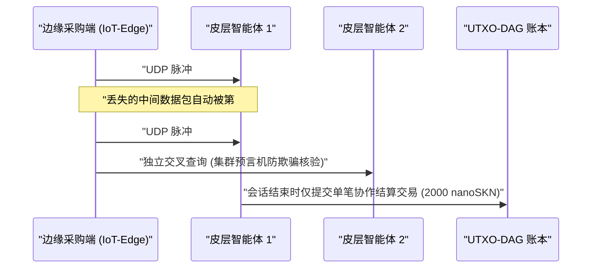

# 第 01 章：问题陈述与实用型机器对机器（`M2M`）经济

[← 第 00 章：摘要与愿景](./00-abstract-and-vision.md) | [第 02 章：多细胞生物体架构 →](./02-multicellular-architecture.md)

---

## 1. 超越中心化聊天机器人：物理边缘的反射式智能

SkyNet 的目标并非取代用于撰写长篇文档的中心化千亿级参数大语言模型。相反，SkyNet 直击一个**数万亿美元规模的结构性盲区**：互联网的物理边缘。在这里，数十亿自主机器、工业传感器、网络网关与软件智能体亟需在不稳定的无线链路上，同时实现**低于 `10 ms` 的反射式推理、持续的本地在线自适应，以及亚美分乃至纳美分级机器对机器（`M2M`）价值结算**。

### 为何中心化云平台与传统区块链在此折戟

设想一个自主边缘智能体 $A$（例如集群无人机、DDoS 清洗网关或智能电网继电器），每隔 $\Delta t = 10\text{ ms}$ 采购一次实时异常分类与遥测交叉核验服务，每次脉冲调用的价值为 $v = 50\text{ nanoSKN}$：

1. **时延与 TCP 重传高墙：** 向远端云数据中心建立 TLS/TCP 会话需要多次往返握手（multi-RTT）。在环境无线丢包率 $p_{\text{loss}} = 20\%$ 的条件下，TCP 拥塞窗口退避与重传超时会将 `p99` 尾部时延推高至数百毫秒——这对于实时信息物理控制回路（cyber-physical control loops）而言是灾难性的。
2. **基础手续费下限壁垒：** 在传统法币支付清算网络或 EVM 智能合约公链上，单笔交易的固定基础开销 $F_{\text{tx}}$ 超出单次脉冲价值达 $10^5\times$ 至 $10^8\times$（$F_{\text{tx}} \gg v$），导致毫秒级粒度的 M2M 商业在经济学上彻底不可行。
3. **静态模型概念漂移（Concept Drift）：** 由云端下发部署的预训练静态权重，在面对剧烈变化的本地信号分布（`concept drift`）时会迅速退化失效；而算力与功耗受限的边缘设备又根本没有足够的内存与电量预算去运行反向传播梯度训练。

---

## 2. 驱动 `SKN` 内生需求的四大真实经济支柱

`SKN` 的内生需求源自中心化云平台与有状态区块链无法企及的四项硬核工程能力：

### 2.1. 超低时延集群边缘微推理（`< 10 ms`）
机器人集群、工业物联网控制器、电信中继设备与网络安全硬件可将 8 维归一化特征向量（`stimulus: [f32; 8]`）连同一张经数字签名的 `SynapticVoucher` 封装进**单个 `<= 1200-byte` 的 UDP 数据报**内发送：
- 邻近节点的 `Epidermal`（表皮）与 `Neural`（神经）细胞在单次脉冲不足 `0.1 ms` 的时间内即可完成循环液态微网络（Liquid Micro-Net）前向传播。
- 由于 `SynapticVoucher` 编码的是单调递增的累计金额，即便蜂窝移动网或卫星链路出现 `25%` 的随机 UDP 丢包，也**不会产生任何计费停滞与重传阻塞**。

### 2.2. 进化即服务（Evolution-as-a-Service）与去中心化 `Plasmid` 基因市场
任何用户或自主智能体无需租用昂贵的云端 GPU 集群来训练紧凑型嵌入式模型，只需向网络广播一份优化悬赏任务，指定输入刺激流 $x_t$、目标响应 $y_t^*$ 以及 `SKN` 奖励额度：
- 成千上万个 `AgentNode` 生物体随即触发 `1 -> 2` 细胞有丝分裂（`Mitosis`），并行评估数以万计的权重扰动与液态时间常数 $\tau$ 组合。
- 表现低劣的突变体经由 `Apoptosis`（细胞凋亡）被自动淘汰，而表现最优的细胞谱系则收敛为紧凑的 `CellDna` 基因组（体积不足 `2 KB`，并由 `BLAKE3` 密码学摘要封存）。
- 悬赏发起方不仅能获得实时推理结果，还能直接收到**独立演化的 `CellDna` 权重成品**（通过 `GF(2)` `FountainDroplet` 喷泉码数据包无损交付），可直接刷写部署至数百万颗微控制器芯片中。

### 2.3. 原子级 `M2M nanoSKN` 支付轨道与防幻觉集群预言机（Swarm Oracles）
以精细至 `1 nanoSKN`（$10^{-9}\text{ SKN}$）的计价颗粒度，AI 智能体可自主采购并交叉核验真实物理世界信号（微气象遥测、射频频谱占用率、路由时延探测、高频订单流）：

在本地集群内对多个相互独立的 `AgentNode` 生物体执行交叉采样，可从根本上消除单一模型幻觉与恶意传感器伪造。

### 2.4. 普惠多层级 DePIN（硬件共生生态）
SkyNet 将全球异构闲置硬件连接为一条共生演化的生物供应链：

| 参与者群体 | 日常计算硬件 | 生态角色分工 | `SKN` 收入来源 |
| :--- | :--- | :--- | :--- |
| **个人与普通家庭** | 旧智能手机、家用路由器、树莓派、IoT 开发板 | 边缘感知采集、`Epidermal` 数据包免疫过滤、`~1 KB` `Utreexo` 轻节点验证 | 通过实时传感数据流与边界流量过滤赚取 `nanoSKN` |
| **开发者与桌面用户** | 笔记本电脑、办公 PC（`StandardNode`） | `Snowball` 共识采样、微支付凭证路由、中等规模组织进化 | 赚取集群交易手续费分润（`cluster_nutrient_pool`）与推理报酬 |
| **实验室与 GPU 运营方** | 多核服务器、Apple `Metal`、NVIDIA `CUDA` GPU | 单节点最高 `16,384` 个细胞的 `TissueBatch` 大规模并行进化 | 赚取模型进化悬赏奖金与 `Plasmid` 水平基因输出版税 |

---

## 3. 亚线性链上结算压缩证明

假设两个 AI 智能体在丢包率为 $p \in [0, 1)$ 的无线信道上交互 $M$ 次高频推理脉冲，每次调用单价为 $\delta\text{ nanoSKN}$。传统链上逐笔结算需要 $\mathcal{O}(M)$ 笔账本交易，同时 TCP 重传开销按 $\frac{1}{1 - p}$ 放大。

在 SkyNet 中，支付方按序列号 $s \in \{1, \dots, M\}$ 签发经 `Ed25519` 签名的微支付凭证，携带单调累计金额 $V_s = s \cdot \delta$。任意成功抵达的第 $s_k$ 号数据包无需重传，即可在密码学上完备证明跨越此前所有丢失数据包的增量净额 $\Delta V = V_{s_k} - V_{s_{k-1}}$。当会话结束时，全部 $M$ 次微推理调用仅需**唯一 $1$ 笔 UTXO-DAG 交易**即可完成链上终局清算，实现 $M : 1$ 的链上结算压缩比（在实际生产负载下可将账本压力降低 $1{,}000\times$ 至 $100{,}000\times$）。

第 02 章将深入剖析每个 `AgentNode` 的内部解剖学结构——展示同一套软件二进制程序如何在任意硬件层级上自组织演化为一个鲜活的多细胞生物体。

---

[← 第 00 章：摘要与愿景](./00-abstract-and-vision.md) | [第 02 章：多细胞生物体架构 →](./02-multicellular-architecture.md)
