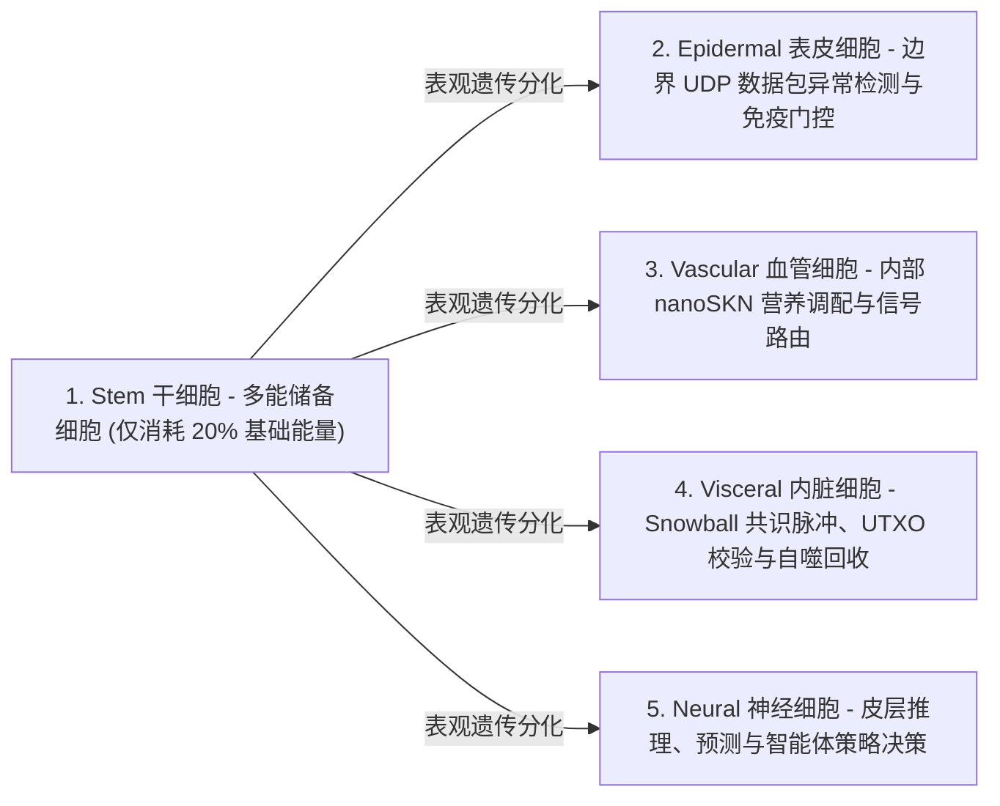

# 第 02 章：多细胞生物体架构与弹性硬件扩缩容（`AgentNode`）

[← 第 01 章：问题陈述与 M2M 经济](./01-problem-and-m2m-economy.md) | [第 03 章：`CellDna` 与液态神经细胞 →](./03-dna-and-liquid-neural-cells.md)

---

## 1. 生物学同构原理：`1 Node = 1 Multicellular Organism`

在传统点对点（P2P）网络中，无论节点运行在嵌入式微控制器还是 64 核 GPU 服务器上，每个节点执行的都是单体式、僵化的状态机。而在 SkyNet（`crates/skynet-agent`）中，每一个网络参与者均被实例化为一个 **`AgentNode`**——一个由动态微型 AI 细胞种群 $\mathcal{C}(t) = \{c_1, c_2, \dots, c_{N(t)}\}$、内部代谢金库（`AgentMetabolicBank`）、无状态 `Utreexo` 树根验证器（`StatelessUtreexoRoots`）以及容损 `SnowballEngine` 共同构成的鲜活多细胞生物体。

细胞种群规模 $N(t) = |\mathcal{C}(t)|$ 绝非硬编码常量；它会**依据宿主机硬件承载能力与所赚取的 `nanoSKN` 营养流入量，通过有丝分裂（`Mitosis`）有机扩张，并通过细胞凋亡（`Apoptosis`）动态收缩**。

---

## 2. 三档弹性硬件层级（`HardwareTier`）

节点启动时，`HardwareProfile::for_tier` 会将宿主设备算力映射为三种生态配置档案之一，并赋予精确的 `nanoSKN` 代谢阈值（详见 `crates/skynet-cell/src/lib.rs`）：

| 生物代谢参数（`HardwareProfile`） | `TinyPeripheral`（IoT / 边缘 MCU） | `StandardNode`（笔记本 / 台式 PC） | `ColossalOrganism`（服务器 / GPU） |
| :--- | :--- | :--- | :--- |
| **最大细胞种群上限（`max_cells`）** | `32` 个细胞 | `512` 个细胞 | `16,384` 个细胞 |
| **活跃细胞每周期基础代谢消耗（`basal_burn_per_tick`）** | `50 nanoSKN` | `25 nanoSKN` | `10 nanoSKN` |
| **休眠 `Stem` 细胞每周期消耗（节省 80% 能耗）** | `10 nanoSKN` | `5 nanoSKN` | `2 nanoSKN` |
| **有丝分裂触发阈值（`mitosis_threshold`）** | `2,000 nanoSKN` | `1,500 nanoSKN` | `1,000 nanoSKN` |
| **有丝分裂血液手续费（`mitosis_blood_fee`）** | `100 nanoSKN` | `60 nanoSKN` | `40 nanoSKN` |
| **细胞凋亡淘汰下限（`apoptosis_floor`）** | `100 nanoSKN` | `80 nanoSKN` | `50 nanoSKN` |
| **计算后端（`candle_core::Device`）** | `Cpu` | `Cpu` / `Metal` / `Cuda` | `Cuda` / `Metal` / `Cpu` SIMD |

> [!NOTE]
> **生物学规模经济效应（克莱伯定律 Kleiber's Law）：** 正如自然界中体型更大的多细胞生物每克组织的基础代谢率更低一样，`ColossalOrganism` 节点享有更低的单细胞基础代谢消耗（`10 nanoSKN` 对比 `50 nanoSKN`），因为成千上万个细胞可在单个批处理 GPU 张量内核中分摊算子调度开销；而 `TinyPeripheral` 节点则在网络物理边缘保持极度精简与高韧性。

---

## 3. 五大专门化组织学谱系（`CellRole`）

当一个 `AgentNode` 诞生时（`AgentNode::from_signing_key`），它会基于确定性的 `base_stem` 创世基因组初始化一个包含 6 个细胞的胚胎种子群落（`2 Stem`、`1 Epidermal`、`1 Vascular`、`1 Visceral`、`1 Neural`）。在整个生物体的生命周期中，五大组织学谱系分别承担五项不可或缺的生理机能：

1. **`Stem`（多能储备干细胞 — `operon_index = None`）：** 处于休眠态的再生储备细胞，每个生理周期仅消耗 $\max(\lfloor E_{\text{burn}} / 5 \rfloor, 1)$ 的维持能量。每当任意专门化器官出现细胞损耗，一枚 `Stem` 细胞便会通过表观遗传分化（`differentiate`）补充该器官，全程无需下载任何外部代码。
2. **`Epidermal`（表皮与免疫门控细胞 — `operon_index = Some(0)`）：** 驻守原始 UDP 套接字边界（`epidermal_inspect_packet`）。在任何外部数据包进入账本或共识引擎之前，`Epidermal` 细胞都会在 `candle` 上评估归一化数据包遥测特征（`raw_len / 1200`、`hop_ttl / 16`、`epoch` 漂移量），即时丢弃畸形包或泛洪攻击脉冲。
3. **`Vascular`（循环调控血管细胞 — `operon_index = Some(1)`）：** 调控 `AgentMetabolicBank` 内部的血液池（`blood_pool`）流动性，将 `nanoSKN` 营养奖励精准输送给高预测精度的细胞。
4. **`Visceral`（内脏稳态维护细胞 — `operon_index = Some(2)`）：** 驱动 `Snowball` 共识轮询节律、无状态 `Utreexo` 见证验证以及代谢能量循环回收。
5. **`Neural`（皮层脑神经细胞 — `operon_index = Some(3)`）：** 执行核心认知推理；全体存活 `Neural` 细胞的集成均值（$\bar{y}_{\text{cortical}} = \frac{1}{|\mathcal{C}_{\text{neural}}|} \sum_{i \in \mathcal{C}_{\text{neural}}} y_i$）共同构成该生物体的群体智能决策输出。

---

## 4. 六阶段生物脉冲生命周期（`run_biological_tick`）

在每一次生理脉冲（`pulse_seq`）中，`AgentNode` 都会执行一套确定性的六阶段生理循环，将达尔文优胜劣汰竞争与精确的 `u128` `nanoSKN` 能量守恒融为一体：

1. **阶段 1 — 基础新陈代谢（Basal Metabolism）：** 每个细胞 $c_i$ 燃烧维持能量 $b_i = \text{metabolize\_tick}()$。至关重要的是，$b_i$ 绝不会在链上凭空销毁；100% 燃烧的细胞内 ATP 能量均被全额回收到生物体自身的 `bank.blood_pool`（血液池）中。处于饥饿状态的细胞（$E_i = 0$）将扣除 `0.25` 点生命值（`health`）。
2. **阶段 2 — 批处理 `candle` 张量推理：** 全部 $N$ 个存活细胞通过 `TissueBatch::forward_slice` 同步执行前向计算，生成输出向量 $y_i \in \mathbb{R}^4$ 并更新短期液态记忆隐状态向量 $h_{i,t} \in \mathbb{R}^{16}$。
3. **阶段 3 — 器官内达尔文营养选择（Intra-Organ Darwinian Nutrient Selection）：**
   给定目标信号 $t \in \mathbb{R}^4$，细胞 $i$ 的预测质量通过有界平均绝对误差（MAE）度量：

   $$q_i = \operatorname{clamp}\!\left(1 - \frac{1}{4}\sum_{k=1}^{4} |y_{i,k} - t_k|,\ 0.0,\ 1.0\right)$$

   令 $\bar{q}_r$ 表示共享同一器官角色 $r = \text{role}(c_i)$ 的所有细胞的平均质量。一个专门化细胞当且仅当其所属器官细胞数 $\le 2$，或其表现超越器官内竞争阈值 $q_i \ge 0.98 \cdot \bar{q}_r$ 时，方可从 `blood_pool` 获得 `nanoSKN` 营养奖励：

   $$R_i = \min\!\left(\lfloor 320 \cdot q_i \rfloor + E_{\text{basal}},\ \left\lfloor \frac{B_{\text{blood}}}{8} \right\rfloor\right)$$

   表现落后的突变细胞（$q_i < 0.98 \cdot \bar{q}_r$）获得零营养分配，并承受 `-0.35` 的生命值（`health`）惩罚。
4. **阶段 4 — 稳态干细胞分化（Homeostatic Stem Differentiation）：** 生物体自动识别当前细胞数量最匮乏的专门化器官（`find_most_needed_role`）。只要满足 `stem_count > 1`，便有一枚 `Stem` 细胞定向分化以补充该器官，同时始终保留至少 `1` 枚生殖系（germline）`Stem` 干细胞不灭绝。
5. **阶段 5 — `1 -> 2` 有丝分裂（Mitosis）：** 健康且营养充沛的细胞（`health >= 0.65` 且 $E_i \ge E_{\text{mitosis}}$）在不超过 `profile.max_cells` 上限的前提下，分裂为一枚保守克隆子细胞（子代 A）与一枚探索突变子细胞（子代 B）。
6. **阶段 6 — 器官保护型细胞凋亡（Organ-Protected Apoptosis）：** 能量枯竭（$E_i < E_{\text{apoptosis}}$）或严重受损（`health <= 0.15`）的细胞发生溶解，并将其剩余的 100% `nanoSKN` 全额归还至 `blood_pool`——但严格受控于一条生存安全底线：**每种已存在的 `CellRole` 至少无条件保留 `1` 枚存活细胞**，确保任何核心生命器官永不灭绝。

在每一个生理周期结束时，`verify_internal_skn_conservation()` 都会强制断言如下精确的 `u128` 恒等式：

$$B_{\text{chain}}(\text{Agent}) \equiv B_{\text{blood}}(\text{Agent}) + \sum_{c_i \in \mathcal{C}} E_i$$

第 03 章将打开细胞核，详尽阐述 `CellDna` 的字节级与数学结构、表观遗传操纵子切换机制，以及三维 `TissueBatch` 液态神经网络张量执行引擎。

---

[← 第 01 章：问题陈述与 M2M 经济](./01-problem-and-m2m-economy.md) | [第 03 章：`CellDna` 与液态神经细胞 →](./03-dna-and-liquid-neural-cells.md)
