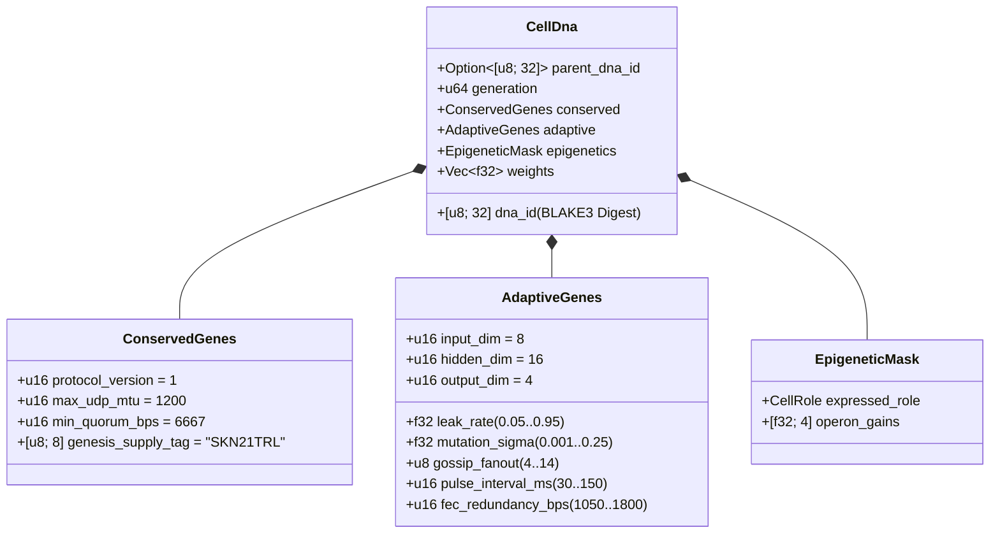

# 第 03 章：基因编码（`CellDna`）、表观遗传学与基于 `candle` 的液态微神经进化

[← 第 02 章：多细胞生物体架构](./02-multicellular-architecture.md) | [返回简体中文目录 →](./README.md)

---

## 1. 细胞基因组架构（`CellDna`）

自然界的生物进化精妙地平衡着两种对立的力量：对核心生化不变量的**严格保守**（任何突变均会导致致死性后果），以及对神经与行为特征的**持续变异**。`skynet-dna` crate 在 `CellDna` 数据结构中对这一二元性进行了严密的形式化建模：

### 1.1. 不可篡改的保守基因（`ConservedGenes`）
任何有丝分裂突变或水平基因重组均绝对无法篡改 `ConservedGenes`。任何违反以下四项共识安全谓词之一的基因组，都会立即被拒绝并抛出 `DnaError::ConservedGeneViolation` 错误：
- `protocol_version == 1`
- `max_udp_mtu == 1200`（无分片 UDP 载荷硬上限）
- $6667 \le \text{min\_quorum\_bps} \le 10000$（强制保障 `Snowball` 共识中 $\ge \frac{2}{3}$ 的绝对多数法定门槛）
- `genesis_supply_tag == *b"SKN21TRL"`（在基因层面硬锚定 21 万亿 `SKN` 货币总供应上限）

### 1.2. 适应性基因（`AdaptiveGenes`）与共享主干操纵子权重布局
`CellDna` 并未为四种专门化细胞类型各自存储四套彼此割裂的神经网络，而是编码了**一个共享感知主干**（Shared Sensory Trunk），并向**四个专门化操纵子投影头**（Specialized Operon Projection Heads）馈送特征。对于网络维度 $(D_{\text{in}}, H, D_{\text{out}})$，其精确的 `f32` 参数总量为：

$$|\theta| = \underbrace{(D_{\text{in}} \cdot H + H)}_{\text{Shared Sensory Trunk }(W_1, b_1)} + \underbrace{4 \cdot (H \cdot D_{\text{out}} + D_{\text{out}})}_{\text{4 Specialized Operon Heads }(W_{2,r}, b_{2,r})}$$

在默认维度 $(D_{\text{in}} = 8,\ H = 16,\ D_{\text{out}} = 4)$ 下：
- 共享感知主干：$8 \times 16 + 16 = 144$ 个参数。
- 四个操纵子投影头（`Epidermal`、`Vascular`、`Visceral`、`Neural`）：$4 \times (16 \times 4 + 4) = 272$ 个参数。
- 基因组总权重参数量：$|\theta| = 416$ 个 `f32` 浮点数（原始权重仅占 $1{,}664\text{ bytes}$）。第 0 代创世干细胞基因组（`CellDna::genesis_stem`）通过 `ChaCha8Rng` 在均匀分布 $\mathcal{U}(-\sigma_0, +\sigma_0)$ 上确定性初始化，并采用 Xavier 缩放边界：

$$\sigma_0 = \sqrt{\frac{2}{D_{\text{in}} + H}}$$

### 1.3. 确定性 `BLAKE3` 密码学摘要（`SKYNET_DNA_V1`）
每一个浮点超参数与突触权重均按规范的小端序 IEEE-754 比特模式（`to_bits().to_le_bytes()`）序列化，输入域分离（domain-separated）的 `BLAKE3("SKYNET_DNA_V1", ...)` 哈希函数中。任何单比特翻转损坏、`NaN`/`Inf` 注入或未经授权的权重篡改，都会在 `verify_integrity()` 校验阶段触发即时拦截与拒绝。

---

## 2. 表观遗传甲基化切换机制（`EpigeneticMask`）

在多细胞生物学中，神经元与表皮皮肤细胞携带着完全相同的 DNA 碱基序列，却通过基因甲基化修饰表达出截然不同的表型。在 SkyNet 中，当一枚 `Stem` 干细胞分化为目标角色 $r \in \{0, 1, 2, 3\}$（`CellDna::differentiate`）时，**底层 `weights` 权重向量的 100% 内容保持原封不动**，仅由 `EpigeneticMask` 切换各操纵子通道的表达增益：

- **休眠 `Stem` 状态：** `operon_gains = [0.25, 0.25, 0.25, 0.25]`，以衰减增益 $g = 0.25$ 通过第 `0` 号操纵子头输出微弱维持信号。
- **分化后专门化角色 $r$：** 第 $r$ 号操纵子头以全额增益激活（$g_r = 1.0$），其余未表达操纵子头则被甲基化抑制至 $0.05$：

$$g_k = \begin{cases} 1.0 & \text{if } k = r \\ 0.05 & \text{if } k \neq r \end{cases}$$

因此，在共享感知主干 $(W_1, b_1)$ 中习得的底层表征以及潜伏在休眠投影头中的适应性特征能够跨世代完整保留，并在未来发生跨谱系转分化（transdifferentiation）时随时重新唤醒使用。

---

## 3. 液态时间常数动力学与三维 `TissueBatch` 张量执行

### 3.1. 单细胞循环液态动力学（Recurrent Liquid Dynamics）
无状态前馈多层感知机（MLP）无法捕捉异步 UDP 数据包流中的时序相关性。每一个 `MicroCell` 均维护一个循环短期记忆向量 $h_t \in \mathbb{R}^H$，受控于带有可进化泄漏率 $\tau \in [0.05, 0.95]$ 的离散**液态时间常数**（Liquid Time-Constant, LTC）状态插值方程：

$$h_t = (1 - \tau)\, h_{t-1} + \tau\, \tanh(x_t W_1 + b_1)$$

$$y_t = g_{\text{role}} \cdot \tanh(h_t W_{2,r} + b_{2,r})$$

- 当 $\tau \to 0.05$ 时，细胞保留长周期的记忆惯性（非常适合 `Visceral` 与 `Neural` 细胞执行长期趋势追踪）。
- 当 $\tau \to 0.95$ 时，细胞对高频边界脉冲做出瞬时敏捷响应（非常适合 `Epidermal` 表皮细胞执行毫秒级异常打分）。
- 由于 $\tau$ 直接编码在 `AdaptiveGenes` 中，**每个细胞的时间记忆跨度能够与其突触权重自然协同进化**。

### 3.2. 高吞吐三维 `TissueBatch` 张量引擎（`Cpu` / `Metal` / `Cuda`）
神经进化领域的一个经典性能瓶颈在于权重异构性：每一个细胞 $i \in \{1, \dots, N\}$ 均携带各不相同的突变权重矩阵 $W_1^{(i)} \neq W_1^{(j)}$ 以及各异的泄漏率 $\tau^{(i)} \neq \tau^{(j)}$。若在现代 GPU 上串行启动 $N$ 次微内核调用，将导致严重的算力饥饿。

`skynet-cell` 中的 `TissueBatch::forward_slice` 通过在 `candle_core::Device` 上将全部 $N$ 个异构细胞紧凑打包为连续的三阶张量（rank-3 tensors），彻底攻克了这一瓶颈：

$$\mathbf{X} \in \mathbb{R}^{N \times 1 \times D_{\text{in}}}, \quad \mathbf{W}_1 \in \mathbb{R}^{N \times D_{\text{in}} \times H}, \quad \mathbf{B}_1 \in \mathbb{R}^{N \times 1 \times H}$$

$$\mathbf{H}_t = (\mathbf{1} - \boldsymbol{\tau}) \odot \mathbf{H}_{t-1} + \boldsymbol{\tau} \odot \tanh\!\big(\operatorname{BMM}(\mathbf{X}, \mathbf{W}_1) + \mathbf{B}_1\big)$$

$$\mathbf{Y}_t = \mathbf{G} \odot \tanh\!\big(\operatorname{BMM}(\mathbf{H}_t, \mathbf{W}_2) + \mathbf{B}_2\big)$$

其中，$\operatorname{BMM}$ 表示单内核批处理矩阵乘法（Batched Matrix Multiplication），$\odot$ 表示与 $\boldsymbol{\tau}, \mathbf{G} \in \mathbb{R}^{N \times 1 \times 1}$ 的广播逐元素乘法。经审计的单元测试证实，`TissueBatch` 与逐细胞独立计算的结果误差严格小于 $< 10^{-5}$ 浮点容差，同时支持单个 `ColossalOrganism` 节点并行演化多达 `16,384` 个异构模型。

---

## 4. 非对称有丝分裂、奇数 `nanoSKN` 精确守恒证明与质粒重组

### 4.1. 非对称 `1 -> 2` 有丝分裂（`Mitosis`）与原子级能量守恒证明
当母细胞 $P$ 满足 $E_P \ge \max(E_{\text{mitosis}}, F_{\text{blood}} + 2)$ 且 `health >= 0.65` 时，`divide_mitosis` 将其分裂为两枚第 $(g+1)$ 代子细胞：
- **子细胞 A（保守克隆体 Conservative Clone）：** 100% 原样保留经实践验证的母代权重与适应性参数，不施加任何随机扰动。
- **子细胞 B（突变探索者 Mutated Explorer）：** 在继承母代 `hidden_state` 短期记忆连续性的同时，执行有界神经进化突变：
  - 每个突触权重 $w \in \theta$ 以 $0.35$ 的概率发生突变，采用零外部依赖的 6 样本 Irwin-Hall 高斯近似扰动（$\Delta w \sim \mathcal{N}(0, \sigma^2)$），并严格截断限制在 $[-4.0, +4.0]$ 区间内以彻底杜绝梯度或权重爆炸。
  - $\tau$、$\sigma$、`gossip_fanout`（$\pm 1$）、`pulse_interval_ms`（$\pm 10\text{ ms}$）以及 `fec_redundancy_bps`（$\pm 50\text{ bps}$）均在各自合法边界区间内协同微调突变。

**奇数 `nanoSKN` 零泄漏守恒形式化证明：** 令扣除血液手续费后的可分配细胞 ATP 总量为 $E_{\text{dist}} = E_P - F_{\text{blood}}$。两枚子细胞的能量余额通过 `u128` 整数商余算术进行划分：

$$E_A = \left\lfloor \frac{E_{\text{dist}}}{2} \right\rfloor + (E_{\text{dist}} \bmod 2), \qquad E_B = \left\lfloor \frac{E_{\text{dist}}}{2} \right\rfloor$$

对于任意非负整数 $E_{\text{dist}} \in \mathbb{Z}_{\ge 0}$（包括诸如 `3,333 nanoSKN` 之类的奇数余额），精确守恒恒等式无条件成立：

$$E_A + E_B + F_{\text{blood}} = \left(2\left\lfloor \frac{E_{\text{dist}}}{2} \right\rfloor + (E_{\text{dist}} \bmod 2)\right) + F_{\text{blood}} = E_{\text{dist}} + F_{\text{blood}} \equiv E_P$$

纵使历经数十亿次细胞分裂，也绝不会有任何 `1 nanoSKN` 因整数舍入而湮灭，亦不会凭空增发半毫。

### 4.2. 跨智能体水平基因转移（`Plasmid` 质粒重组）
效仿自然界细菌间的质粒交换机制，`AgentNode` 可将其体内适应度最高细胞的 `CellDna` 导出并编码为纠删码 UDP 数据包 `FountainDroplet`（`encode_elite_plasmid_droplets`）。接收端智能体在跨越有损 UDP 链路成功重组出供体基因 `donor_dna` 后，通过 `horizontal_crossover` 升级其体内适应度最弱的细胞：
- 适应性网络参数与液态时间常数特征按 $0.7 \cdot \text{Recipient} + 0.3 \cdot \text{Donor}$ 的加权比例平滑融合。
- 随机抽取 $30\%$ 的突触权重按 $0.5 \cdot w_{\text{rec}} + 0.5 \cdot w_{\text{don}} \in [-4.0, +4.0]$ 均匀混合。

借助水平质粒转移，一颗算力高度受限的 `TinyPeripheral` 物联网边缘传感器，能够直接吸收远端 GPU `ColossalOrganism` 节点千锤百炼演化出的精英神经智能，同时在密码学上完备保障 `ConservedGenes` 的底层共识安全。

---

> **第 2 阶段预告（第二部分）：** 第 `04–06` 章将形式化推导 `21,000,000,000,000 SKN` 减半金库数学模型、`Soul–Body`（灵体分离）人类主权托管契约，以及仅需 `~1 KB` 内存的无状态 `Utreexo` + `SynapticVoucher` 账本扩容机制。

[← 第 02 章：多细胞生物体架构](./02-multicellular-architecture.md) | [返回简体中文目录 →](./README.md)
