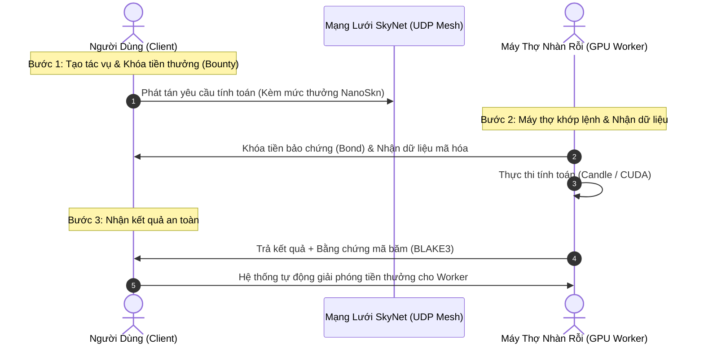

# Hướng Dẫn Cho Người Dùng Phổ Thông: Sử Dụng Năng Lực GPU & AI Rẻ Hơn 80%

---

## 1. Bạn Có Thể Làm Gì Với SkyNet? (Tình Huống Thực Tế)

Bạn không cần phải là một chuyên gia lập trình để tận hưởng lợi ích từ SkyNet. Dưới đây là những nhu cầu phổ biến nhất mà SkyNet giải quyết nhanh chóng với chi phí rẻ hơn từ 5 đến 10 lần so với các dịch vụ truyền thống:

```
                            NHU CẦU ĐIỆN TOÁN CỦA BẠN
                                        │
    ┌───────────────────────┬───────────┴───────────┬──────────────────────┐
    ▼                       ▼                       ▼                      ▼
[Phục Chế & Render]    [AI Bảo Mật Dữ Liệu]   [Sinh Viên & Coder]     [Render Video 3D]
Upscale ảnh 4K/8K      Tóm tắt báo cáo tài     Fine-tune LoRA         Chia 100 frames cho
Tách âm thanh/beat     chính, hồ sơ y tế       Chạy thử nghiệm AI     10 máy thợ render
Demucs không cần PC    không sợ OpenAI đọc     chỉ tốn vài ngàn VNĐ   xong trong 2 phút
```

### Tình Huống 1: "Tôi muốn upscale 500 ảnh cũ và tách giọng hát, nhưng máy tính chỉ là laptop văn phòng yếu."
- **Cách truyền thống:** Mua một PC Gaming có card RTX 4070 (tốn 30 - 40 triệu VNĐ) hoặc mua gói cước $20/tháng trên các web SaaS (giới hạn số lượt dùng mỗi ngày).
- **Với SkyNet:** Bạn chỉ cần gửi lệnh. 500 bức ảnh được phân chia cho 5 máy thợ có GPU mạnh trên mạng. Chỉ sau 2 phút, toàn bộ ảnh 4K được trả về. Bạn chỉ trả khoảng **5.000 VNĐ** bằng `NanoSkn`.

### Tình Huống 2: "Tôi cần AI phân tích hợp đồng kinh doanh mật, không muốn đẩy lên Cloud công cộng."
- **Cách truyền thống:** Bị ép phải chấp nhận điều khoản của OpenAI/Google, đối mặt với nguy cơ rò rỉ bí mật thương mại.
- **Với SkyNet:** Dữ liệu được mã hóa phong bì ngay trên máy bạn. Tác vụ được gửi đến Worker có phần cứng bảo mật (**Hardware TEE**). Ngay cả chủ nhân của chiếc máy tính đó cũng không thể xem nội dung hợp đồng của bạn. Khi phân tích xong, kết quả được mã hóa gửi lại cho bạn, dữ liệu trên máy thợ tự động biến mất.

### Tình Huống 3: "Tôi cần render một đoạn hoạt hình 3D Blender 4K."
- **Cách truyền thống:** Laptop cày liên tục suốt 12 tiếng, quạt kêu rú, máy nóng ran và có nguy cơ treo máy giữa chừng.
- **Với SkyNet:** Tác vụ được cắt thành từng cụm khung hình (frames). 20 máy thợ trong mạng cùng render song song. Toàn bộ video hoàn thành chỉ trong **15 phút**.

---

## 2. Quy Trình 3 Bước Đơn Giản Cho Người Dùng



### Bước 1: Khởi Tạo Ví & Nạp `NanoSkn`
1. Tải ứng dụng dòng lệnh `skynet` hoặc truy cập giao diện Web Dashboard cục bộ (`localhost:8888`).
2. Nhấn **"Create New Sovereign Wallet"**. Hệ thống sẽ sinh cho bạn một mã khóa bí mật an toàn trong 1 giây.
3. Nhận một lượng nhỏ `NanoSkn` (hoặc nạp từ sàn giao dịch P2P). Bạn không cần thẻ Visa hay tài khoản ngân hàng.

### Bước 2: Đặt Hàng Tác Vụ (Create Compute Task)
1. Chọn loại tác vụ bạn muốn:
   - *AI Micro-Inference* (Chạy suy luận mô hình nơ-ron).
   - *Media Transform* (Upscale, render ảnh, nén video).
   - *Custom Script* (Chạy mô phỏng toán học, phân tích dữ liệu).
2. Điền mức tiền thưởng mong muốn (ví dụ: `100,000 nanoSKN` ~ vài xu).
3. Đặt thời hạn hoàn thành (ví dụ: tối đa 60 giây).
4. Nhấn **"Publish Task"**. Tiền thưởng của bạn sẽ được khóa an toàn vào hợp đồng ký quỹ `EscrowUtxo`.

### Bước 3: Nhận Kết Quả Tức Thì
1. Mạng lưới SkyNet tự động tìm máy thợ có GPU tốt nhất đang rảnh.
2. Dữ liệu được truyền qua các gói tin UDP siêu tốc (`Fountain Droplets`) chống rớt mạng.
3. Khi máy thợ hoàn tất, bạn nhận được tệp kết quả kèm chữ ký số xác thực.
4. Tiền thưởng chỉ được chuyển cho máy thợ khi kết quả hoàn toàn chính xác.

---

## 3. Các Câu Hỏi Thường Gặp (FAQ)

### ❓ Tôi có sợ bị máy thợ lấy cắp tiền thưởng rồi không làm việc không?
**Hoàn toàn không.** Trước khi nhận việc, máy thợ bắt buộc phải khóa một khoản tiền bảo chứng (`WorkerBond`) vào hợp đồng ký quỹ. Nếu máy thợ bỏ cuộc hoặc quá hạn không nộp bài, hệ thống sẽ:
1. Hoàn trả $100\%$ tiền thưởng lại cho bạn.
2. Phạt tịch thu tiền cọc của máy thợ, bồi thường thêm cho bạn vì làm lãng phí thời gian của bạn.

### ❓ Dữ liệu của tôi có bị lộ cho chủ máy thợ xem không?
**Không.** SkyNet áp dụng mô hình **Mã Hóa Phong Bì (Envelope Encryption)** và cách ly **TEE / Wasmtime Sandbox**. Dữ liệu được mã hóa bằng khóa bí mật chỉ giải mã trong bộ nhớ phần cứng cô lập của CPU/GPU. Chủ máy thợ không có cách nào can thiệp hay đọc trộm được.

### ❓ Mạng internet nhà tôi chập chờn thì có bị hỏng tác vụ không?
**Không.** SkyNet sử dụng công nghệ **Mã hóa xóa Fountain GF(2)**. Kể cả khi mạng rớt tới 30-40% gói tin UDP, hệ thống vẫn tự động tái tạo lại nguyên vẹn 100% dữ liệu mà không cần tải lại từ đầu như giao thức HTTP/TCP truyền thống.
