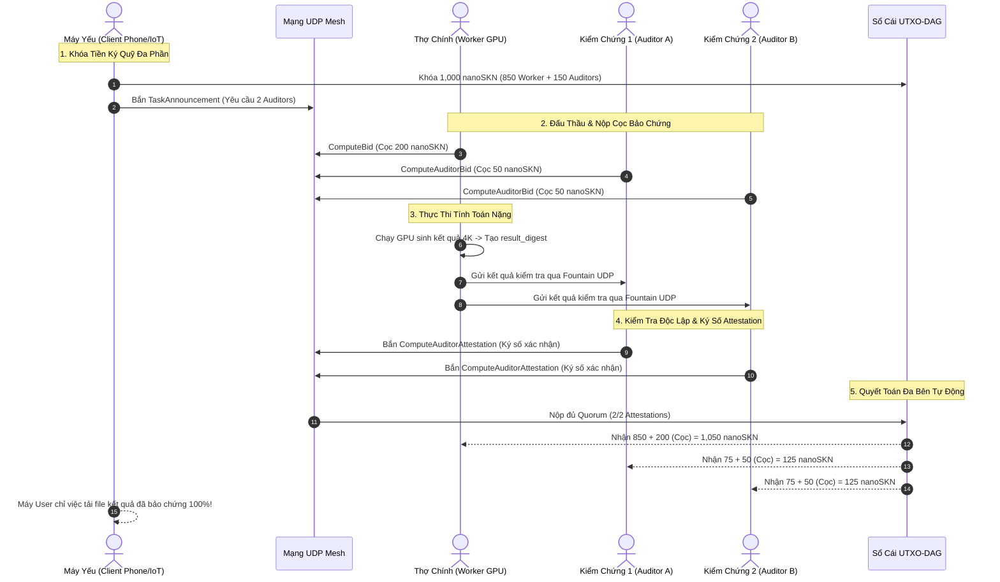

# Sổ Tay Chuyên Đề: Cơ Chế Ủy Quyền Kiểm Chứng & Phân Chia Tiền Thưởng (Delegated Auditor Quorum & Bounty Splitting)

---

## 1. Vấn Đề Thực Tế: Nghịch Lý Của Người Kiểm Chứng (The Verifier's Dilemma)

Trong mô hình điện toán đám mây phi tập trung, câu hỏi hóc búa nhất là: **"Làm sao máy khách hàng biết máy thợ làm thật hay làm ẩu?"**

Nếu câu trả lời là: *"Máy khách hàng phải tự tải dữ liệu về và chạy lại để kiểm chứng"* — thì toàn bộ hệ thống sẽ sụp đổ khi khách hàng là:
- Một chiếc đồng hồ thông minh (Smartwatch) pin yếu.
- Một camera IoT dùng vi điều khiển ESP32 / ARM Cortex-M.
- Một chiếc smartphone pin còn 10% hoặc laptop văn phòng không có card đồ họa rời.

Nếu chiếc máy yếu đó cố gắng kiểm chứng 100 ảnh 4K hay một mô hình AI 70B:
- CPU sẽ bị nghẽn $100\%$, máy nóng ran và sập nguồn.
- Mất sạch ý nghĩa của việc "bỏ tiền ra thuê máy mạnh từ xa làm hộ".

---

## 2. Giải Pháp SkyNet: Hội Đồng Kiểm Chứng Ủy Quyền (Delegated Auditor Quorum)

SkyNet giải quyết triệt để bài toán này bằng cách **chia sẻ công việc kiểm tra cho các máy thợ khác trong cộng đồng** có cấu hình tương đương, và **trích một phần tiền thưởng (`Bounty`)** để trả công cho họ.

```
                               TỔNG BOUNTY KÝ QUỸ (1,000 nanoSKN)
                                              │
                      ┌───────────────────────┴───────────────────────┐
                      ▼                                               ▼
          [WORKER EXECUTION POOL]                         [AUDITOR VERIFIER POOL]
             850 nanoSKN (85%)                               150 nanoSKN (15%)
                      │                                               │
             Chi trả cho Thợ Chính                           Chia đều cho 2-3 Auditors
             hoàn thành tính toán                            ký xác thực kết quả
                      │                                               │
                      └───────────────────────┬───────────────────────┘
                                              ▼
                               [QUYẾT TOÁN SỔ CÁI UTXO-DAG]
                               Toàn bộ tiền cọc & thưởng được
                               giải phóng chính xác 100%
```

---

## 3. Kiến Trúc Cấu Trúc Dữ Liệu Rust (`skynet-ledger` & `skynet-wire`)

Cơ chế này đã được hiện thực hóa trực tiếp vào mã nguồn của SkyNet:

### 3.1. Cấu Hình Phân Chia Tiền Thưởng (`EscrowSplitConfig`)
Được định nghĩa tại [`compute_escrow_types.rs`](file:///Users/pain/DATA/Projects/SkyNet/crates/skynet-ledger/src/compute_escrow_types.rs):

```rust
pub struct EscrowSplitConfig {
    pub worker_bounty: NanoSkn,       // Ví dụ: 850 nanoSKN (85%)
    pub auditor_pool_bounty: NanoSkn, // Ví dụ: 150 nanoSKN (15%)
    pub required_auditors: u8,        // Số lượng kiểm chứng viên tối thiểu (ví dụ: 2)
}
```

### 3.2. Đấu Thầu & Ký Quỹ Bảo Chứng Của Kiểm Chứng Viên (`AuditorDeposit`)
Để ngăn chặn việc kiểm chứng ẩu, mỗi Auditor muốn nhận thù lao **bắt buộc phải đặt cọc tiền bảo chứng (`AuditorBond`)**:

```rust
pub struct AuditorDeposit {
    pub auditor_pubkey: [u8; 32],
    pub bond: NanoSkn, // Tiền cọc cam kết kiểm tra trung thực
}
```

### 3.3. Quyết Toán Đa Bên (`EscrowPayoutBreakdown`)
Khi có đủ số lượng chữ ký thẩm định hợp lệ từ các Auditors:

```rust
pub struct EscrowPayoutBreakdown {
    pub worker_payout: NanoSkn,                    // worker_bounty + worker_bond
    pub auditor_payouts: Vec<([u8; 32], NanoSkn)>, // Mỗi auditor nhận: bond + phần chia từ pool
    pub total_disbursed: NanoSkn,                  // Tổng tiền giải phóng (Bảo toàn 100%)
}
```

---

## 4. Vòng Đời 5 Bước Giữa Máy Yếu, Thợ Chính & Hội Đồng Kiểm Chứng



---

## 5. Quy Tắc Xử Phạt (Slashing Mechanics) Khi Gian Lận Hoặc Quá Hạn

Nếu hệ thống xảy ra sự cố:

### Kịch bản 1: Thợ chính quá hạn không nộp bài hoặc nộp file rác
- Các Auditors từ chối ký giấy xác thực (`Attestation`).
- Quá thời hạn `timeout_epoch`, Client gọi hàm `refund_task()`.
- **Hình phạt:**
  - Client được hoàn trả $100\%$ tiền thưởng gốc (`1,000 nanoSKN`).
  - Toàn bộ tiền cọc của thợ (`200 nanoSKN`) bị tịch thu: $50\%$ đền bù cho Client, $50\%$ bị **thiêu hủy vĩnh viễn (Burn)** khỏi tổng cung tiền tệ SKN.
  - Các Auditors không bị phạt và được hoàn trả tiền cọc vì lỗi do thợ chính.

### Kịch bản 2: Auditor thông đồng phê duyệt kết quả sai
- Nếu Auditor ký xác nhận một kết quả có mã băm sai lệch so với thực tế, bằng chứng mật mã không khớp (`DigestMismatch`) sẽ kích hoạt quy trình trừng phạt.
- Tiền cọc `AuditorBond` của Auditor gian lận bị tịch thu ngay lập tức và tài khoản bị hạ bậc uy tín trên bảng định tuyến `SynapticPeerTable`.

---

## 6. Lợi Ích Của Cơ Chế Này Đối Với Toàn Bộ Hệ Sinh Thái

1. **Người dùng máy yếu:** Không cần tốn pin, không cần máy khỏe, chỉ cần đưa bài toán lên mạng là nhận được kết quả đã qua thẩm định kỹ thuật chất lượng cao.
2. **Cộng đồng có thêm nguồn thu:** Các máy tính có cấu hình tầm trung (không đủ mạnh để nhận các task AI siêu khủng) vẫn có thể đăng ký làm **Auditor** để kiếm dòng tiền đều đặn từ việc thẩm định chéo các tác vụ trên mạng lưới.
3. **Mạng lưới phi tín nhiệm tuyệt đối:** Không một cá nhân nào có thể đơn phương gian lận mà không bị mất tiền cọc.
