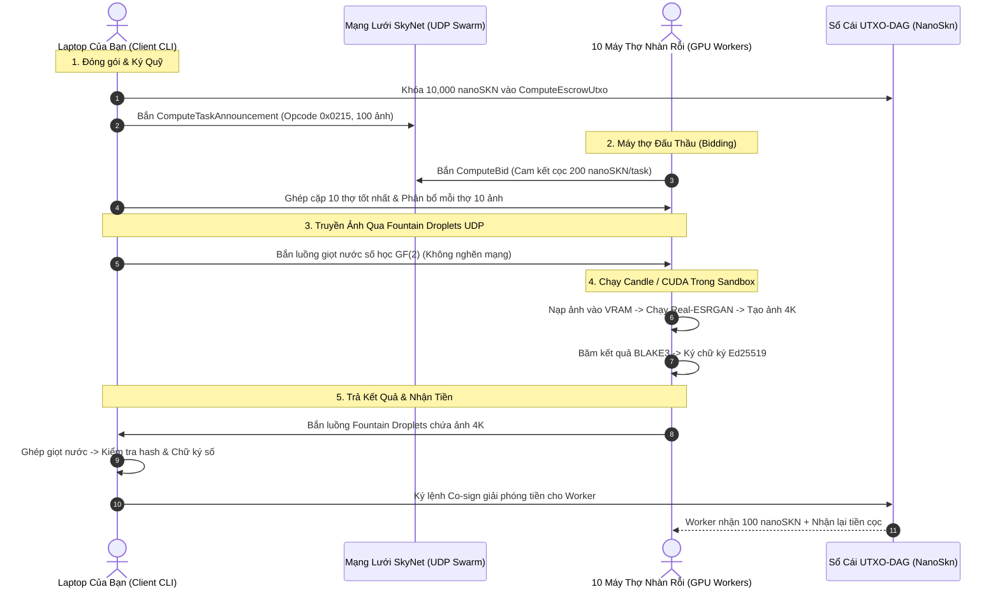

# Ca Thực Chiến 01: Phóng To 100 Ảnh Từ 720p Lên 4K Bằng AI (AI Image Super-Resolution)

---

## 1. Tình Huống Cụ Thể Của Bạn

- **Hiện trạng:** Bạn có một thư mục `~/photos_720p/` chứa **100 bức ảnh** kỷ niệm gia đình chụp bằng điện thoại cũ ở độ phân giải 720p ($1280 \times 720$). Dung lượng trung bình mỗi ảnh khoảng 1.2 MB (tổng cộng ~120 MB).
- **Phần cứng của bạn:** Bạn chỉ có một chiếc laptop văn phòng (ví dụ MacBook Air M1 hoặc laptop Dell không có card đồ họa rời NVIDIA).
- **Nhu cầu:** Bạn muốn phóng to 4 lần lên độ phân giải chuẩn **4K UHD** ($3840 \times 2160$), khử nhiễu hạt, tái tạo chi tiết mắt/tóc sắc nét bằng mô hình trí tuệ nhân tạo **Real-ESRGAN**.
- **Nếu làm theo cách truyền thống:**
  - *Chạy trên laptop của bạn:* Laptop dùng CPU cày mất khoảng **6 đến 8 tiếng**, máy nóng 95°C, quạt rú ầm ĩ và đơ toàn bộ các ứng dụng khác.
  - *Thuê Cloud GPU (RunPod/AWS):* Phải tạo tài khoản, nhập thẻ Visa, tạo Docker image, cài driver CUDA, tốn tối thiểu $2 - $4 và mất cả tiếng đồng hồ cấu hình.
- **Mục tiêu với SkyNet:**
  - Hoàn thành toàn bộ 100 bức ảnh trong vòng **2 đến 3 phút**.
  - Laptop của bạn mát rượi, không tốn tài nguyên.
  - Chi phí: Khoảng **10,000 nanoSKN** (~vài ngàn đồng), thanh toán tự động, bảo mật 100%.

---

## 2. Tất Cả Thao Tác Bạn Cần Làm Trên Máy Tính (User Actions)

### Bước 1: Cài đặt công cụ SkyNet CLI (Chỉ làm 1 lần duy nhất — mất 30 giây)

Mở Terminal trên máy tính của bạn (macOS, Linux hoặc Windows WSL2) và dán lệnh sau:

```bash
# Tải và cài đặt SkyNet Node & CLI
curl -sSL https://install.skynet-network.org | bash
```

Khởi tạo danh tính ví cá nhân của bạn:

```bash
skynet wallet init
```

*Màn hình hiển thị:*
```text
✨ Khởi tạo ví chủ quyền thành công!
🔑 Khóa công khai (Public Key): 0x7a3f8c...e29b1a
📁 Khóa bí mật đã lưu an toàn tại: ~/.skynet/identity.key
💰 Số dư hiện tại: 0 nanoSKN
```

Kiểm tra số dư sau khi nạp một lượng nhỏ `NanoSkn` (khoảng 20,000 nanoSKN):

```bash
skynet wallet balance
# Output: Số dư khả dụng: 20,000 nanoSKN
```

---

### Bước 2: Chuẩn bị thư mục ảnh

Tạo một thư mục chứa ảnh đầu ra:

```bash
mkdir -p ~/photos_4k
```

Lúc này, trên máy bạn có:
- Thư mục đầu vào: `~/photos_720p/` (chứa 100 file ảnh từ `img_001.jpg` đến `img_100.jpg`).
- Thư mục đầu ra: `~/photos_4k/` (đang trống).

---

### Bước 3: Phát lệnh xử lý vào mạng lưới SkyNet (Dòng lệnh duy nhất)

Gõ dòng lệnh sau vào Terminal và nhấn Enter:

```bash
skynet compute dispatch \
  --input ~/photos_720p/ \
  --output ~/photos_4k/ \
  --opcode 0x0215 \
  --model "Real-ESRGAN_x4plus" \
  --bounty-per-item 100 \
  --parallel 10 \
  --timeout 300
```

#### Giải thích các tham số cực kỳ dễ hiểu:
- `--input ~/photos_720p/`: Đường dẫn đến 100 ảnh cần xử lý.
- `--output ~/photos_4k/`: Nơi lưu ảnh 4K sau khi nhận về.
- `--opcode 0x0215`: Mã nhận diện tác vụ trong danh mục SkyNet (`0x02` = Đa phương tiện, `0x15` = Super-Resolution Upscaling).
- `--model "Real-ESRGAN_x4plus"`: Tên mô hình AI mong muốn.
- `--bounty-per-item 100`: Trả công **100 nanoSKN** cho mỗi bức ảnh hoàn thành hợp lệ (tổng 100 ảnh = 10,000 nanoSKN).
- `--parallel 10`: Cho phép chia việc cho tối đa **10 máy thợ khác nhau** cùng làm việc song song để đạt tốc độ tối đa.
- `--delegate-audit 2` *(Tùy chọn dành cho máy yếu)*: Ủy quyền cho 2 máy kiểm chứng viên (Auditors) thẩm định chất lượng ảnh 4K trước khi giải phóng tiền (tự động phân chia 85% cho thợ chính và 15% chia đều cho 2 auditors).
- `--timeout 300`: Hạn chót tối đa 300 giây (5 phút). Nếu quá giờ, tự động hủy và hoàn tiền cọc.

---

### Bước 4: Quan sát tiến trình thời gian thực

Ngay sau khi bạn nhấn Enter, màn hình hiển thị thanh tiến trình trực quan:

```text
🚀 [SkyNet] Bắt đầu phân phối 100 tác vụ tính toán (Opcode: 0x0215)...
🔒 Đã khóa 10,000 nanoSKN vào hợp đồng ký quỹ EscrowUtxo.
📡 Đang phát tín hiệu tìm thợ trên mạng lưới UDP (Port 8888)...
🤝 Đã ghép cặp thành công với 10 Máy Thợ GPU (RTX 4090 x 4, RTX 3080 x 6).
⚡ Đang truyền tải dữ liệu qua luồng Fountain GF(2)...

Tiến độ: [========================================] 100/100 (100%)
- Thời gian trôi qua: 2 phút 14 giây
- Tốc độ xử lý: ~0.75 ảnh / giây
- Số tiền đã thanh toán: 10,000 nanoSKN (~0.00001 SKN)
- Số máy thợ tham gia: 10 Workers

🎉 HOÀN TẤT TOÀN BỘ 100 ẢNH 4K!
📂 Kết quả đã lưu tại: /Users/username/photos_4k/
```

Mở thư mục `~/photos_4k/`, bạn sẽ thấy toàn bộ 100 bức ảnh độ phân giải $3840 \times 2160$ nét căng, dung lượng khoảng 8-10 MB/ảnh.

---

## 3. Điều Gì Thực Sự Diễn Ra "Dưới Nắp Ca-Pô"? (Under The Hood)

Hãy cùng nhìn sâu vào bên trong hệ thống để hiểu tại sao công việc được xử lý nhanh, rẻ và an toàn đến vậy:



### Chi Tiết Kỹ Thuật Từng Giai Đoạn:

#### 1. Đóng Gói Nhiệm Vụ (Task Packaging)
- Client đọc từng file ảnh, tính mã băm nhận diện: `input_hash = BLAKE3(image_bytes)`.
- Tạo `ComputeTaskManifest` chuẩn mực với `task_id` duy nhất cho từng bức ảnh.
- Khóa chính xác số tiền thưởng `bounty_nano_skn = 100` vào hợp đồng ký quỹ `ComputeEscrowVault` trên sổ cái `skynet-ledger`. Số tiền này nằm ở trạng thái `Locked`, không ai rút được nếu chưa hoàn thành việc.

#### 2. Khớp Lệnh Đấu Thầu (Matchmaking)
- Gói tin thông báo việc làm `TaskAnnouncement` có kích thước chỉ **~180 Bytes** (nhỏ hơn rất nhiều so với giới hạn UDP `1200 Bytes`), được phát tán đa hướng (Gossip).
- Các máy tính chơi game có card RTX 3060, 4070, 4090 hoặc Mac M2/M3 đang cắm sạc nhàn rỗi ở khắp nơi trên thế giới bắt được thông báo.
- Để được nhận việc, mỗi máy thợ bắt buộc phải ký một gói tin `ComputeBid`, cam đoan khóa **200 nanoSKN tiền bảo chứng (`WorkerBond`)** của chính họ vào hợp đồng. Điều này ngăn chặn triệt để tình trạng máy thợ "nhận việc bừa bãi rồi bỏ cuộc".

#### 3. Bơm Dữ Liệu Bằng Mã Hóa Xóa Fountain GF(2)
- Thay vì gửi qua giao thức TCP truyền thống (vốn rất dễ bị nghẽn mạng và rớt kết nối nếu file lớn), SkyNet dùng **`FountainEncoder`**:
  - Tấm ảnh 1.2 MB được cắt thành các khối 512 Bytes.
  - Bộ mã hóa liên tục tạo ra các "giọt nước" đại số tuyến tính XOR trên trường hữu hạn $\text{GF}(2)$ (`FountainDroplet`).
  - Dữ liệu được bắn với tốc độ hàng chục Megabit/giây tới 10 máy thợ mà không cần chờ tín hiệu ACK xác nhận. Dù mạng Wi-Fi nhà bạn có chập chờn rớt 30% gói tin, máy thợ vẫn tái tạo lại $100\%$ bức ảnh gốc.

#### 4. Thực Thi An Toàn Trên Máy Thợ (Candle Engine Isolation)
- Máy thợ nhận dữ liệu, nạp vào động cơ nơ-ron [`compute_candle.rs`](file:///Users/pain/DATA/Projects/SkyNet/crates/skynet-cell/src/compute_candle.rs).
- Máy thợ tự động kích hoạt nhân GPU CUDA (`Device::new_cuda(0)`) hoặc Metal trên Mac.
- **Bảo mật tuyệt đối:** Quá trình tính toán diễn ra trong môi trường cô lập. Thợ không có quyền truy cập ổ đĩa, không biết ảnh thuộc về ai, không lưu trữ file vào ổ cứng của họ.
- Khi render xong ảnh 4K: Thợ băm kết quả thành `result_digest = BLAKE3(output_bytes)`, dùng khóa bí mật `Ed25519` ký vào biên nhận `ComputeCompletionClaim`.

#### 5. Nhận Ảnh & Quyết Toán Tiền Thưởng Tức Thì
- Máy tính của bạn hứng các giọt nước kết quả từ máy thợ, tự động lắp ghép lại thành file `photo_001_4k.png`.
- Ứng dụng SkyNet trên máy bạn tự động băm lại file nhận được và kiểm tra chữ ký số của thợ.
- **Nếu khớp chính xác:** Hệ thống tự động ký lệnh giải phóng Escrow. Máy thợ nhận được `100 nanoSKN` tiền công + `200 nanoSKN` tiền hoàn cọc.
- **Bảo toàn kinh tế:** Toàn bộ quá trình hoàn tất mà không mất một khoản phí hoa hồng trung gian nào cho các tập đoàn Cloud.

---

## 4. Xử Lý Các Tình Huống Ngoại Lệ & Rủi Ro (Fail-Safe Mechanics)

### ⚠️ Tình huống 1: Máy thợ số 4 đang chạy thì bị cúp điện hoặc đứt mạng Wi-Fi
- **Xử lý:** Sau 45 giây không thấy máy thợ số 4 nộp bài, Client kích hoạt cơ chế `handle_timeout_refund()`.
- **Hậu quả kinh tế:** Tiền thưởng 100 nanoSKN của bạn được hoàn trả về ví. Máy thợ số 4 bị phạt trừ tiền cọc: 100 nanoSKN được đền bù cho bạn vì bắt bạn phải chờ, 100 nanoSKN còn lại bị thiêu hủy vĩnh viễn (Slashing Burn).
- **Tự động phục hồi:** Bức ảnh chưa xong sẽ lập tức được giao lại cho máy thợ số 11 tiếp tục làm. Toàn bộ quá trình diễn ra hoàn toàn tự động trong nền.

### ⚠️ Tình huống 2: Máy thợ gian lận, trả về ảnh đen hoặc ảnh rác
- **Xử lý:** Kết quả trả về sẽ cho ra mã băm `result_digest` sai lệch so với logic kiểm chứng.
- **Hậu quả kinh tế:** Client từ chối ký lệnh giải phóng tiền. Hết thời gian timeout, tiền cọc của thợ gian lận bị tịch thu và tài khoản của thợ đó bị hạ điểm tín nhiệm (`SynapticPeerTable`), không bao giờ được nhận việc trên mạng lưới nữa.

---

## 5. Tóm Tắt Trải Nghiệm Người Dùng

Bạn chỉ cần:
1. Đặt 100 ảnh vào thư mục `~/photos_720p/`.
2. Gõ đúng 1 dòng lệnh `skynet compute dispatch`.
3. Đi uống một ngụm nước (2 phút sau quay lại).
4. Mở thư mục `~/photos_4k/` và tận hưởng 100 bức ảnh 4K hoàn hảo với chi phí chỉ bằng một cốc trà đá!
