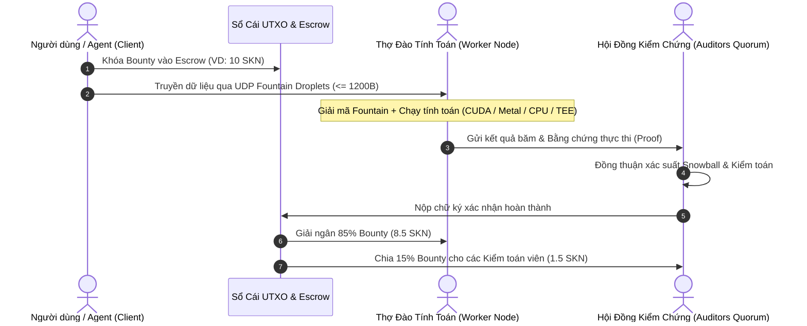

# Sổ Tay Vận Hành Nút Thợ Đào & Cung Cấp Tính Toán (SkyNet Worker Guide)

Chào mừng bạn đến với mạng lưới thợ đào và cung cấp tài nguyên tính toán **SkyNet Compute Grid**. 

Trong SkyNet, bất kỳ ai sở hữu thiết bị điện toán — từ chiếc laptop chơi game Nvidia RTX, máy Mac Apple Silicon, máy chủ Homelab, cụm trâu cày tiền ảo cũ cho đến thiết bị nhúng Raspberry Pi hoặc máy chủ Enclave TEE bảo mật cao — đều có thể cho mạng lưới thuê năng lực tính toán nhàn rỗi và nhận thù lao sòng phẳng bằng đồng **`NanoSkn`** (1 SKN = $10^9$ nanoSKN).

---

## 1. Cơ Chế Kiếm Tiền Của Worker

Mỗi khi một User hoặc Agent phát lệnh tính toán (`skynet compute dispatch`), một hợp đồng ký quỹ (`ComputeEscrow`) được mở trên sổ cái UTXO-DAG với số tiền thưởng (`Bounty`).

- **Thợ đào tính toán (Compute Worker):** Nhận **85%** tổng bounty của nhiệm vụ ngay khi kết quả được phê duyệt.
- **Hội đồng kiểm chứng (Auditor Quorum):** Chia đều **15%** tổng bounty cho việc đối chiếu, xác thực chéo kết quả tính toán.
- **Tự động đấu thầu (Auto-Bidding):** Bạn chỉ cần bật `skynet-agent --auto-bid`, nút của bạn sẽ tự động quét các tác vụ phù hợp với cấu hình phần cứng (VRAM, CPU, TEE) và giá sàn bạn mong muốn (`--min-bounty-rate`).

---

## 2. Thợ Đào Có Cần Cài Phần Mềm Phức Tạp Không? (Cơ Chế "Zero-Touch" & Chuẩn Hóa MCP)

> **CÂU TRẢ LỜI NGẮN GỌN: HOÀN TOÀN KHÔNG!**  
> Bạn chỉ cần tải duy nhất **1 file nhị phân `skynet-agent`** và chạy nó. Bạn tuyệt đối không cần cài đặt Python, CUDA Toolkit, Blender, Docker hay bất kỳ thư viện chuyên biệt nào.

### Nguyên Lý Vận Hành Tự Động 100%:
1. **Tự động dò phần cứng (Auto-Hardware Probing):** Khi bạn khởi chạy `skynet-agent`, phần mềm tự động quét và phân loại GPU (NVIDIA CUDA / Tensor Cores / VRAM), chip Apple Silicon (Metal 3 / Unified Memory), tập lệnh CPU (AVX-512 / NEON) hoặc tính năng bảo mật (Intel SGX / AMD SEV-SNP).
2. **Chuẩn hóa công việc qua Giao thức Model Context Protocol (MCP):** Mọi tác vụ trên SkyNet (từ xử lý ảnh, bóc tách âm thanh đến huấn luyện AI) đều được đóng gói theo chuẩn **MCP Tool Call** (`skynet://vision.upscale.real_esrgan`, `skynet://audio.transcribe.whisper`...).
3. **Tự động tải môi trường thực thi (On-Demand Capsule Provisioning):** Khi nút của bạn trúng thầu một tác vụ mà môi trường xử lý chưa có sẵn trong máy, `skynet-agent` sẽ **tự động tải ngầm** gói thực thi độc lập (**SkyNet Capsule**) qua mạng P2P Fountain UDP hoặc CDN phân tán.
   - Gói Capsule được đóng gói sẵn mọi thư viện phụ thuộc, có kích thước siêu nhẹ (15MB – 80MB).
   - Được bảo vệ bằng mã băm `blake3` chống giả mạo mã độc.
   - Chạy hoàn toàn bên trong sandbox MCP cô lập, không chạm vào dữ liệu cá nhân của máy thợ.
4. **Tự dọn dẹp & Tự giải phóng VRAM:** Khi bạn cần chơi game hoặc làm việc, `skynet-agent` lập tức giải phóng VRAM/RAM trong vòng 1 giây mà không để lại rác trong hệ điều hành.

Xem chi tiết đặc tả kỹ thuật tại [Đặc Tả Kiến Trúc MCP Compute (MCP Compute Specification)](../../docs/MCP_COMPUTE_SPECIFICATION.md).

---

## 3. Danh Mục 100 Kịch Bản & Cấu Hình Thợ Đào Thực Tế

Toàn bộ 100 cấu hình và kịch bản kiếm tiền của Worker được phân nhóm khoa học theo từng hệ sinh thái phần cứng:

### [Phần 1: Máy tính Chơi Game & PC Cá Nhân (Cases 001 – 020)](./part-1-consumer-pc-gaming.md)
*Tận dụng GPU gaming Nvidia RTX nhàn rỗi khi đi ngủ, đi làm hoặc nghỉ ngơi để cày tiền.*
- **Case 001:** PC Gaming RTX 3060 12GB – Chuyên nhận Job Upscale ảnh Real-ESRGAN ban đêm.
- **Case 002:** Desktop RTX 4070 12GB – Chạy Inference LLM Llama-3.1 8B và Whisper Audio.
- **Case 003:** Cỗ máy đồ họa RTX 4090 24GB – Khai thác tác vụ FLUX.1 / SDXL Text-to-Image công suất cao.
- **Case 004:** Laptop Gaming RTX 4060 Mobile – Tự động chuyển đổi nhận job khi cắm sạc pin và máy rảnh rỗi.
- **Case 005:** PC RTX 3080 10GB – Render hoạt hình Blender Cycles 3D theo từng block khung hình.
- **Case 006:** Dàn máy RTX 2060 Super 8GB cũ – Nhận tác vụ OCR bóc tách hóa đơn Surya và PDF.
- **Case 007:** Desktop RTX 3070 8GB – Chạy bộ tách giọng bài hát Demucs v4 Audio Stems.
- **Case 008:** Cấu hình Dual GPU RTX 3090 (48GB VRAM) – Tinh chỉnh LoRA mô hình ngôn ngữ 70B.
- **Case 009:** PC RTX 4080 Super 16GB – Render video trường bức xạ ánh sáng 3D Gaussian Splatting.
- **Case 010:** Gaming Rig RTX 3060 Ti – Nhận job lọc nhiễu âm thanh khử ồn thời gian thực DeepFilterNet.
- **Case 011:** PC RTX 4070 Ti Super 16GB – Chạy mô phỏng vật lý n-body và docking thuốc phân tử nhỏ.
- **Case 012:** Máy tính đồ họa RTX 5080 (Blackwell mới) – Khai thác tác vụ suy luận FP4/FP8 tốc độ siêu nhanh.
- **Case 013:** Desktop RTX 2080 Ti 11GB – Chạy mô hình phân tích y tế CT/MRI segmentation 3D.
- **Case 014:** PC Gaming RTX 3050 8GB giá rẻ – Chuyên nhận job vector hóa hình ảnh và dán nhãn dữ liệu.
- **Case 015:** Dàn máy RTX 4090 tản nước Custom – Duy trì hiệu năng tính toán liên tục không hạ xung (Thermal Throttle).
- **Case 016:** Laptop mỏng nhẹ RTX 4050 – Chế độ Whisper transcription tiết kiệm điện 45W.
- **Case 017:** Dual RTX 4070 – Chia tải song song xử lý luồng camera an ninh Re-ID.
- **Case 018:** Cấu hình PC văn phòng kết hợp eGPU RTX 3080 Thunderbolt – Bật cày tính toán ngoài giờ hành chính.
- **Case 019:** Máy tính RTX 3080 Ti 12GB – Phục vụ tác vụ tạo ảnh Ray-tracing tổng hợp cho xe tự lái.
- **Case 020:** Trạm PC Gaming cá nhân nhiều ổ cứng SSD NVMe – Nhận job chuyển đổi Parquet và nén dữ liệu lớn.

---

### [Phần 2: Hệ Sinh Thái Apple Silicon Mac (Cases 021 – 040)](./part-2-apple-silicon-mac.md)
*Tận dụng kiến trúc Unified Memory băng thông siêu cao của Apple M-Series để chạy các mô hình AI khổng lồ không ồn, cực kỳ tiết kiệm điện.*
- **Case 021:** Mac mini M2 Pro 32GB – Trạm phục vụ suy luận LLM 14B/32B chạy nền 24/7 chỉ tốn 30W điện.
- **Case 022:** Mac Studio M2 Ultra 192GB Unified Memory – Cung cấp VRAM khổng lồ chạy mô hình Llama-3.3 70B và DeepSeek-V2.
- **Case 023:** MacBook Pro M3 Max 64GB – Chạy tác vụ sinh video CogVideoX và render Metal khi cắm sạc qua đêm.
- **Case 024:** MacBook Air M2 16GB không quạt tản nhiệt – Nhận job bóc tách âm thanh Whisper và OCR hoàn toàn tĩnh lặng.
- **Case 025:** Mac Studio M1 Max 64GB – Trạm tạo chỉ mục vector HNSW và trích xuất thực thể Wikipedia.
- **Case 026:** Mac Pro M2 Ultra 128GB PCIe – Chuyên nhận job mô phỏng khí tượng WRF và tài chính Monte Carlo.
- **Case 027:** MacBook Pro M1 Pro 32GB – Chạy tác vụ giải nén, mã hóa video AV1/ProRes bằng Apple Media Engine.
- **Case 028:** Mac mini M4 mới nhất 24GB – Khai thác năng lực Neural Engine mới cho thị giác máy tính và phân loại ảnh.
- **Case 029:** MacBook Pro M2 Max 96GB – Chạy song song nhiều tác vụ kiểm toán tài chính và đối soát dữ liệu ngân hàng.
- **Case 030:** Mac mini M1 16GB cũ – Chuyển đổi thành Node Kiểm toán (Auditor) chạy độc lập 24/7 với chi phí điện 50.000 VNĐ/tháng.
- **Case 031:** iMac M3 24GB – Nhận job biên dịch đồ họa vector SVG và xử lý tài liệu Hán Nôm di sản.
- **Case 032:** Cụm 3 máy Mac mini M2 kết nối mạng nội bộ 10GbE – Đóng vai trò thành cụm tính toán phân tán gia đình.
- **Case 033:** MacBook Pro M4 Pro 48GB – Khai thác kiến trúc Metal 3 Ray Tracing cho các frame đồ họa phức tạp.
- **Case 034:** Mac Studio M1 Ultra 64GB – Xử lý các batch dữ liệu âm thanh Demucs 1.000 bài hát.
- **Case 035:** MacBook Pro M3 Pro 36GB – Nhận job tổng hợp tin tức tài chính vĩ mô ban đêm.
- **Case 036:** Mac mini M2 8GB cấu hình cơ bản – Đóng vai trò làm UDP Fountain Packet Relay chuyển tiếp gói tin phi trạng thái.
- **Case 037:** MacBook Air M3 24GB – Vừa làm việc văn phòng ban ngày, vừa nhận micro-jobs AI khi gập màn hình.
- **Case 038:** Mac Pro Intel Xeon cũ nâng cấp eGPU Radeon Pro – Nhận các job tính toán CPU đa luồng OpenFOAM.
- **Case 039:** Mac Studio M2 Max 32GB – Chuyên nhận job sinh chuyển động cho bầy drone 500 chiếc.
- **Case 040:** MacBook Pro M1 Max 32GB – Tự động nhận job kiểm thử phần mềm Fuzzing khi người dùng rời bàn làm việc.

---

### [Phần 3: Máy Trạm Kỹ Thuật & Máy Chủ Homelab (Cases 041 – 060)](./part-3-workstation-server.md)
*Khai thác các trạm máy chủ AMD EPYC, Threadripper, Intel Xeon và hạ tầng ảo hóa Proxmox/TrueNAS.*
- **Case 041:** Trạm AMD Threadripper 7980X 64-core 256GB RAM – Chuyên giải các bài toán CFD OpenFOAM 15 triệu ô.
- **Case 042:** Máy chủ kép AMD EPYC 9654 (192 nhân 384 luồng) – Trung tâm tính toán Monte Carlo 100M path tài chính định lượng.
- **Case 043:** Cụm Homelab ảo hóa Proxmox VE – Cắt các container LXC GPU Passthrough tự động bắt job SkyNet.
- **Case 044:** Máy chủ Dell PowerEdge 2x Intel Xeon Gold 512GB ECC – Chuyên xử lý kho dữ liệu Parquet và khử trùng lặp MinHash 500GB.
- **Case 045:** Workstation Asus ProArt 4x RTX 4090 – Cung cấp 96GB VRAM phục vụ huấn luyện LoRA và tạo ảnh quy mô lớn.
- **Case 046:** Máy chủ Supermicro 8x GPU PCIe – Chuyên nhận các batch sinh dữ liệu tổng hợp Synthetic Data Ray-tracing.
- **Case 047:** Cụm TrueNAS Scale kết hợp dàn ổ cứng U.2 NVMe – Nhận các job xây dựng đồ thị Vector HNSW 10 triệu embeddings.
- **Case 048:** Trạm làm việc HP Z8 G4 Dual Xeon 128GB RAM – Nhận các bài toán mô phỏng ứng suất khung máy bay CalculiX FEA.
- **Case 049:** Máy chủ rack thanh lý cũ 2x Xeon E5-2699v4 44 nhân – Khai thác giá điện rẻ cày job bóc tách dữ liệu Scrapy 1 triệu website.
- **Case 050:** Máy chủ lưu trữ kết hợp GPU RTX A6000 48GB – Chuyên chạy AlphaFold3 dự đoán cấu trúc protein.
- **Case 051:** Server 1U đặt tại Datacenter Colocation – Chạy trạm điều phối các bài toán tối ưu lộ trình logistics VRP.
- **Case 052:** Workstation Lenovo ThinkStation Threadripper Pro – Mô phỏng plasma nhiệt hạch Tokamak và địa chấn FWI.
- **Case 053:** Homelab mini cluster 4 node Intel NUC 13th i9 – Chuyên giải bài toán khớp lệnh lô chống MEV CoW-Swap.
- **Case 054:** Máy chủ đồ họa chuyên nghiệp NVIDIA RTX 6000 Ada – Chạy mô phỏng mạch lượng tử 40-qubit.
- **Case 055:** Dàn server doanh nghiệp nhàn rỗi cuối tuần – Tự động bật cluster SkyNet kiếm tiền bù chi phí điện và khấu hao máy.
- **Case 056:** Workstation tản dầu khoáng (Immersion Cooling) – Khai thác ép xung nhận các job giới hạn thời gian nghiêm ngặt.
- **Case 057:** Máy chủ chuyên phân tích gene 1TB RAM – Xử lý các file RNA đơn bào Scanpy 100k tế bào.
- **Case 058:** Server ảo chạy trên nền tảng VMware vSphere – Tận dụng tài nguyên CPU vSphere chưa sử dụng.
- **Case 059:** Trạm máy tính kỹ thuật dựng hình Houdini – Nhận job nướng hạt khói lửa (VDB fluid simulation).
- **Case 060:** Hệ thống máy chủ dùng nguồn điện mặt trời mái nhà công ty – Chỉ nhận job vào ban ngày khi điện mặt trời dư thừa.

---

### [Phần 4: Thiết Bị Nhúng, Di Động & Nút Biên IoT (Cases 061 – 075)](./part-4-edge-embedded-iot.md)
*Các thiết bị tiêu thụ dưới 15W điện kiếm tiền bằng cách làm trạm chuyển tiếp gói tin, nút kiểm chứng hoặc suy luận AI siêu nhẹ.*
- **Case 061:** Raspberry Pi 5 8GB chạy 24/7 – Đóng vai trò Nút Kiểm toán (Auditor) xác minh hash và nghiệm bài toán.
- **Case 062:** NVIDIA Jetson Orin Nano 8GB – Chạy suy luận nơ-ron trạng thái lỏng MicroCell cho các luồng IoT.
- **Case 063:** NVIDIA Jetson AGX Orin 64GB – Trạm AI biên xử lý dữ liệu LiDAR SLAM của xe tự hành.
- **Case 064:** Orange Pi 5 Plus (Rockchip RK3588 NPU) – Khai thác chip NPU 6 TOPS nhận job nhận diện biển số và OCR nhẹ.
- **Case 065:** Thiết bị Intel NUC Celeron tiết kiệm điện 10W – Trạm Fountain Packet Relay trung chuyển gói UDP cho mạng lưới.
- **Case 066:** Mini PC AMD Ryzen 7 7840HS Mini PC – Khai thác iGPU Radeon 780M chạy Whisper Audio Transcription.
- **Case 067:** Raspberry Pi 4 cũ – Node giám sát đồng thuận Snowball và đồng bộ trạng thái Ledger.
- **Case 068:** Khung máy chủ Mini-ITX 12V trên xe bán tải du lịch – Kiếm tiền từ pin năng lượng mặt trời khi xe đỗ.
- **Case 069:** Trạm quan trắc thời tiết sử dụng vi xử lý RISC-V – Cung cấp dữ liệu Oracle vi khí hậu nhận thưởng SkyNet.
- **Case 070:** Dàn 10 bo mạch Jetson Orin Nano trong rack 1U – Cụm micro-inference phục vụ bot DeFi.
- **Case 071:** Cổng Router OpenWrt cấu hình cao – Chạy tiến trình nền kiểm tra tính khả dụng mạng và chuyển tiếp gói Fountain.
- **Case 072:** Laptop hỏng màn hình cắm dây LAN – Tái sinh thành trạm tính toán chạy 24/7 trong góc tủ.
- **Case 073:** Thiết bị di động Android cũ cài Termux + proot Linux – Tham gia làm Auditor xác minh chữ ký Ed25519.
- **Case 074:** Thiết bị đo lường công tơ điện thông minh nhúng – Tự giải bài toán cân bằng phụ tải VPP nhận vi thanh toán.
- **Case 075:** Bo mạch Khadas VIM4 – Khai thác NPU phân tích độ độc hại bình luận mạng xã hội.

---

### [Phần 5: Dàn Trâu Cày Tiền Ảo Cải Tạo (Mining Rig Retrofits) (Cases 076 – 088)](./part-5-mining-rig-retrofits.md)
*Biến dàn trâu cày Ethereum / Altcoin cũ với 6-8 GPU thành các trạm AI xử lý lô (Batch AI Workers) siêu lợi nhuận.*
- **Case 076:** Dàn trâu 6x RTX 3070 8GB cải tạo trên khung sắt cũ – Nhận hàng loạt job Upscale ảnh 4K hàng loạt.
- **Case 077:** Rig 8x RTX 3080 10GB nâng cấp riser PCIe x16 – Chạy suy luận song song bóc tách nhạc Demucs.
- **Case 078:** Dàn 6x RTX 3060 Ti chạy hệ điều hành HiveOS chuyển đổi sang SkyNet – Tự động nhận job OCR và Whisper.
- **Case 079:** Khung trâu cày 4x RTX 3090 (96GB tổng VRAM) – Nhận đào các khối ZK-SNARK Prover nặng đô.
- **Case 080:** Dàn 8x RTX 4070 Ti nguồn kép – Chuyên xử lý song song các tác vụ render Blender theo lô 1.000 frame.
- **Case 081:** Trâu cày đặt tại xưởng gần nguồn thủy điện nhỏ giá rẻ – Chạy các thuật toán giải mã văn bản và Fuzzing hợp đồng.
- **Case 082:** Rig 6x AMD Radeon RX 6800XT dùng driver ROCm Linux – Nhận các bài toán OpenCL và xử lý hình ảnh y tế.
- **Case 083:** Cụm 8x GPU CMP 50HX / 90HX chuyên đào coin – Tận dụng bộ nhớ băng thông cao để chạy ma trận nhị phân.
- **Case 084:** Trại đào 20 rig tại vùng nông thôn – Quản lý tập trung qua Ansible tự điều phối nhận job công suất cao ban đêm.
- **Case 085:** Rig đào coin kết hợp hệ thống thông gió đối lưu – Duy trì nhiệt độ GPU dưới 65 độ C khi tính toán liên tục.
- **Case 086:** Dàn 6x RTX 2060 12GB (bản nâng cấp RAM) – Chuyên chạy mô hình phân loại rác thải và dán nhãn ảnh.
- **Case 087:** Trâu cày tận dụng nhiệt sưởi ấm trang trại mùa đông – Vừa sưởi ấm nông sản vừa thu về đồng `NanoSkn`.
- **Case 088:** Cụm 4x RTX 4090 khung mở tản gió cưỡng bức – Đỉnh cao sức mạnh AI Batching nhận các bounty lớn nhất mạng lưới.

---

### [Phần 6: Phần Cứng Chuyên Dụng, TEE & Nút Kiểm Toán (Cases 089 – 100)](./part-6-specialized-hardware.md)
*Các nút yêu cầu môi trường thực thi tin cậy (TEE), phần cứng gia tốc mật mã và nút kiểm toán ký quỹ cao.*
- **Case 089:** Máy chủ Intel Xeon hỗ trợ Intel SGX Enclave – Độc quyền nhận các job xử lý hồ sơ y tế bảo mật HIPAA và TEE.
- **Case 090:** Máy chủ AMD EPYC hỗ trợ SEV-SNP – Chuyên chạy các bài toán tổng hợp gradient Federated Learning ngân hàng.
- **Case 091:** Nút Staking Kiểm toán viên Cấp cao (Master Auditor) – Ký quỹ 50.000 SKN để thẩm tra tính hợp lệ của kết quả.
- **Case 092:** Máy trạm trang bị Card FPGA Xilinx Alveo U50 – Gia tốc phần cứng tính toán ZK-STARK Merkle Tree.
- **Case 093:** Nút xác minh chữ ký phần cứng sử dụng HSM (Hardware Security Module) – Đảm bảo an toàn khóa Ed25519 tuyệt đối.
- **Case 094:** Nút kiểm toán chuyên đối soát số dư UTXO-DAG – Quét liên tục giao dịch để phát hiện gian lận double-spend.
- **Case 095:** Máy chủ trang bị bộ gia tốc trí tuệ nhân tạo Tenstorrent Wormhole – Khai thác kiến trúc Tensix tối ưu ma trận thưa.
- **Case 096:** Node kiểm toán chuyên sâu về AI Safety – Quét mô hình đầu ra để bảo đảm không chứa mã độc hoặc rò rỉ dữ liệu.
- **Case 097:** Nút chạy môi trường TEE AWS Nitro Enclaves – Cung cấp cầu nối tính toán bảo mật giữa đám mây và SkyNet.
- **Case 098:** Trạm kiểm toán chuyên ngành Y sinh – Đối soát cấu hình năng lượng tự do RMSD của các chuỗi protein AlphaFold.
- **Case 099:** Cụm kiểm chứng chuyên trách DeFi Solvers – Chạy giả lập lại các giao dịch Batch Auction để chống gian lận giá.
- **Case 100:** Nút Hạt Nhân Mạng Lưới (Genesis Quorum Validator) – Duy trì sự ổn định, tính đúng đắn của đồng thuận Snowball và chia sẻ năng lực điều phối toàn cầu.
